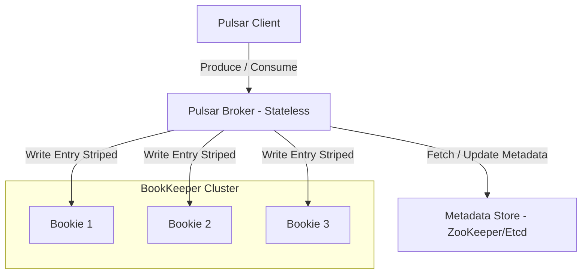
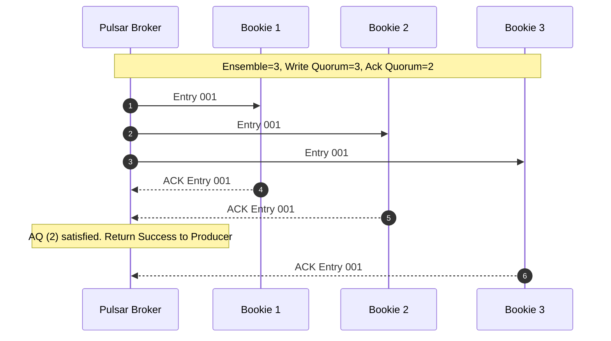
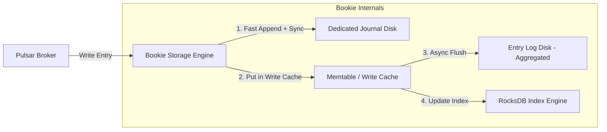
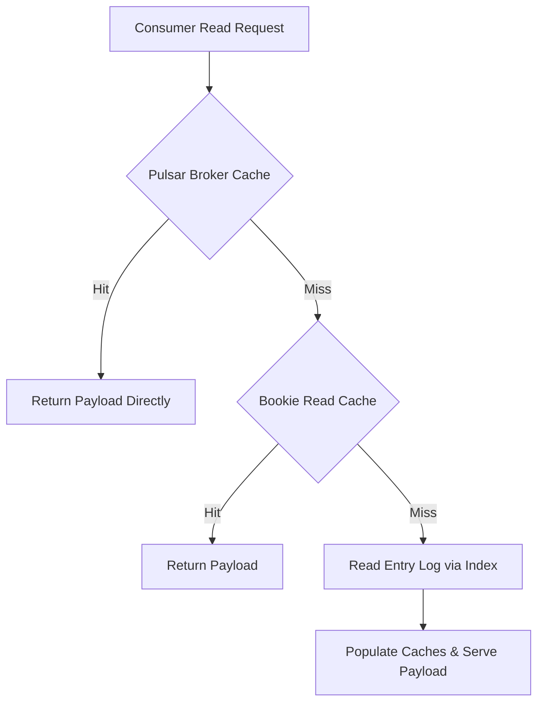
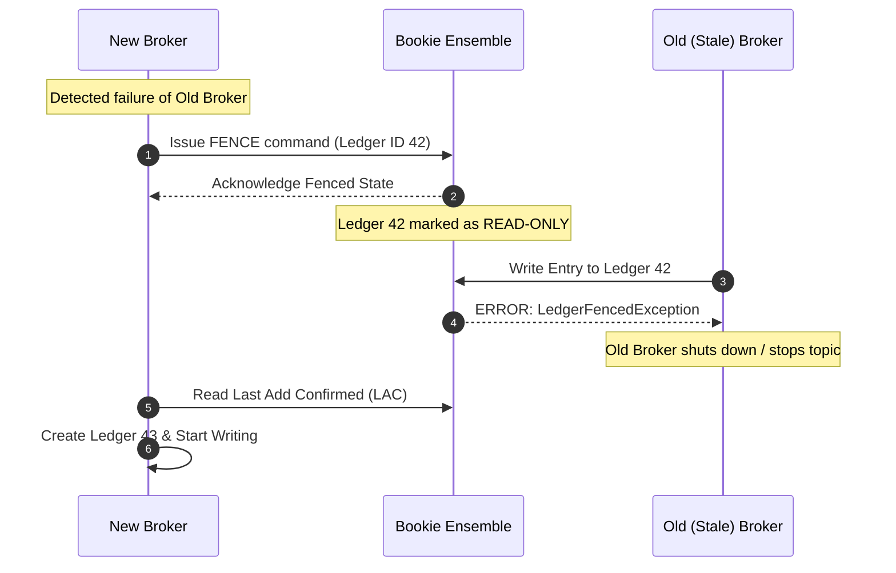

# Inside Apache Pulsar: BookKeeper Ledgers, Journal Syncs, and Managed Ledger State Machines

Most distributed messaging systems couple message processing with physical log storage on the same node. Apache Kafka partitions, for instance, map directly to contiguous files on a single broker disk. If that broker runs out of space or experiences hardware degradation, you have to rebalance partitions across the cluster, streaming gigabytes of redundant history across the network. 

Apache Pulsar avoids this by separating stateless serving brokers from stateful storage nodes called Bookies running Apache BookKeeper. Pulsar brokers act as routing layers that translate client publish operations into ledger entries, while BookKeeper operates as an append-only distributed log store. Understanding how Pulsar achieves high throughput with low latency tailing reads requires opening up the write path of BookKeeper, the ledger striping mechanics, and how Pulsar brokers coordinate ledger lifecycles.

## Decoupling Compute and Storage with Managed Ledgers

In Pulsar, a topic is not a single huge monolithic file on disk. A topic is logical construct backed by a Managed Ledger. A Managed Ledger is an ordered sequence of individual append-only segments known as BookKeeper ledgers. 

When messages flow into a Pulsar broker, the broker doesn't write to its own disk. It appends the payload to the currently open BookKeeper ledger. Once a ledger hits configured limits such as maximum time open or maximum size in megabytes, the broker seals that ledger permanently and creates a new open ledger. Because old ledgers are immutable, Pulsar can offload historic ledger files directly to cold cloud object stores like Amazon S3 without touching the active serving layer.

Stateless brokers handle client connections, authentication, topic lookup, cache management, and consumer acknowledgement tracking. If a Pulsar broker crashes, no data re-balancing occurs. ZooKeeper or the configured metadata store updates the ownership mapping of the topic to a surviving broker. The new broker acquires the topic metadata, opens the existing active ledger, reads the trailing entries, and resumes accepting client traffic instantly.

## Apache BookKeeper Architecture and Ledger Primitives

A ledger is the fundamental unit of storage in BookKeeper. It is an append-only log of entries, where each entry contains a byte payload, a ledger ID, an entry ID, a authentication tag, and a 64-bit integer index. Entry IDs within a ledger are strictly monotonic and zero-indexed.

A single Bookkeeper node, or Bookie, does not own an entire ledger exclusively. Instead, ledgers are distributed across an ensemble of Bookies using configurable quorum parameters. 

Ensemble Size (E) defines the total number of Bookie nodes allocated to store entries for a specific ledger. Write Quorum (WQ) defines how many Bookies within that ensemble must receive and store a given entry. Ack Quorum (AQ) defines how many successful write acknowledgements the broker must receive before confirming the write to the producer client.

BookKeeper uses a round-robin striping algorithm across the allocated ensemble. If an ensemble has three Bookies and Write Quorum is two, entry zero goes to Bookies one and two, entry one goes to Bookies two and three, and entry two goes to Bookies three and one. This striping distributes read and write pressure uniformly across hardware drives while ensuring predictable fault tolerance.

## Dual-Disk Write Path: Journal vs Entry Log

Storing millions of concurrent, un-sequenced streams on a database drive leads to severe I/O thrashing. Random disk writes kill hard drives and degrade solid-state drives due to write amplification. BookKeeper bypasses this problem using a dual-path storage design on every Bookie.

Every Bookie isolates disk operations onto two separate physical directories, typically placed on separate storage devices: the Journal directory and the Entry Log directory.

When a write request reaches a Bookie, it first appends the entry to an append-only Journal file. The write to the journal is purely sequential. The Bookie forces a hardware flush (fsync) to guarantee durability on disk. Because the journal is strictly sequential, the drive spends almost zero time seeking, achieving low latency even under heavy load.

Simultaneously, the Bookie inserts the entry into an in-memory Write Cache. Once the entry is logged in the journal and added to the write cache, the Bookie returns an acknowledgement back to the broker. At this point, the write is officially durable.

The Entry Log path processes data asynchronously. As the Write Cache fills up, a background thread sorts the cached entries by their Ledger ID and Entry ID. It then flushes these sorted blocks in large continuous batches into consolidated Entry Log files on the entry storage drive. 

To allow fast lookup of entries within these mixed Entry Log files, BookKeeper maintains an index mapping using RocksDB or a custom memory-mapped index structure called DbLedgerStorage. The index maps a composite key of Ledger ID and Entry ID to the target Entry Log file offset.

## Read Path Mechanics and Cache Hierarchy

Pulsar achieves high read performance by layering multi-tier caching above the physical disk engines. When consumers read messages, the system attempts to serve requests as high up the stack as possible.

The first layer is the Broker Cache. When a producer publishes a message to a Pulsar broker, the broker keeps that message payload in JVM off-heap memory while dispatching it to active tailing consumers. If consumers are keeping up with the real-time stream, reads never touch BookKeeper at all. The payload is served straight out of broker memory.

The second layer is the Bookie Read Cache. If a consumer falls behind and experiences catch-up reads, requests bypass the broker cache and hit the Bookie layer. The Bookie checks its internal read cache, which holds recently flushed entries and prefetched blocks.

The final fallback is the Entry Log Disk Read. If the entry misses both memory caches, the Bookie queries its DbLedgerStorage index engine to locate the precise file offset inside an Entry Log file, issues a read call to the underlying OS page cache or disk, populates its read cache, and sends the entry back to the broker.

This separation guarantees that heavy historical reads reading old entry logs off disk do not pollute or slow down real-time tailing reads running in the broker memory space.

## Ledger Fencing and Split-Brain Recovery

When a Pulsar broker ownership lease expires or a network partition occurs, ZooKeeper detects the failure and re-assigns the topic to a new broker. However, the old broker might still be alive, running long GC pauses or trapped in an isolated network segment. If the old broker continues accepting writes while the new broker starts writing, data corruption or out-of-order logs would result.

BookKeeper prevents this split-brain scenario through a process called Ledger Fencing.

When a new broker takes ownership of a Managed Ledger, it reads the topic metadata from ZooKeeper to discover the current open ledger ID. It then issues a Fence command to all Bookies in the active ensemble for that ledger.

Upon receiving a fence request, every Bookie marks its local state for that ledger ID as read-only. Any subsequent write request originating from the old broker triggers a `LedgerFencedException`, forcing the old broker to fail its writes and drop topic ownership.

Once the ledger is successfully fenced, the new broker determines the Last Add Confirmed (LAC) entry. LAC represents the highest entry ID that has been successfully written and acknowledged across the Ack Quorum. The new broker reads up to LAC, writes a metadata entry sealing the ledger length permanently in ZooKeeper, creates a fresh new ledger ID, and resumes active writes.

## Managed Ledger Cursor Management

Tracking message consumption acknowledgements in a high-throughput streaming engine can easily choke metadata stores if done naively. If every message ack required a write to ZooKeeper, the cluster would grind to a halt.

Pulsar manages consumption state through Cursors embedded inside the Managed Ledger layer. A Cursor tracks the read position and acknowledgement status for a specific subscription on a topic.

A Cursor consists of a mark-delete position alongside an individual acknowledgement set. The mark-delete position indicates that all entries prior to this position have been fully processed by consumers. The individual ack set tracks out-of-order message acknowledgements for messages occurring after the mark-delete pointer.

Instead of updating metadata stores continuously, Pulsar stores cursor state inside a system-level BookKeeper ledger dedicated to tracking state changes. The broker periodically writes state snapshots to this internal cursor ledger. If a broker crashes, the new broker reads the latest snapshot from the cursor ledger, replays the trailing delta entries, and reconstructs the exact subscription consumption state without losing track of message progress.
