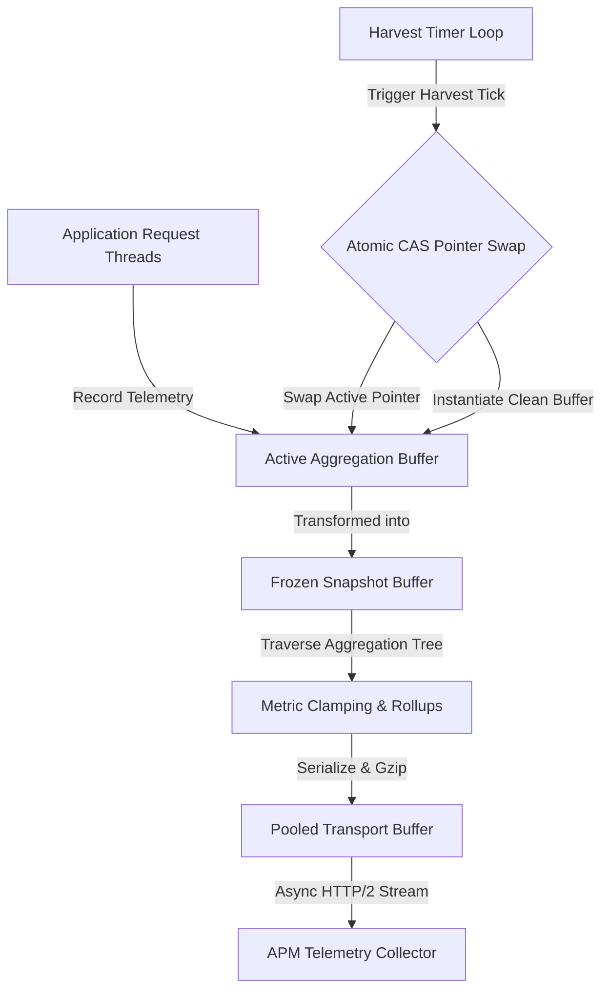
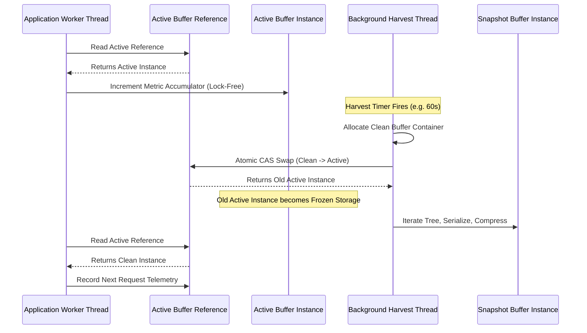
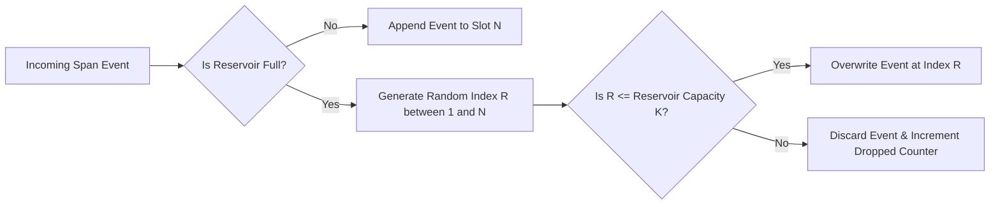

# Inside APM Agent Harvest Cycles: Local Aggregation Trees, Reservoir Sampling, and Memory-Bounded Telemetry Buffers

In-process Application Performance Monitoring (APM) agents operate under an absolute zero-impact mandate. They run directly within host application processes like ASP.NET Core runtimes, JVM instances, or Node.js event loops. If an APM agent introduces noticeable latency spikes, causes memory leaks, or crashes the host application during a traffic surge, it fails its primary purpose. 

When a high-throughput backend services tens of thousands of requests per second, every HTTP handler execution, database execution, and internal service call fires instrumentation hooks. Sending a wire packet over the network for every single trace span or database metric instantly destroys application throughput. To make telemetry collection feasible, agents execute local aggregation inside the runtime. They aggregate high-frequency telemetry into tightly bounded in-memory structures and transmit those snapshots out-of-band on a fixed schedule called a harvest cycle.

Building an agent harvest pipeline requires solving tough concurrency and resource allocation challenges. The agent must maintain microscopic CPU overhead on hot paths, guarantee strict memory bounds even when metric key cardinality explodes, and snapshot operational metrics without locking application execution threads.

## Dual-Buffer Swapping and Lock-Free Synchronization

To decouple telemetry collection from background network transmission, modern APM agents rely on double-buffering architectures. The agent maintains two primary buffer containers in heap memory: an active aggregation buffer and a frozen snapshot buffer. Application worker threads write solely to the active buffer. When the harvest timer fires, typically every 5 or 60 seconds, a background harvest thread swaps these buffers.

Performing this swap without blocking host application execution requires lock-free pointer swapping using Compare-And-Swap (CAS) semantics. In C# or Java, this is executed using Interlocked.Exchange or AtomicReference fields. The harvest thread creates a clean, unpopulated metric container and atomically swaps its reference with the active metric container reference. Application threads that hit instrumentation hooks immediately after the swap begin writing to the new buffer without experiencing lock contention or blocking on I/O operations.

Once the pointer swap completes, the background thread owns the old buffer exclusively. Because no application threads hold references to the swapped container, the harvest thread can safely traverse the telemetry payload, sanitize metric keys, apply sampling algorithms, serialize data to JSON or Protobuf, and compress the output using streaming Gzip or Zstd pipelines. The entire transport workflow runs asynchronously off the main processing path.

## Hierarchical Aggregation Trees and Thread-Local Accumulators

Metrics collected by APM agents are structured hierarchically. Metric namespaces describe operational scopes such as HttpDispatcher, Database/Statement, or External/Host. Rather than storing a flat, append-only log of raw metrics, the active container stores metrics as a prefix tree or concurrent hash map of metric node accumulators.

Each node in the aggregation tree tracks essential statistical properties for a specific metric key: call count, total duration, minimum duration, maximum duration, and sum of squared durations. Sum of squares allows APM query backends to calculate standard deviation and variance across aggregated harvest windows without requiring raw event persistence.

Updating these nodes on application threads requires extreme care to avoid lock overhead. Naive implementations wrapped in mutexes degrade performance instantly when hundreds of concurrent request threads contend for the same root metric node. Agents eliminate this bottleneck by leveraging lock-free atomic primitives, like Interlocked.Add for integer counts and memory-barriered floating-point accumulators, or by using thread-local metric accumulators.

With thread-local buffers, each execution thread maintains its own micro-buffer of metric counters. Instrumentation code increments counters inside the thread-local state with zero lock contention. When the harvest cycle executes, the harvest worker iterates across all active thread-local slots, sums their local counter trees into the frozen harvest buffer, and resets the thread-local fields. This design converts cache-line bouncing into linear, CPU-bound aggregation work performed entirely on the background harvest thread.

## Controlling Memory Spikes via Reservoir Sampling

While fixed-size metrics like transaction execution times aggregate into small numerical accumulators, detailed telemetry like transaction trace events, error trace stacks, and custom domain events cannot be collapsed into simple sums. Storing every trace segment or error event in memory creates an unsustainable memory footprint during unexpected application traffic surges.

If an application suddenly spikes from 500 to 50,000 requests per second, storing full span attributes for every request will exhaust heap memory and trigger catastrophic garbage collection pauses. APM agents prevent memory exhaustion by enforcing strict reservoir limits on detailed event types during each harvest window.

Reservoir sampling allows the agent to bound its memory allocation while preserving statistically unbiased samples across high-volume traffic. In a standard implementation, the agent configures a maximum reservoir capacity per harvest window, such as 10,000 transaction events. During the harvest period, incoming events fill the reservoir sequentially until it reaches maximum capacity.

Once the reservoir is full, the agent transitions to probabilistic sampling using algorithms like Algorithm R. For the nth incoming event where n exceeds the reservoir capacity k, the agent generates a random integer r between 1 and n. If r is less than or equal to k, the new event overwrites the existing event stored at index r in the reservoir. Otherwise, the incoming event is discarded.

This algorithm ensures that every request processed during the 60-second harvest window has an equal probability of being retained in the trace sample set. It enforces a hard memory ceiling regardless of request volume. The agent tracks total seen events alongside retained events, transmitting the total count so backend analytics engines can calculate accurate transaction rates through sample scaling.

## Shielding the Heap from Metric Explosions

Metric cardinality explosions represent one of the most dangerous edge cases for an APM agent. A cardinality explosion occurs when application code introduces unbounded dynamic variables into metric key path names. Examples include appending unparsed database query parameters, UUIDs, or raw customer email addresses directly into metric names.

Instead of creating a few hundred stable metric nodes like `Database/Orders/Select`, the metric tree accumulates millions of unique keys like `Database/Orders/Select/104928`. A single unparsed dynamic path can inflate the internal aggregation map to millions of entries, consuming gigabytes of managed heap memory and threatening host process stability.

APM agents defend against this using dynamic clamping state engines. The active aggregation buffer tracks the total number of unique metric keys created during the current harvest cycle. When key count breaches a safe limit, typically set between 5,000 and 10,000 keys, the agent enters a clamped metric state.

While clamped, newly observed metric keys that do not already exist in the aggregation tree are blocked from generating new nodes. Instead, the agent maps their operational metrics into a fallback metric node named `Supportability/MetricCount/Limit` or appends them to a wild-card category like `Database/Method/Other`. The agent records supportability metrics detailing that metric clamping occurred, alerting engineers to fix unparsed parameters without allowing the host process to crash from memory exhaustion.

## Serialization, Backpressure, and Transport Failures

When the harvest thread acquires the frozen buffer, it transforms internal tree structures into compressed network payloads. Serialization logic must be optimized to prevent garbage generation on the host application's heap. Agents pre-allocate byte array pools and stream serialized metrics directly into shared memory streams, bypassing transient string allocations entirely.

Once serialized, the payload streams through Gzip compression into a transmission pipeline targeting collector endpoints via HTTP/2 or gRPC sockets. However, network interfaces fail, DNS resolution times out, and backend APM ingestion nodes occasionally return 503 Service Unavailable responses under heavy load. The agent needs predictable backpressure strategies to handle collector unreachable states.

When a network payload fails to deliver, the agent must decide what to do with the snapshot buffer data. Dropping data immediately loses telemetry during network glitches, while keeping all data in memory indefinitely causes memory growth. Modern agents solve this using bounded retry queues with exponential backoff and buffer merging rules.

If a harvest payload fails to send, the harvest thread attempts to merge the failed metric buffer back into the current active buffer. Metric node numerical accumulators like counts and durations are added together. However, unaggregated data types like trace reservoirs and custom events are subjected to hard retention caps. If total backlogged memory exceeds pre-allocated fallback thresholds, the agent aggressively drops older event streams, prioritizing host application memory stability over absolute metric delivery guarantees.

Through double-buffered pointer swapping, lock-free accumulators, reservoir sampling, metric key clamping, and strict fallback rules, in-process APM agents collect deep runtime telemetry while maintaining a tiny, predictable resource footprint.
