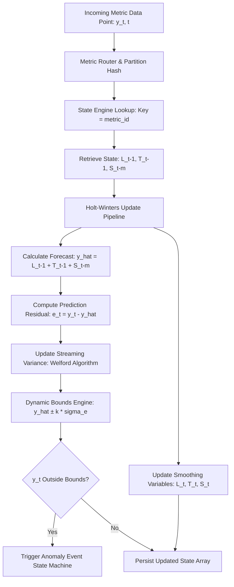

Static alerting on infrastructure metrics breaks the moment your system faces natural cyclical load. Setting a hard limit of five thousand requests per minute on an API gateway triggers false alarms during lunch hour spikes while completely missing a fatal downstream database hang at three in the morning when baseline traffic drops to two hundred requests per minute. Modern Application Performance Monitoring platforms avoid this by computing dynamic baselines using statistical anomaly detection engines that adapt to diurnal and weekly seasonality.

At the core of streaming anomaly detection engines sits Holt-Winters triple exponential smoothing. Unlike simple moving averages or basic exponential smoothing which only account for baseline level and linear trend, Holt-Winters tracks three separate dynamic components: level, trend, and seasonal pattern. Evaluating this on incoming telemetry streams requires maintaining real-time state machines across millions of active metric time series without burning through memory or CPU allocation budgets.

### The Mathematics of Holt-Winters Smoothing

The dynamic model continuously updates three state variables at every time tick $t$. Level represents the structural center of the metric series. Trend tracks the rate of increase or decrease over time. Seasonal component tracks repeating periodic variations, such as daily or weekly cycles.

For an additive seasonality model, the governing update equations run as follows.

The level calculation isolates the current measurement adjusted for the expected seasonal value, blending it with the previous step's trend-adjusted level.

$$L_t = \alpha (y_t - S_{t-m}) + (1 - \alpha)(L_{t-1} + T_{t-1})$$

The parameter \$\alpha\$ is the level smoothing factor bounded between zero and one. A higher \$\alpha\$ makes the engine react faster to permanent shifts in baseline level, while a lower \$\alpha\$ dampens noisy fluctuations.

The trend component updates by comparing the shift in level against the prior estimated trend vector.

$$T_t = \beta (L_t - L_{t-1}) + (1 - \beta)T_{t-1}$$

Here \$\beta\$ dictates how aggressively short-term slope changes update the long-term trend estimate.

The seasonal component updates by comparing the raw observation against the current unseasonal level, mapping back $m$ steps in time where $m$ is the seasonal period length.

$$S_t = \gamma (y_t - L_t) + (1 - \gamma)S_{t-m}$$

The seasonal smoothing factor \$\gamma\$ controls how fast the system adapts to evolving periodic behavior, such as gradual week-over-week user growth patterns.

For metrics where fluctuations scale proportionally with volume, such as request latencies under load, multiplicative Holt-Winters is used instead. The multiplicative seasonal update scales the measurement relative to the level.

$$S_t = \gamma \frac{y_t}{L_t} + (1 - \gamma)S_{t-m}$$

### Streaming Engine State and Ring Buffer Storage

Running these equations in a streaming APM pipeline requires a stateful streaming processor. Each active metric key, identified by its metric name, host, service, and dimension set, maps to a persistent state structure in memory.

The primary architectural challenge is storing the seasonal vector $S$. If telemetry arrives at one-minute granularity and your system tracks weekly seasonality, $m$ equals 10,080 intervals. Storing ten thousand floating-point values per time series across tens of millions of active telemetry streams quickly balloons memory overhead into hundreds of gigabytes.



To manage this, high-performance telemetry engines allocate compact circular ring buffers backed by memory-mapped files or off-heap allocations. The seasonal buffer for a time series stores raw 32-bit floats. Indexing into the buffer uses simple modulo arithmetic based on epoch timestamp modulo the seasonal period $m$.

```python
class HoltWintersStreamEngine:
    def __init__(self, alpha: float, beta: float, gamma: float, period: int):
        self.alpha = alpha
        self.beta = beta
        self.gamma = gamma
        self.period = period
        self.level = None
        self.trend = None
        self.seasonal = [0.0] * period
        self.variance = 0.0
        self.mean_error = 0.0
        self.count = 0

    def process_datapoint(self, timestamp_idx: int, y_t: float, k_sigma: float = 3.0):
        season_idx = timestamp_idx % self.period
        
        if self.level is None:
            self.level = y_t
            self.trend = 0.0
            return False, y_t, y_t, y_t

        prev_level = self.level
        prev_trend = self.trend
        s_past = self.seasonal[season_idx]

        y_hat = prev_level + prev_trend + s_past
        residual = y_t - y_hat

        self.count += 1
        delta = residual - self.mean_error
        self.mean_error += delta / self.count
        delta2 = residual - self.mean_error
        self.variance += delta * delta2
        
        std_dev = (self.variance / max(1, self.count - 1)) ** 0.5 if self.count > 1 else 1.0

        upper_bound = y_hat + (k_sigma * std_dev)
        lower_bound = y_hat - (k_sigma * std_dev)
        is_anomaly = y_t > upper_bound or y_t < lower_bound

        clipped_y = y_t
        if is_anomaly:
            clipped_y = upper_bound if y_t > upper_bound else lower_bound

        self.level = self.alpha * (clipped_y - s_past) + (1 - self.alpha) * (prev_level + prev_trend)
        self.trend = self.beta * (self.level - prev_level) + (1 - self.beta) * prev_trend
        self.seasonal[season_idx] = self.gamma * (clipped_y - self.level) + (1 - self.gamma) * s_past

        return is_anomaly, y_hat, lower_bound, upper_bound
```

### Residual Analysis and Dynamic Variance Estimation

A static prediction line isn't enough to trigger alerts. The system needs dynamic upper and lower boundaries based on standard deviations of forecast errors. Standard deviations can't be treated as static either, because noise during high-traffic hours is naturally larger than during low-traffic night hours.

The residual error $e_t = y_t - \hat{y}_t$ measures the deviation of the true metric value from the Holt-Winters expectation. Telemetry engines stream this residual into a running variance estimator using Welford's algorithm or an exponentially weighted moving variance buffer.

Exponentially weighted variance adapts dynamically to sudden structural changes in metric noise.

$$\sigma^2_t = \lambda \sigma^2_{t-1} + (1 - \lambda)(e_t - \bar{e}_t)^2$$

Where \$\lambda\$ represents the decay parameter for the variance memory window. Multiplying the dynamic standard deviation \$\sigma_t\$ by a configurable standard deviation multiplier $k$ yields dynamic alerting thresholds.

$$\text{Upper Threshold}_t = \hat{y}_t + k \cdot \sigma_t$$

$$\text{Lower Threshold}_t = \hat{y}_t - k \cdot \sigma_t$$

When observed metrics push past these dynamically computed upper or lower bounds, the engine increments an anomaly persistence counter. A single point exceeding the threshold might just be network jitter, so alerting logic requires $N$ out of $M$ consecutive evaluated windows to breach confidence limits before emitting an alert event payload to downstream alert routers.

### Feedback Isolation and Outlier Poisoning Mitigation

One critical flaw in basic streaming Holt-Winters implementation is baseline contamination during actual incidents. If an outage spikes latencies from 50 milliseconds to 5000 milliseconds for half an hour, naive execution of update equations will feed those extreme numbers into the level and seasonal variables. When the outage resolves, the dynamic baseline will remain severely distorted for cycles to come, causing false negatives or false positives.

Robust APM engines fix this using Huber loss gating or Winsorization on incoming updates. When an incoming point $y_t$ is flagged as a statistical anomaly, the update pipeline replaces $y_t$ with the dynamic threshold limit before updating internal state buffers.

This feedback isolation ensures that outages do not corrupt the baseline state. The underlying seasonal history remembers what normal traffic looks like, allowing the threshold bounds to snap back immediately once the incident ends.

State persistence during engine restarts presents another engineering challenge. Telemetry state components including levels, trends, variance estimates, and seasonal ring buffers are periodically snapshot to RocksDB or local disk partitions. If a processing pod restarts, it reloads state buffers and replays recent message queues from Kafka to restore memory state without recalculating weeks of raw telemetry history from scratch.
