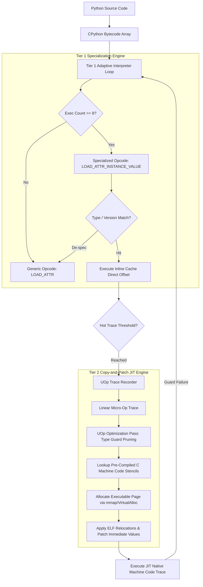

For decades, the execution core of CPython was conceptually simple. A giant switch statement inside ceval.c looped indefinitely over a stream of stack-based bytecodes. Every instruction execution paid a heavy tax. The runtime had to fetch an opcode, decode its operand, perform dynamic type lookup through Python's object pointer hierarchy, dispatch through dictionary structures or descriptor tables, adjust reference counts, and finally push or pop pointers on the value stack. Even a trivial attribute access like obj.x forced the interpreter to re-evaluate the object's type identity, dictionary layout, and inheritance chain on every single loop iteration.

Python 3.11 dramatically altered this model by introducing PEP 659, known as the Specialized Adaptive Interpreter. Instead of treating bytecode as immutable instructions executed by a static C loop, CPython began mutating its own instruction stream at runtime based on type feedback. Python 3.13 went further by adding Tier 2 optimization and an experimental copy-and-patch JIT compiler. Rather than pulling in a heavy runtime compilation architecture like LLVM or building a complex SSA compiler from scratch, CPython uses pre-compiled C code stencils patched dynamically in memory. Understanding how these two tiers interact reveals how modern Python achieves native execution speeds without giving up its traditional C execution invariants.



## Tier 1 Specialization and Opcode Quickening

The Tier 1 adaptive interpreter relies on inline caches embedded directly into code objects alongside instructions. When CPython compiles a function into bytecode, it allocates extra space in the instruction array immediately following instructions that benefit from type feedback. These extra 16-bit units are called inline cache entries.

Instructions begin in an unspecialized generic state. For example, a LOAD_ATTR instruction starts by executing generic attribute lookup code. Every unspecialized instruction maintains a backoff counter inside its inline cache. When a function executes, CPython decrements this counter. For the first eight executions, the interpreter runs the full dynamic lookup routine. On the eighth execution, if the object types seen by the instruction have remained consistent, the interpreter triggers opcode quickening.

Quickening rewrites the opcode in the code object's instruction buffer in place. The generic LOAD_ATTR opcode gets overwritten with a specialized variant such as LOAD_ATTR_INSTANCE_VALUE. The inline cache entries immediately following the instruction are populated with structural details about the target object. These details include the expected shape version of the object's type and the direct index array offset where the attribute value resides in memory.

When the specialized instruction executes on subsequent iterations, it bypasses dictionary lookups entirely. It performs two cheap integer comparisons: verifying that the target object's type header pointer matches the expected type pointer, and verifying that the instance's dictionary version matches the cached version. If both guards pass, the interpreter reads the attribute directly from the object's instance memory array using the offset stored in the cache. The runtime converts what was previously a multi-stage pointer dereference with hash table lookups into a direct array access.

If the application passes an object of a different type or an instance whose dictionary changed layout due to dynamic attribute deletion, the specialized instruction guard fails. When a guard fails, the interpreter executes a de-specialization fallback. The counter is reset to trigger a backoff period, and the instruction temporarily reverts to its generic form. If type instability persists, the opcode remains generic to avoid thrashing the cache.

## Micro-Operations and Tier 2 Trace Construction

While Tier 1 specialization speeds up individual instructions inside the standard interpreter loop, it still pays the execution overhead of fetching the next opcode, maintaining the internal interpreter stack pointer, and handling dispatch indirect branches. Python 3.13 builds upon Tier 1 by introducing Tier 2 execution, which groups hot execution paths across instruction boundaries into linear sequences of Micro-Operations, abbreviated as UOps.

Tier 2 activation relies on a trace counter. As specialized Tier 1 opcodes execute successfully, CPython tracks loop iterations and function entries. When a specific instruction path crosses the hot execution threshold, CPython instantiates a trace recorder. The recorder runs alongside the interpreter, monitoring the exact path taken by code execution.

Instead of recording high-level CPython bytecodes, the trace recorder translates execution into a stream of low-level UOps. A UOp represents a primitive operation. Where a single specialized Python opcode might perform stack manipulation, type checking, memory fetching, and reference count incrementing, the trace recorder breaks that opcode into distinct UOps. These consist of individual guard operations, memory load operations, stack projection operations, and error check operations.

The resulting UOp trace represents a single-entry, multi-exit basic block. Because the trace recorder captures the exact execution flow of a running loop, control flow branches are flattened. Conditional jumps that took the same direction during trace recording are converted into guard UOps. If a guard UOp fails during trace execution, control exits the trace and returns to the Tier 1 interpreter.

Once a UOp trace is assembled, CPython runs an abstract interpretation optimization pass over the trace buffer. This pass performs partial evaluation and type guard elimination. If an early UOp in the trace already verified that local variable zero is an instance of a specific class, subsequent guard UOps within the same trace that validate the identical type condition are redundant and get stripped out completely. Memory stack operations are also optimized so that intermediate values reside in internal abstract register slots rather than being written back and popped from the frame stack on every instruction.

## The Copy-and-Patch JIT Compiler Engine

Building a traditional JIT compiler like V8's TurboFan or PyPy's RPython architecture requires shipping a full intermediate representation compiler, register allocator, and machine code generator inside the executable runtime. That approach adds massive codebase complexity and memory overhead. CPython solves this by taking advantage of a technique called Copy-and-Patch compilation.

In a copy-and-patch JIT, all code generation work is pushed to compile time when CPython itself is built. CPython's repository contains a standalone C file, often called jit_cases.c, which defines small C functions representing the exact runtime execution logic for every single UOp. During the building of CPython, Clang compiles jit_cases.c into ELF or Mach-O object code.

A custom Python build script parses these compiled object files using ELF tools. The script extracts the raw machine code bytes generated by Clang for each UOp function. These extracted machine code fragments are called stencils. Because the C compiler compiled these stencils offline, they already contain fully optimized native x86_64 or AArch64 machine instructions for carrying out the core work of each UOp.

However, these C stencils cannot run in isolation because they contain references to dynamic values that are only known at runtime, such as specific Python object address pointers, code offsets, and jump targets. In the compiled ELF object file, Clang emits standard ELF relocations for these missing values. The CPython build script parses these relocation tables and outputs a generated header file containing stencil byte arrays along with structured metadata detailing the exact byte offsets inside each stencil that require patching.

At runtime, when a UOp trace is ready for JIT compilation, CPython's Tier 2 compiler executes a simple memory copying loop. It requests executable memory from the operating system using mmap with read and write permissions on POSIX systems or VirtualAlloc on Windows. The compiler iterates through the UOp trace, copying each corresponding pre-compiled stencil byte array into the target memory buffer end-to-end.

As each stencil is written to executable memory, the compiler reads the relocation metadata for that stencil. It evaluates the current runtime values, such as target object addresses or inline cache parameters, and patches those values directly into the copied machine code instructions at the designated relocation byte offsets. Once all stencils in the trace are written and patched, CPython calls mprotect to flip the memory page permissions from read-write to read-execute. Finally, it flushes the CPU instruction cache.

```c
// Simplified representation of the runtime stencil patching loop
unsigned char* jit_mem = allocate_executable_buffer(total_trace_size);
size_t offset = 0;

for (size_t i = 0; i < uop_trace.length; i++) {
    UOp instruction = uop_trace.uops[i];
    Stencil stencil = StencilTable[instruction.type];
    
    // 1. Copy raw pre-compiled machine code bytes
    memcpy(jit_mem + offset, stencil.code_bytes, stencil.code_size);
    
    // 2. Process ELF relocations to patch dynamic constants
    for (size_t r = 0; r < stencil.reloc_count; r++) {
        Relocation reloc = stencil.relocations[r];
        uintptr_t runtime_val = resolve_uop_operand(instruction, reloc.symbol_id);
        
        // Patch the immediate value directly into executable memory
        uintptr_t* patch_site = (uintptr_t*)(jit_mem + offset + reloc.byte_offset);
        *patch_site = runtime_val;
    }
    
    offset += stencil.code_size;
}

make_page_executable(jit_mem, total_trace_size);
```

## Frame State Management and Guard De-optimization

Executing native machine code generated by stencils introduces a major engineering problem: maintaining compatibility with Python's introspection capability, frame stack inspection, and exception handling. If native code encounters a type guard failure halfway through a trace execution, it cannot simply crash or abandon the execution state.

Every trace compiled by the copy-and-patch JIT maintains explicit ties back to CPython's frame evaluation architecture. Stencils that represent type guards or structural assertions emit machine code instructions that validate conditions directly in CPU registers. If a type check fails, the machine code branch targets a guard recovery stub compiled into the trace.

The guard recovery stub performs frame reconstruction. Native code reads the current abstract register state used during native execution and writes those values back into the standard PyFrameObject value stack locations in memory. It updates the instruction pointer in the CPython frame to point to the exact Tier 1 specialized instruction corresponding to the failed UOp.

Once frame reconstruction completes, the native code executes a CPU jump that transfers control out of the JIT-compiled memory region and straight back into the interpreter's Tier 1 execution loop inside ceval.c. Because the interpreter frame was updated to reflect the exact state at the moment of guard failure, the Python program resumes execution inside the standard interpreter seamlessly. System state remains consistent, frame inspection tools see complete execution stacks, and exceptions can be handled through standard unwinding mechanisms.

By layering opcode specialization, micro-operation trace flattening, and pre-compiled stencil patching into distinct stages, CPython achieves native execution speed on critical paths. The system avoids the high memory costs and execution startup delays of classical JIT frameworks while preserving full compatibility with standard C extension modules and runtime debugging tools.
