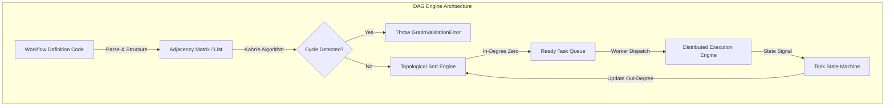
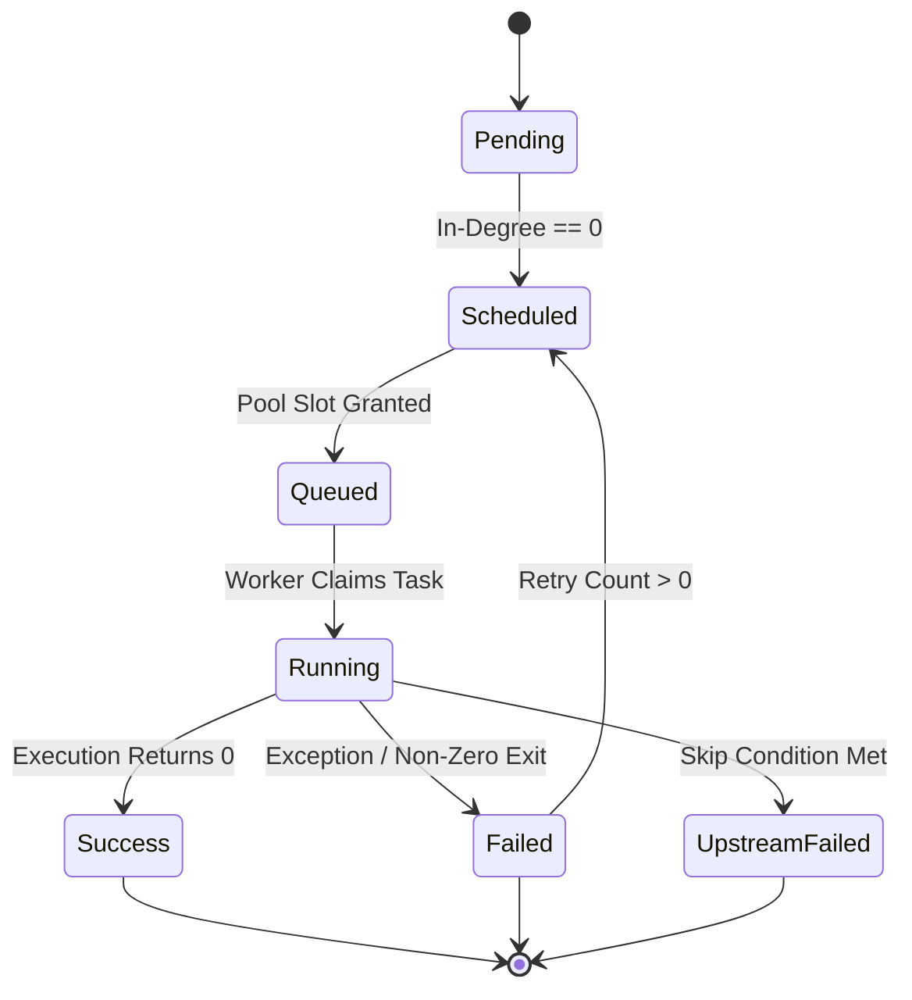

Every modern workflow orchestrator, whether you look at Apache Airflow, Prefect, or Dagster, operates on a simple fundamental core premise. It takes a collection of isolated computational steps, structures them into a Directed Acyclic Graph, and walks that graph until every executable node reaches a terminal state. Underneath the slick web interfaces and developer abstractions lies a high-throughput graph processing engine that must handle dynamic node additions, cycle validation, state machine progression, and distributed task dispatching without corrupting pipeline execution.

Building a pipeline runner sounds straightforward until you hit edge cases like dynamic task mapping, upstream task failures cascading through partial graphs, and race conditions in concurrent execution loops. When an orchestrator parses your workflow code, it is not running your business logic yet. It is constructing an in-memory data structure of vertices and directed edges. The vertices represent task instances containing metadata like retries, timeouts, and execution handlers. The directed edges represent explicit dependency constraints, enforcing that node B cannot execute until node A successfully completes.

Graph construction happens during a parsing phase where code statements register dependencies into an internal adjacency list. In systems like Airflow, a background scheduler process continuously evaluates workflow definition files, executing top-level code to materialize python objects that form the graph network. Prefect and Dagster take slightly different approaches by decoupling graph definition from schedule evaluation, but the resulting runtime graph structure remains identical. It is a directed graph where every edge goes from a parent task to a child task, guaranteed to contain zero directed cycles.

Validating that a pipeline is strictly acyclic is the first critical boundary crossing before execution begins. If a cyclic dependency slips into the execution plan, the scheduling engine will dead-lock waiting for upstream signals that can never resolve. Orchestrators execute cycle detection using either Kahn's algorithm or Depth-First Search with recursion stack tracking. Kahn's algorithm works by calculating the in-degree of every vertex, which is the exact count of incoming directed edges pointing to that node. Nodes with an in-degree of zero are added to an initial processing queue because they have no dependencies blocking their execution.

As the cycle validation loop pops nodes from the queue, it decrements the in-degree of all their downstream neighbors. If a neighbor node's in-degree drops to zero, it enters the processing queue. The algorithm tracks the total number of visited nodes. If the final count of visited nodes equals the total number of vertices in the graph, the graph is structurally valid and acyclic. If the visited count is less than the vertex count, at least one cycle exists somewhere in the graph structure, and the engine rejects the deployment or run initialization instantly.

Topological sorting directly flows out of this validation step. A topological sort produces a linear ordering of vertices such that for every directed edge from vertex U to vertex V, vertex U appears before vertex V in the ordering. However, real-world execution engines do not simply flatten the graph into a single linear list and execute tasks sequentially. Doing so would destroy all potential for parallel execution. Instead, the scheduler uses the in-degree state engine dynamically during runtime.

During runtime, the execution engine maintains a dynamically updated in-degree table for every active workflow instance. When a pipeline run triggers, the scheduler queries the database or memory state for all tasks where in-degree is zero and execution state is set to Pending. These tasks represent the immediate execution frontier. The scheduler transitions these tasks from Pending to Scheduled, evaluates concurrency slot limits for worker pools, and places them into an execution queue backed by RabbitMQ, Redis, or an internal database polling loop.

Managing task state transitions requires a strict state machine to prevent race conditions when multiple worker processes finish tasks simultaneously. A task instance starts in a Pending state. Once upstream dependencies complete, the scheduler moves it to Scheduled. From Scheduled, the concurrency governor checks resource pools. If a task requires a slot in a constrained database access pool and that pool is full, the task remains in Scheduled until a slot frees up. Once a slot opens, the engine transitions the task to Queued.

Worker processes continually poll the queue or listen on a message channel. A worker claims the task, updating its state in the centralized persistence layer from Queued to Running while updating a heartbeat timestamp. Heartbeating is critical because if a worker host crashes, suffers an Out-Of-Memory kill event, or loses network connectivity, the worker stops updating its heartbeat. A separate reaper loop in the orchestrator identifies stale running tasks whose heartbeat exceeded the timeout window, marks them as Failed, and evaluates whether a retry should be scheduled based on the task's retry configuration.

When a task finishes execution, its final state dictates how the engine evaluates downstream dependencies. Downstream execution is governed by trigger rules attached to child nodes. The default trigger rule in most engines is all-success, meaning a child task only decrements its active in-degree when all immediate parent tasks reach the Success state. If any parent fails, the child task bypasses execution, transitioning directly to Upstream Failed. This failure status propagates transitively down the rest of the branch without executing any of the dependent code paths.

Orchestrators also support alternative trigger rules like one-success, all-failed, or all-done. For example, a cleanup or teardown task might use the all-done trigger rule. In this case, the scheduler decrements the child task's in-degree regardless of whether parent nodes landed in Success, Failed, or Upstream Failed. The scheduler evaluates child node trigger conditions by inspecting the precise status of all upstream adjacent edges every time a parent task writes its final status to the storage backend.

Data passing between isolated execution steps poses a distinct architectural challenge. Because task execution is often distributed across separate containers, pods, or physical host instances, tasks cannot share in-memory heap references. Workflow engines handle this by decoupling state metadata from execution payloads. The orchestrator's state engine tracks status changes, timestamps, and log pointers in a transactional relational database. Small values like status flags, execution counters, or small string outputs are stored directly in a key-value payload table, commonly referred to as XComs in Airflow or task results in Prefect.

For large datasets like dataframes, Parquet files, or machine learning model binaries, storing payloads inside the orchestrator's backend database would cause severe IO starvation and database bloat. Production orchestrators enforce a pattern where task scripts write heavy payloads directly to object storage like AWS S3 or Azure Blob Storage, passing only the URI path reference through the orchestrator's payload exchange engine. The downstream task receives the bucket URI, initializes its own object storage client, and streams the data directly into its own memory space, keeping the control plane entirely out of the data path.

Dynamic task mapping and DAG expansion at runtime introduce another layer of complexity. When a pipeline needs to process an arbitrary number of items determined at runtime, such as a list of files generated by an upstream query, the static graph structure must expand dynamically. The engine achieves this by creating dynamic task instances mapped to index positions under a parent mapped task container. The main DAG graph structure remains static, but the scheduler instantiates N parallel child sub-states that each independently progress through the Pending, Scheduled, Running, and Success state transitions. The downstream aggregate task's in-degree then equals N, ensuring it blocks execution until every single dynamically mapped child instance completes.

Understanding these graph traversal mechanisms, cycle detection algorithms, and state transition governors reveals why modern orchestrators are far more than glorified cron jobs. They are resilient, distributed finite state machines designed to transform unpredictable computational steps into deterministic data processing streams.
