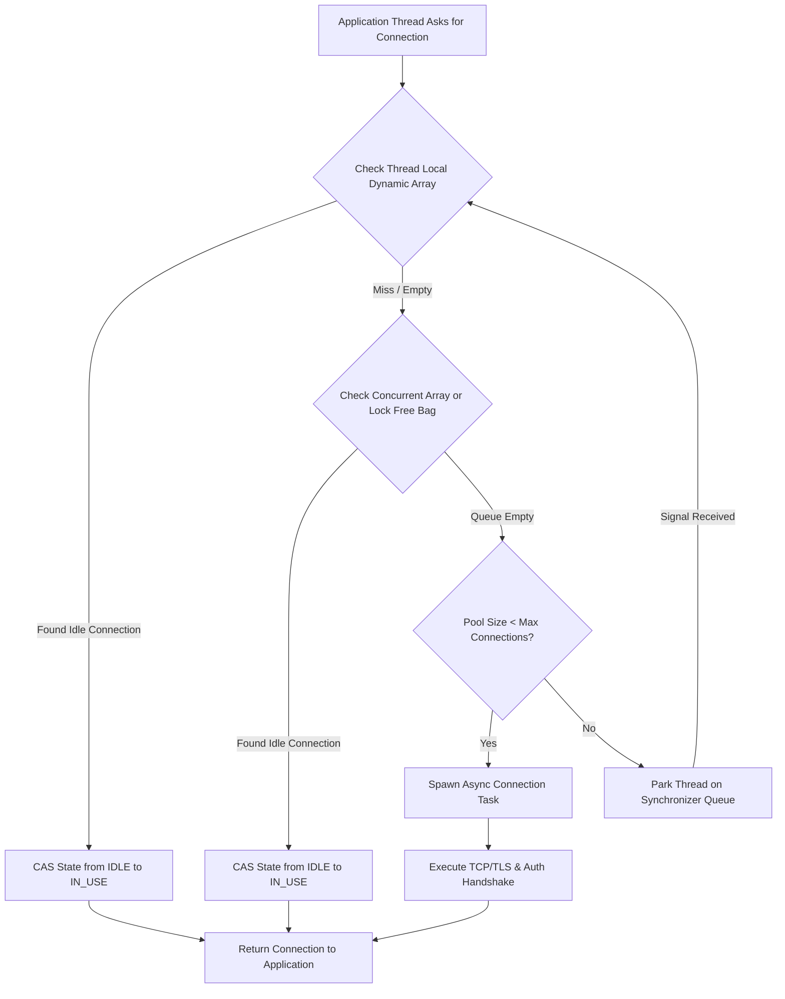
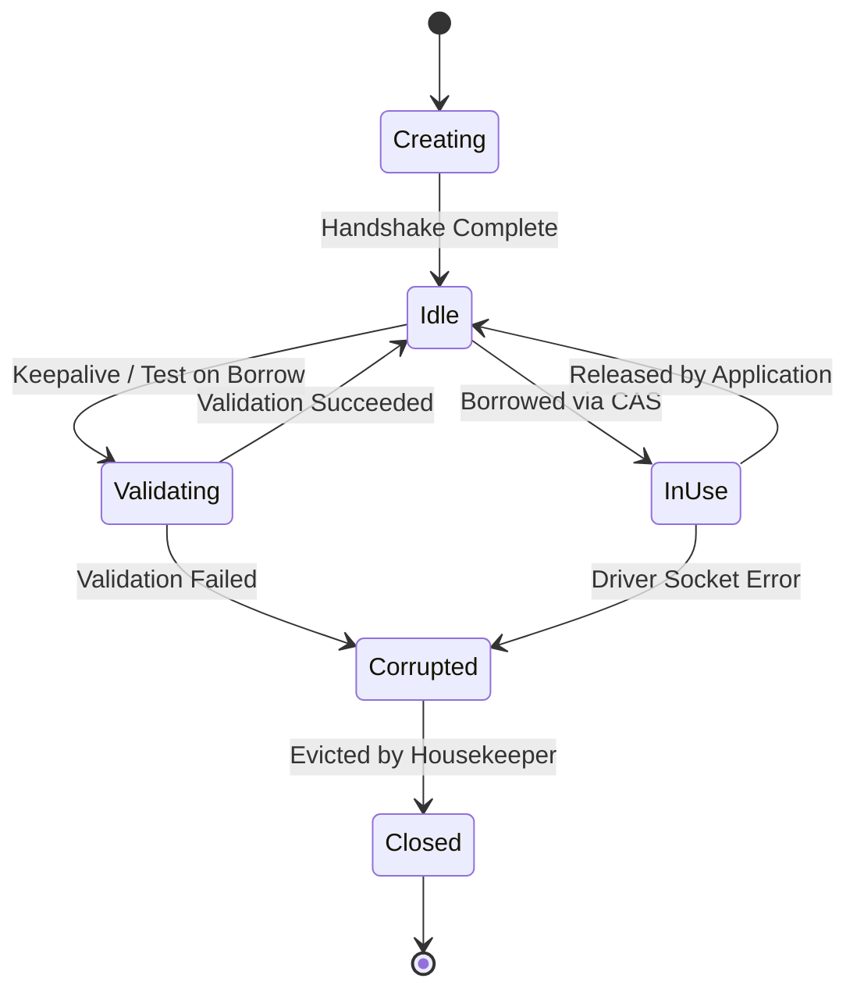

When your application executes a database query, establishing a fresh TCP connection on the fly destroys throughput. Opening a connection requires a multi-step sequence. First comes the TCP three-way handshake, adding a network round trip. Next, if encryption is enabled, TLS negotiation adds another one to two round trips for handshake verification and key exchange. Once the transport layer is established, the application protocol takes over. PostgreSQL, for instance, executes startup packets, client authentication using mechanisms like SCRAM-SHA-256, and parameter status exchanges before sending a ready-for-query signal. On the database server itself, accepting a new connection usually requires spawning a process or allocating dedicated engine thread context and memory structures.

Executing this ceremony for every incoming request causes severe latency spikes and quickly exhausts database resources. A database server handling ten thousand concurrent HTTP requests cannot fork ten thousand process contexts without crushing its OS scheduler and memory subsystem. Connection pools solve this by maintaining a warm set of reusable database sockets. Modern connection pools do not just hold sockets in a simple synchronized list, though. Under heavy concurrent load, a naive synchronized list becomes a massive CPU bottleneck where threads spend most of their time fighting over a single queue lock.



High-throughput connection pools use multi-tiered allocation pipelines designed to minimize global lock contention. When an application thread requests a database connection, the pool routes the request through a series of increasingly general lookup layers.

The first layer in pools like HikariCP or Npgsql is a thread-local cache. Thread-local storage stores references to connections previously used by that specific thread. If the executing thread finds an available connection in its local queue, it attempts an atomic compare-and-swap operation on the connection's internal state variable. If successful, the borrow operation completes without touching any shared data structures across CPU sockets.

If the thread-local lookup fails, the borrow pipeline drops to a shared concurrent bag or lock-free array. This layer uses atomic reference arrays where items are scanned without acquiring mutual exclusion locks. If the concurrent bag has available sockets, the thread CAS-claims one and proceeds. Only when all existing connections are actively in use does the pool fall back to expanding its total size. If the pool has reached its hard capacity cap, the calling thread parks on a fairness-oriented handoff queue using primitives like LockSupport.parkNanos or AsyncSemaphore, waiting for a releasing thread to hand off an active connection directly.



Every connection inside the pool transitions through an explicit state machine. Managing these states correctly prevents applications from receiving broken sockets caused by silent network drops, database restarts, or firewall idle cutoffs.

A connection starts in the Creating state during socket setup and authentication. Once ready, it enters the Idle state and resides in the pool's allocation queue. When an application thread acquires it, the state shifts atomically to In-Use. Upon application completion, returning the socket resets its state to Idle.

If a connection sits idle for an extended period, middleboxes like cloud firewalls or NAT gateways might drop the TCP session without sending a FIN packet. To protect applications from receiving dead sockets, pools use validation strategies. The old method relied on executing a lightweight query like SELECT 1 whenever a connection was borrowed. This added a network round trip to every borrow operation, degrading throughput. Modern drivers use socket-level probes or track connection age and last-seen activity timestamps. If a connection has been idle longer than a configured keepalive threshold, the pool issues a fast network probe or background query before marking it fit for reuse. If validation fails, the socket is marked Corrupted, removed from the allocation structures, closed, and a fresh socket creation task fires.

To see how lock-free pools eliminate lock contention, consider how connection states are represented. Instead of locking a shared container during borrow operations, each connection wrapper maintains an atomic integer tracking its current state.

```csharp
public class ConnectionHolder
{
    public const int STATE_NOT_IN_USE = 0;
    public const int STATE_IN_USE = 1;
    public const int STATE_REMOVED = -1;
    public const int STATE_RESERVED = 2;

    private int state = STATE_NOT_IN_USE;
    public DbConnection RawConnection { get; }

    public bool TryClaim()
    {
        return Interlocked.CompareExchange(ref state, STATE_IN_USE, STATE_NOT_IN_USE) == STATE_NOT_IN_USE;
    }

    public bool TryMarkReserved()
    {
        return Interlocked.CompareExchange(ref state, STATE_RESERVED, STATE_NOT_IN_USE) == STATE_NOT_IN_USE;
    }

    public void Release()
    {
        Volatile.Write(ref state, STATE_NOT_IN_USE);
    }
}
```

When borrowing, threads iterate over array slots containing ConnectionHolder references. Instead of locking the array, a thread invokes TryClaim, which executes a single atomic instruction like LOCK CMPXCHG on x86 architectures. If two threads simultaneously attempt to borrow the exact same idle connection, hardware cache coherency protocols ensure exactly one CAS instruction succeeds. The winning thread changes the state to STATE_IN_USE and immediately returns the connection. The losing thread simply advances to the next array slot in the concurrent list.

When returning a connection, the owning thread clears any uncommitted transactional state on the underlying database socket, such as issuing a rollback if a transaction was left open, resets auto-commit flags, and then executes a volatile write setting state back to STATE_NOT_IN_USE. If waiting threads are parked on the handoff queue, the returning thread notifies the top waiter or writes directly into a handoff slot to bypass queue re-insertion entirely.

Application code that fails to close or dispose database connections creates connection leaks. Left unchecked, leaked connections permanently reduce pool capacity until the entire pool is exhausted and incoming requests hang indefinitely.

Connection pools detect leaks without introducing runtime overhead on the fast path by decoupling borrow tracking from eviction scheduling. When leak detection is enabled, borrowing a connection wraps the socket in a proxy object and captures a stack trace snapshot of the borrowing thread.

```csharp
public class TrackedLease : IDisposable
{
    private readonly ConnectionHolder holder;
    private readonly CancellationTokenSource leakTimer;
    private readonly string allocationStackTrace;

    public TrackedLease(ConnectionHolder holder, TimeSpan leakThreshold, Action<TrackedLease> onLeak)
    {
        this.holder = holder;
        this.allocationStackTrace = Environment.StackTrace;
        this.leakTimer = new CancellationTokenSource();
        
        Task.Delay(leakThreshold, leakTimer.Token).ContinueWith(t =>
        {
            if (!t.IsCanceled)
            {
                onLeak(this);
            }
        }, TaskContinuationOptions.ExecuteSynchronously);
    }

    public void Dispose()
    {
        leakTimer.Cancel();
        leakTimer.Dispose();
        holder.Release();
    }

    public string GetStackTrace() => allocationStackTrace;
}
```

When an application borrows a connection, a lightweight timer or registration entry is created. If the application holds the connection longer than the threshold, say thirty seconds, the background timer fires and invokes the leak handler callback. The leak handler logs a warning containing the exact stack trace recorded at the moment of allocation, pinpointing the un-closed code path in application logic. Crucially, the leak detector can optionally mark the connection as corrupted, forcibly close the physical database socket underneath, and allocate a replacement connection to keep the pool at healthy capacity.

Outside of leak detection, a background thread runs periodic housekeeping loops. This housekeeper handles soft and hard lifetime limits. Connections are routinely retired after reaching a maximum lifetime, such as thirty minutes, to prevent memory leaks in database driver buffers and to allow database server load balancers to re-distribute connections across multi-node clusters. Rather than closing expired connections immediately, the housekeeper flags them for retirement. The next time an expired connection is released back to the pool, the pool destroys it and asynchronously establishes a fresh connection, maintaining a smooth lifecycle transition without abrupt connection churn.
