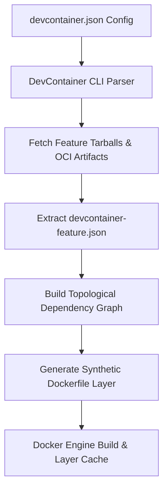
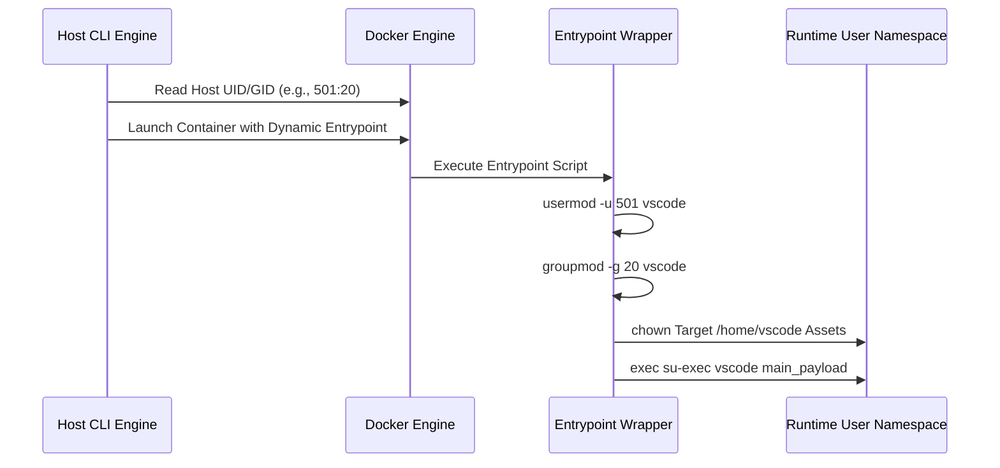
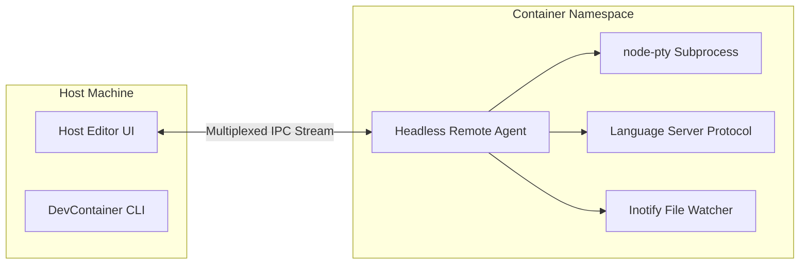

When you open an editor and click Reopen in Container, your IDE feels like it seamlessly shifted its entire language server, terminal session, and debugging context into an isolated Linux environment. Most developers assume this mechanism is just a thin wrapper around a standard docker run command with a basic bind mount. It is not. Raw Docker containers lack native user UID mapping, automated extension provisioning, persistent command history bindings, dynamic port forwarding, and multi-stage lifecycle orchestration.

The DevContainer specification, maintained as an open standard and implemented primarily by the devcontainer CLI node engine, operates a multi-pass runtime orchestrator. It parses container metadata, synthesizes base images with dynamic feature layer compositions, virtualizes storage interfaces to bypass host-to-guest filesystem bottlenecks, and bootstraps a headless editor RPC agent deep within the container kernel namespace.

### Image Synthesis and Feature Composition Engines

The orchestrator workflow begins by parsing .devcontainer/devcontainer.json. This configuration references an existing base image, a local Dockerfile, or a multi-container Docker Compose setup. When your JSON file declares devcontainer features, the CLI does not simply execute random shell scripts inside a running container. Instead, it treats features as versioned OCI artifacts or compressed tar files fetched directly from remote registries.

Each feature bundle contains shell installation scripts alongside a devcontainer-feature.json manifest. This manifest defines environment variables, required kernel capabilities like SYS_PTRACE for gdb or lldb debuggers, mount points, entrypoints, and explicit feature dependencies. The devcontainer CLI extracts these manifests and constructs an in-memory directed acyclic graph to compute execution order. If feature B relies on feature A, the engine guarantees feature A's setup script executes first.

During image creation, the CLI synthesizes a dynamic Dockerfile on the fly. It injects feature installation scripts into chained RUN directives within the build context. This approach maximizes Docker layer caching mechanics. Environment variables exported by features are either stamped directly into image metadata using ENV instructions or recorded into a specialized system metadata file at /etc/dev-containers/meta.json. Child shells inherit these variables regardless of how process execution begins inside the container.

### Storage Virtualization and UID Reconciliation

Bind mounting local source trees into containers looks simple until you run into POSIX file permissions and storage I/O limits. On native Linux hosts, bind mounting directly maps host file ownership to container user space. If your host user UID is 1000, files created inside the container inherit UID 1000. But on macOS or Windows setups using virtualized Linux microVMs, file operations must pass through hypervisor boundaries like VirtioFS or gRPC FUSE.

Permission mismatches surface when containers execute under non-root identities like vscode or node with UID 1000, while host files belong to UID 501 on macOS. Without intervention, simple file edits trigger permission denied errors. The devcontainer engine mitigates this mismatch using dynamic entrypoint adjustments.

When updateRemoteUserUID is active, the CLI inspects local host user identity prior to launching the container payload. It generates a small bootstrap script that overrides container startup. This script runs usermod and groupmod against the target container account, updating /etc/passwd and /etc/group directly within the root container filesystem. It recursively updates ownership for home directory paths like /home/vscode while intentionally avoiding host bind mounts to eliminate long startup delays.

Disk performance requires targeted volume boundary isolation. Subdirectories like node_modules in JavaScript projects, target folders in Rust, or .venv environments in Python hit massive performance penalties when pushed across hypervisor bind mounts. The devcontainer engine supports targeted volume overrides, replacing host-bound subdirectories with isolated Docker named volumes. Source files remain accessible on your host disk, while rapid compilation reads and writes land on high-speed ext4 disk images managed natively by the container daemon.

### Remote Agent Injection and Transport Topologies

Once the container process namespace is running, your editor interface must establish direct control over the guest runtime environment. The host editor does not run language servers or debugger engines locally over host-mounted files. Doing so would reintroduce cross-platform path resolution issues and force heavy RPC operations over bind mounts. Instead, the devcontainer CLI installs a headless editor server directly into the guest runtime.

For VS Code, the CLI fetches a commit-matched build of vscode-server and unpacks it inside ~/.vscode-server/bin/commit-id within the container filesystem. The host engine initiates this headless server via docker exec commands or over an established SSH stream. The remote server process binds to an internal IPC socket or local transport stream, opening a multiplexed communication channel back to the host UI.

This remote server executes language engines, debugger tools, and terminal sessions completely inside the container namespace. When you open a terminal window in the host editor, the remote server spawns a shell process bound to pseudo-terminal instances via node-pty bindings. Code completions run locally against native container binaries like gopls or dotnet-roslyn, avoiding network and file system translation overhead.

Port forwarding relies on a dual-path proxy engine. Static ports listed under forwardPorts in configuration files are intercepted by host loopback listeners, mapping requests directly to container network interfaces. When applications dynamically listen on new ports, the container agent reads state from /proc/net/tcp or hooks socket system calls, automatically opening on-demand tunnel streams over the primary IPC connection.

### Lifecycle Hook State Machines

Container initialization follows a multi-stage execution model. Setup tasks span both host systems and container namespaces, split across granular lifecycle boundaries.

The initializeCommand hook runs directly on your host system before build operations or container creation begins. Developers use this step to refresh host credentials, clear old build artifacts, or create host directories.

The onCreateCommand hook fires inside the container root environment immediately after volume mounting completes. This phase runs prior to default environment setup, making it ideal for low-level system package operations.

The updateContentCommand hook runs once workspace files are fully mounted and visible inside the container namespace. Dependencies managed by npm, cargo, or dotnet belong in this phase because project manifests must be present.

The postCreateCommand hook triggers after initial setup finishes. Workspace tool setups, developer shell configurations, and developer authentications run during this phase.

The postStartCommand hook executes every time the container transitions from a stopped state to running, handling background service startups like starting local databases or trace collectors.

The devcontainer CLI tracks state transitions by placing sentinel files into /tmp/devcontainers-marker-* paths within the container filesystem. These markers guarantee that non-idempotent operations like postCreateCommand execute once per container lifecycle, preventing accidental re-execution when restarting paused workspaces.
