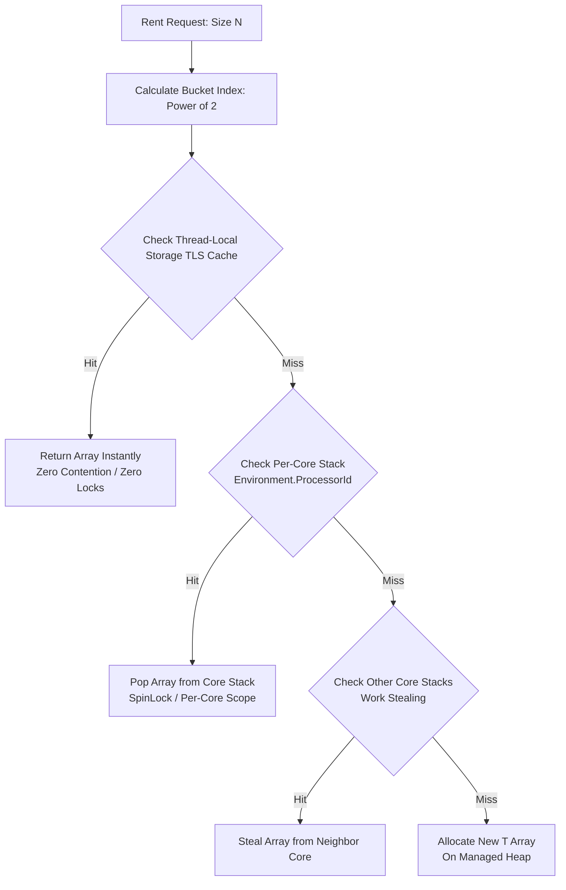
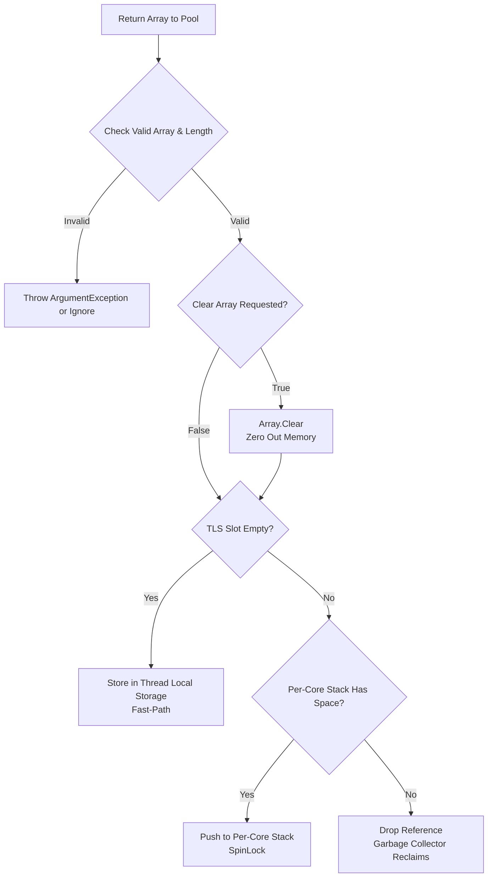
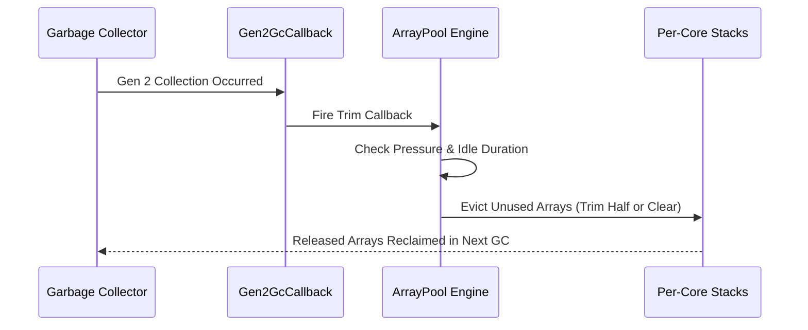

High allocation rates destroy backend performance. When processing incoming network streams, building JSON payloads, or parsing binary messages, allocating transient byte arrays puts tremendous stress on the .NET Garbage Collector. Small short-lived arrays saturate Generation 0, triggering constant garbage collection cycles. Large arrays exceeding 85,000 bytes land directly on the Large Object Heap, where memory isn't compacted by default, leading to heap fragmentation and expensive Generation 2 pauses. To solve this, .NET provides System.Buffers.ArrayPool<T>.

While developers frequently call ArrayPool<T>.Shared.Rent(size) and ArrayPool<T>.Shared.Return(array), few understand the architecture operating under the hood. The default shared pool isn't a naive lock-bound concurrent queue. It is backed by an internal class named TlsOverPerCoreLockedStacksArrayPool<T>. This data structure uses a multi-tier caching topology designed to minimize thread contention on high-core server systems while avoiding memory leaks under changing workloads.

Memory in ArrayPool<T>.Shared is organized into power-of-two bucket sizes. When you request a buffer of length 500, the pool rounds up to the nearest power of two, selecting the 512-element bucket. Buckets range from 16 elements up to 2^30 elements. Each bucket contains three tiers of storage: thread-local storage slots, per-core locked stacks, and heap allocation fallbacks.

The top tier is Thread Local Storage. Every worker thread that interacts with the array pool holds cached arrays directly in thread-local storage fields. When a thread rents or returns an array that fits its thread-local slot, no synchronization primitives are touched. No atomic compare-and-swap operations occur, no spinlocks are acquired, and no memory barriers are enforced. The fast-path operation is a raw reference swap executing in under three nanoseconds.

If the thread-local storage slot is empty during a rent request, the engine falls back to the second tier: Per-Core locked stacks. The pool checks Environment.ProcessorId to identify which physical CPU core is executing the current thread. It accesses a stack collection assigned specifically to that core. Access to a per-core stack is protected by a fast SpinLock. Partitioning array stacks by processor core ensures that threads running on core 0 rarely contend with threads running on core 8, preserving scalability across hardware threads.

The third tier handles empty per-core stacks and global fallbacks. If the current core stack is empty, the engine attempts to steal an array from neighboring core stacks within the same bucket. If every per-core stack in that bucket is depleted, the pool allocates a fresh array on the managed heap using the standard runtime allocator.

Returning an array to the pool reverses this path while enforcing memory safety and pool bounds.

When returning a buffer via ArrayPool<T>.Shared.Return(array, clearArray), the pool checks whether clearArray is set to true. If set to true, Array.Clear wipes the array contents. Wiping memory prevents object references from staying alive inside pooled buffers, which would otherwise prevent the garbage collector from reclaiming unreferenced graph objects.

Once cleared, the returning thread checks its local TLS slot for that bucket. If empty, the array is saved directly into TLS. If the TLS slot is already filled, the thread acquires the core's SpinLock using Environment.ProcessorId and pushes the array onto the core stack. Each core stack has a strict maximum element limit. If the per-core stack is full, the pool rejects the array and drops its reference, allowing the garbage collector to clean it up. Capping stack capacity prevents the array pool from growing unbounded during massive traffic spikes.

Pooling memory creates a tricky problem: memory retention during idle periods. If a web application processes a burst of 10,000 concurrent requests, the pool allocates thousands of arrays and stores them in per-core stacks upon return. If traffic drops to zero, those arrays remain referenced by the pool indefinitely, consuming valuable system RAM. To solve this, TlsOverPerCoreLockedStacksArrayPool implements an automatic memory trimming engine tied to Generation 2 garbage collections.

The pool registers an instance of Gen2GcCallback with the runtime GC subsystem. Whenever a Generation 2 collection runs, the garbage collector fires this callback. The pool tracks usage metrics, counting how many rent operations occurred since the last Gen 2 event. If the pool detects that certain per-core stacks haven't been accessed or utilized during the window, the trimming algorithm acquires the core locks and drops half or all of the stored arrays from the unused stacks. The next GC pass reclaims those unrooted arrays, returning physical memory back to the host system.

Despite these optimizations, using ArrayPool<T> introduces bugs if developers misuse the API. Double returning an array is the most dangerous bug. If two separate asynchronous tasks return the same array reference back to the pool, ArrayPool will hand out that exact same buffer to two concurrent operations. One operation will overwrite the buffer while another is actively reading it, leading to subtle data corruption that bypasses normal exception handling.

Another common mistake is assuming that Rent(minimumLength) returns an array matching minimumLength. Renting 100 elements typically yields a 128-element array. Code that reads or serializes up to array.Length instead of tracking the actual written byte count will process stale garbage memory left behind by previous pool tenants. Always slice returned arrays into Span<T> or Memory<T> bounded by the exact count of initialized elements.
