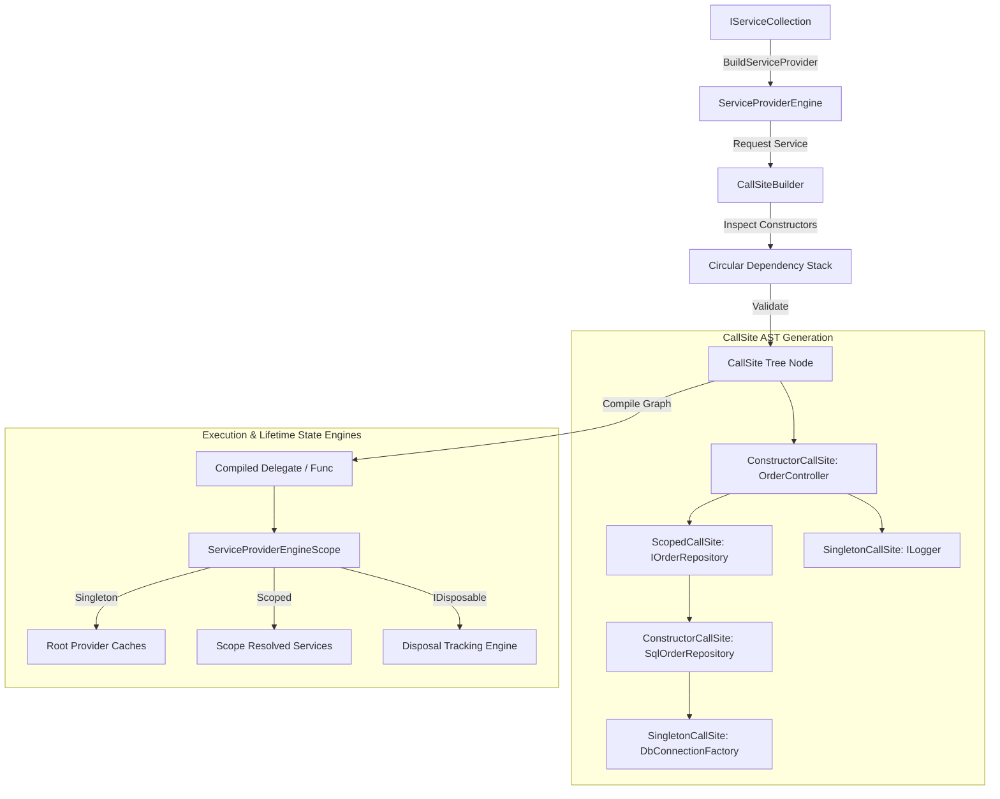

Every modern .NET backend relies on Microsoft.Extensions.DependencyInjection to wire up services, manage lifecycles, and inject dependencies into constructors. Most developers treat it as a black box where you register a service with a lifetime and request it in a constructor. Underneath that familiar AddScoped interface lies a sophisticated dynamic compilation engine. The framework transforms raw registrations into abstract syntax trees, compiles them down to IL delegates to eliminate reflection overhead, and manages concurrent instance caches alongside disposal tracking state engines.

Understanding how this container works under the hood requires tracing what happens when you transition from a passive collection of descriptors to an active service provider capable of constructing complex object graphs in nanoseconds.

## From Registrations to CallSites

Registration begins with IServiceCollection, which is nothing more than a wrapper around a standard List of ServiceDescriptor objects. Each descriptor holds three key pieces of metadata. It tracks the ServiceType representing the interface or abstraction, the ImplementationType or factory method used to fulfill the request, and the ServiceLifetime controlling instance caching.

When you invoke BuildServiceProvider, the framework stops accepting registrations and begins converting raw descriptors into an executable graph. The core engine does not use reflection every time you call GetService. Reflecting over constructor parameters on every HTTP request would destroy throughput. Instead, the container uses an internal abstraction called ServiceCallSite.

A CallSite represents a distinct node in a dependency resolution tree. When the container analyzes a service, it creates a specialized CallSite subtype based on how that service is defined. ConstructorCallSite represents a type that must be instantiated by invoking a constructor with dependencies. ConstantCallSite holds an instance that was pre-constructed and passed in during registration. FactoryCallSite wraps a user-provided delegate. IEnumerableCallSite handles resolving arrays or collections of services registered under a single interface.

To build these CallSites, the engine uses a call site builder that inspects the target implementation type using reflection once during initial resolution or build phase. It finds the constructor with the highest number of resolvable arguments. If a constructor requires parameters that cannot be resolved from the registered descriptors, the builder falls back to smaller constructors until it finds a valid match or throws an InvalidOperationException.



During graph construction, circular dependencies are detected using a stack-based visitor engine. As the builder traverses down a dependency tree, it pushes each resolved ServiceCacheKey onto an active evaluation stack. If the builder encounters a key that already exists in the current stack path, it immediately aborts and throws a circular dependency exception, preventing stack overflow errors before any object instantiation occurs.

## The Dynamic Compilation Engine

Once a CallSite tree is constructed for a service, resolving it repeatedly through tree traversal would still introduce significant overhead. The framework solves this by dynamically compiling the CallSite AST into a C# Func delegate. The internal architecture uses distinct execution strategies depending on the environment and runtime capabilities.

The framework provides multiple engine implementations. CallSiteRuntimeResolver processes the CallSite AST directly by recursively evaluating nodes. This mode requires zero code generation, making it lightweight for startup, but it pays a small performance penalty on every invocation due to tree walking.

To achieve maximum throughput, the container uses dynamic compilation engines like ExpressionResolver or DynamicILEmitResolver. The compilation engine transforms the CallSite graph into a System.Linq.Expressions.Expression tree. A ConstructorCallSite becomes a NewExpression, dependencies become embedded sub-expressions, and lifetime checks become conditional lookup expressions against the scope cache.

Consider a service with two constructor arguments. The expression compiler generates code logically equivalent to an inline factory routine. It checks if the instance already exists in the active scope cache. If present, it returns the cached instance. If absent, it invokes the constructor using pre-compiled argument expressions and stores the result in the scope cache before returning.

Once the Expression tree is assembled, the engine calls Expression.Compile. This generates raw Microsoft Intermediate Language (MSIL) at runtime, compiling the entire multi-layered dependency graph into a single, tightly-optimized delegate. Subsequent calls to GetService bypass constructor inspection and graph walking entirely. The runtime simply executes the compiled IL delegate, creating objects almost as fast as hand-written code.

In modern .NET environments running under Native AOT (Ahead-Of-Time compilation), runtime IL generation via System.Reflection.Emit is disabled. In these scenarios, the framework smoothly falls back to the interpreted runtime resolver or utilizes source generators that construct the CallSite trees at compile time, maintaining zero-allocation resolution without dynamic code generation.

## Scope Lifetime Mechanics and Disposal State Engines

Managing object lifecycles is the most critical responsibility of the container. A memory leak in a long-running web application almost always traces back to a misunderstanding of how scope state engines track instances and disposables.

The root ServiceProvider instance acts as the top-level container. When you create a scope by calling CreateScope, the root provider instantiates a ServiceProviderEngineScope. This scope represents a bounded lifetime boundary, typically mapped to the lifespan of an incoming HTTP request or background message queue processing loop.

Each ServiceProviderEngineScope maintains two internal state collections used for lifecycle management. The first is a dictionary for caching resolved instances. The second is a list dedicated to tracking disposable objects.

```
ROOT SERVICE PROVIDER (Singleton Lifetime Boundary)
 ├─ Resolved Singletons Cache: { DbFactory, Logger }
 └─ Root Disposal List: [ DbFactory ]
       │
       ├─► CHILD SCOPE A (HTTP Request 1)
       │    ├─ Scoped Cache: { SqlOrderRepository, UnitOfWork }
       │    └─ Scope Disposal List: [ SqlOrderRepository, UnitOfWork ]
       │
       └─► CHILD SCOPE B (HTTP Request 2)
            ├─ Scoped Cache: { SqlOrderRepository, UnitOfWork }
            └─ Scope Disposal List: [ SqlOrderRepository, UnitOfWork ]
```

When a service is resolved, the container evaluates its ServiceLifetime setting. Singletons are resolved once and stored in the root provider instance cache. Any subsequent request for that Singleton, regardless of which child scope initiates the request, returns the exact reference stored in the root container.

Scoped services are cached within the specific ServiceProviderEngineScope that handled the request. If five components inside the same HTTP request ask for an IUnitOfWork, the container resolves the expression tree once, stores the reference in that child scope instance dictionary, and returns the identical instance for the remaining four requests. When another HTTP request executes in a parallel child scope, it gets its own distinct instance cached in its own local dictionary.

Transient services are never cached in the instance dictionary. Every time a Transient service is requested, the compiled delegate executes the constructor and returns a brand-new instance.

Disposal mechanics introduce a dangerous edge case. The container guarantees that any object it creates implementing IDisposable or IAsyncDisposable will have its Dispose method called when its parent scope shuts down. To enforce this, whenever a CallSite instantiates a disposable type, it registers that object in the current scope disposal list.

If a Transient service implements IDisposable and is resolved from a child scope, the child scope adds that instance to its local disposal list. When the HTTP request completes and the child scope is disposed, all transient disposables created within that request are cleanly cleaned up.

Problems arise when a Transient disposable service is resolved directly from the root provider instead of a child scope. Because the root provider never shuts down until the application terminates, every transient disposable resolved from the root gets appended to the root provider disposal list. The root container holds a strong reference to every transient instance ever created from it, completely preventing the garbage collector from reclaiming that memory. Over hours of execution, this scenario leads to massive memory leaks as millions of dead transient objects pile up inside the root disposal array.

To prevent scope mismatches, Microsoft added scope validation checks. When enabled in development environments, the container verifies that Scoped services are never resolved directly from the root provider or injected into Singleton components. If a Singleton depends on a Scoped service, a capture error occurs where the Scoped instance gets captured by the Singleton and lives forever, violating the intended application architecture and corrupting state across concurrent requests.

## Thread Safety and Lock-Free Read Paths

Because the dependency injection container is accessed concurrently by thousands of incoming requests simultaneously, thread safety is paramount. The internal architecture achieves high performance under heavy concurrency by separating the read path from the write path.

Resolving an already-compiled service must be lock-free. The engine uses concurrent data structures and atomic CAS (Compare-And-Swap) operations to access cached delegates and instances. The internal cache mapping a Type to its compiled CallSite delegate relies on lock-free reads using internal dictionary implementations optimized for fast lookups without taking global locks.

When a service needs to be instantiated for the first time, or when a instance must be added to a child scope cache, the scope enters a synchronized lock block specific to that scope instance. This lock guarantees that a Scoped service registered as a single instance per request is never instantiated twice if two parallel tasks inside the same scope request it concurrently.

By keeping synchronization localized to individual ServiceProviderEngineScope instances, thread contention on the root provider is virtually zero once initial compilation finishes. The application scales linearly across CPU cores, spending time running business logic rather than waiting on container locks.
