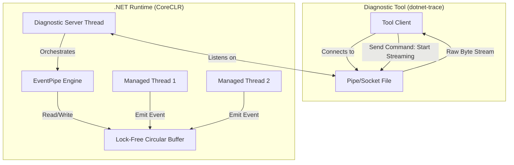

Most developers treat diagnostic tools like dotnet-trace or dotnet-counters as black boxes that just work. You point the tool at a process ID and suddenly you have a stream of GC events and CPU samples. But the magic isn't in the tool itself. It is in a dedicated subsystem inside the .NET runtime called the Diagnostic Server. This server is a background thread that starts up with the CLR and opens a very specific communication channel. On Linux, this is a Unix Domain Socket tucked away in the /tmp directory. On Windows, it is a Named Pipe. This diagnostic pipe is the backbone of the entire modern .NET observability stack. It replaced the old, heavy reliance on Event Tracing for Windows (ETW) and gave us a cross-platform way to peek into the runtime without killing performance.

When you start a .NET app, the runtime creates a socket file. The naming convention is predictable, usually something like dotnet-diagnostic-PID-timestamp-socket. The runtime doesn't just open this for anyone. It has basic file system permission checks. Once a tool like dotnet-trace connects to this socket, it speaks a custom, binary IPC protocol. This isn't some high-level REST API or even gRPC. It's a raw stream of bytes where the first few bytes define the command set and the specific command being requested. There are commands to start an EventPipe session, take a heap snapshot, or even request a core dump. The protocol is designed to be extremely fast because we don't want the act of measuring the system to change the system behavior. This is why the diagnostic server runs on its own thread, separate from the managed code execution threads.

The real workhorse of this system is the EventPipe. If the Diagnostic Pipe is the delivery truck, the EventPipe is the warehouse. The EventPipe engine manages the collection of events from various providers like the GC, the JIT, or even your own EventSource classes. To keep overhead low, the EventPipe uses a lock-free circular buffer for each thread. When a managed thread needs to log an event, it doesn't wait for a global lock. It writes the data into its own thread-local buffer. A separate background thread then periodically sweeps these buffers and aggregates the data into a single stream. This design prevents a massive performance hit when you have hundreds of threads all trying to log telemetry at the same time.

Once the events are aggregated, the Diagnostic Server thread picks them up and pushes them through the IPC pipe to the external tool. The format used here is NetTrace, which is a binary representation of the events. It is essentially a stream of blocks. Each block contains a set of events and the metadata needed to decode them. The metadata is crucial because the tool on the other end needs to know what the fields in a 'GC Start' event actually represent. By sending the metadata along with the data, the runtime ensures that the diagnostic tool doesn't need to be perfectly in sync with the runtime version. This version-agnostic approach is why you can often use a newer version of the SDK tools to profile an older .NET app.

Everything about this architecture screams efficiency. The runtime uses a technique called 'Deferred Serialization' for the events. It doesn't stringify everything immediately. It stores the raw field values in the buffer and only formats them when they are about to be sent over the wire. If no one is listening to the diagnostic pipe, the EventPipe engine is basically dormant. The events are never generated, and the circular buffers aren't even allocated. This 'pay-for-play' model is the reason why .NET apps can keep the diagnostic server running in production environments without a noticeable CPU tax. If you've ever wondered why your APM agent doesn't slow down your site, it's likely because it's piggybacking on these exact same internal structures. The diagnostic pipe is essentially a high-performance backdoor into the runtime's soul, built specifically for the era of sidecar containers and microservices where external observability is not optional.
