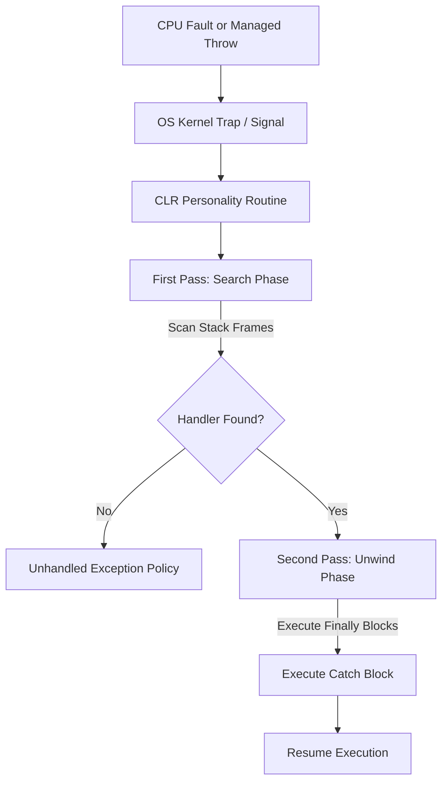

When you write a throw statement in C#, it feels like a simple control flow jump. In reality, you're triggering one of the most complex subsystems in the Common Language Runtime. The CLR doesn't just look for a catch block. It initiates a multi-stage negotiation with the operating system that bridges managed code, native frames, and kernel-level signal handling. Understanding this process is the difference between writing robust code and accidentally swallowing the context you need to debug a production meltdown.

At the heart of this system is the distinction between hardware and software exceptions. Software exceptions are explicit, like when you manually throw a new InvalidOperationException. Hardware exceptions are forced by the CPU, such as a divide-by-zero error or a null reference that triggers a page fault. On Windows, these are unified under Structured Exception Handling, while on Linux, the CLR has to map signals like SIGSEGV or SIGFPE into the managed world. This mapping is handled by the CLR's personality routine, a specialized function that acts as a translator between the OS unwinder and the runtime's internal metadata.

The CLR uses a two-pass unwinding model which is significantly different from how C++ traditionally handles things. This design exists for a specific reason: debugging and diagnostic fidelity. During the first pass, also known as the Search Phase, the runtime walks the stack to find a matching catch block. It checks the type of the exception against the protected regions defined in the method's metadata. If you have an exception filter, using the 'when' keyword in C#, it's executed during this first pass. This is critical because the stack hasn't been unwound yet. The local variables and the state of the application at the point of failure are still intact. If you take a memory dump inside a filter, you're seeing the world exactly as it was when it broke.

Once a handler is identified, the second pass, or the Unwind Phase, begins. This is where the runtime actually changes the instruction pointer. It walks the stack a second time, but this time it's executing finally blocks and fault handlers. It starts from the frame where the exception was thrown and works its way up to the frame containing the catch block. This two-step dance ensures that we don't start tearing down the house until we know someone is there to catch the falling pieces. If no handler is found in the first pass, the runtime can trigger a FailFast or let the debugger attach before any state has been destroyed by finally blocks.

The JIT compiler plays a massive role here by generating GC Info and Unwind Info for every method. This metadata tells the runtime how to 'virtually' unwind a frame. It describes which registers need to be restored and how the stack pointer should be adjusted to reach the parent frame. Without this, the runtime wouldn't know how to step back through the stack, especially in optimized code where the frame pointer might be omitted. The personality routine uses this JIT-generated data to decide if the current frame can handle the exception or if it needs to keep looking higher up.

There's a common misconception about the performance cost of exceptions. The 'cost' isn't just the memory allocation of the exception object. The real overhead comes from the context switches between managed and native code and the intensive stack walking required to find handlers. In the Search Phase, every frame must be decoded using the JIT metadata. In the Unwind Phase, the runtime has to frequently transition back into managed code to execute finally blocks before jumping back into the native unwinder. This is why using exceptions for control flow is a terrible idea. You're essentially asking the OS and the runtime to perform a complex forensic analysis of your stack just to move to the next logic branch.

Preserving the stack trace is another area where things get messy. When you use 'throw e', you're effectively telling the CLR to restart the search phase with a new starting point. This overwrites the original call stack information in the exception object. Using 'throw' on its own tells the runtime to continue the current search while keeping the original site recorded. If you need to capture an exception and re-throw it later, perhaps on a different thread, you use ExceptionDispatchInfo. This helper allows the runtime to stitch together the original stack trace with the new one, providing a 'remote stack trace' marker that indicates the exception crossed a boundary.

Stack unwinding on Linux adds another layer of complexity because there is no native SEH like on Windows. The CLR on Linux relies on the DWARF unwinding format and the libunwind library. The runtime registers its own signal handlers for the entire process. When a SIGSEGV occurs, the CLR intercepts it, checks if the instruction pointer is within managed code, and if so, converts it into a managed NullReferenceException. It then manually initiates the two-pass unwinding by calling into the libunwind APIs, passing its personality routine to guide the process. It is a fragile but impressive bit of engineering that makes C# feel identical across wildly different kernel architectures.
