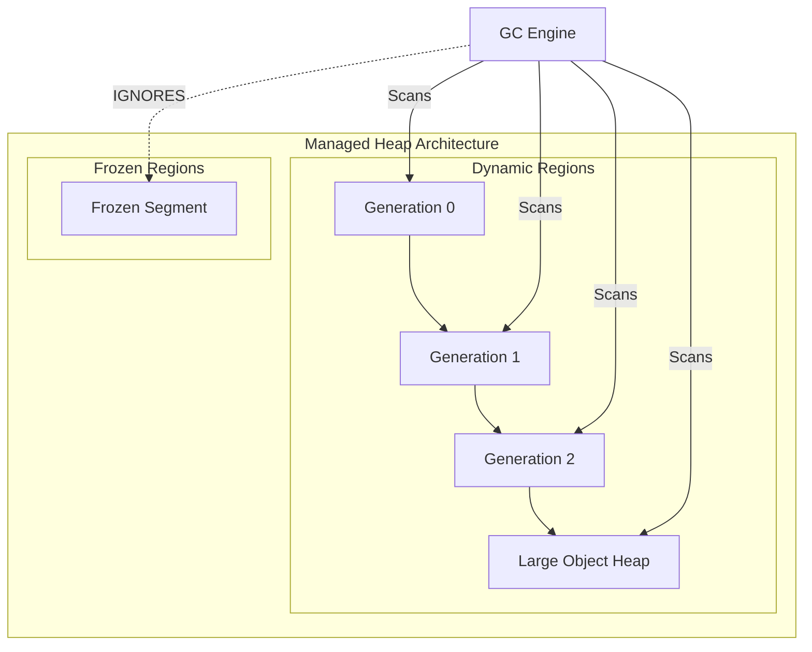
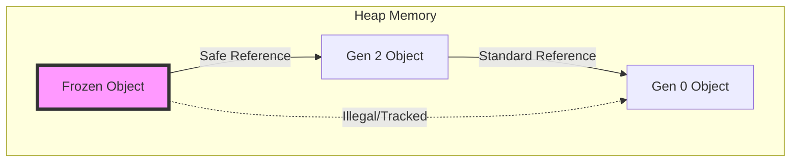

Every time the .NET Garbage Collector performs a full collection, it has to walk through the entire heap to figure out what is still alive. This is generally fine for short lived objects, but it becomes a massive bottleneck when you have millions of objects that are never going to die. I'm talking about things like static string literals, type metadata, and large lookup tables that stay in memory for the entire life of the process. In a traditional heap, these objects eventually migrate to Generation 2. Even though they never change, the GC still spends precious CPU cycles scanning them during every Gen 2 mark phase to see if they still have roots. This is essentially wasted work.

To solve this, the .NET runtime introduced the concept of Frozen Segments. These are special regions of memory where objects are effectively virtualized out of the GC's jurisdiction. When an object is placed in a Frozen Segment, the GC knows that it can never be collected and, more importantly, it can never be moved. This allows the runtime to skip these objects entirely during the marking phase of a garbage collection. It is not just about avoiding collection. It is about avoiding the cost of even looking at the object to see if it should be collected.

The architecture of a Frozen Segment is fundamentally different from a standard generational segment. In a normal segment, the GC tracks pointers and updates them when objects are compacted. In a Frozen Segment, the objects are laid out once and stay there forever. This is particularly powerful for Native AOT scenarios where the compiler can pre compute the layout of static data at build time. Instead of allocating these objects on the managed heap at startup, the runtime can simply map a read only section of the executable directly into a Frozen Segment. This results in nearly zero startup cost for static data and zero overhead during GC cycles.

There is a significant technical hurdle with this approach. We have to consider what happens when a frozen object needs to point to a non frozen object. If a static string in a Frozen Segment is somehow modified or if a static field points to a newly allocated object in Generation 0, the GC needs to know about that reference. If the GC ignores the Frozen Segment, it won't see that reference, and it might accidentally collect the Generation 0 object because it thinks it is unreferenced. This is the classic write barrier problem.

To handle this, the runtime enforces strict rules about what can live in a Frozen Segment. Generally, objects in these segments are meant to be immutable. If an object is truly immutable and only points to other frozen objects, the GC can safely ignore it. However, if the runtime allows frozen objects to point to the dynamic heap, it must use a specialized write barrier. In current implementations, the runtime heavily optimizes for the case where these objects are truly static. This is why you primarily see the runtime using Frozen Segments for things like string literals and certain internal metadata objects that are guaranteed to stay put.

The way the runtime manages these segments involves the FrozenObjectHeapManager. When the runtime identifies a candidate for freezing, it allocates space in a special segment that is marked with a specific flag in the internal heap descriptors. During a GC, the engine checks the segment flags for every memory range it processes. If it hits a range marked as frozen, it simply skips the marking logic for that entire block of memory. This is a massive win for large scale applications with massive caches or complex type systems.

Another interesting aspect is how this interacts with memory protection. Since these segments are intended to be immutable, the runtime can actually mark the underlying memory pages as read only at the OS level using mprotect on Linux or VirtualProtect on Windows. This provides a hard security boundary. If a bug in the runtime or a malicious piece of code tries to overwrite a static string literal, the CPU will trigger a hardware exception instead of allowing the memory corruption. This turns a logical guarantee into a physical one.

You can see the impact of this when profiling applications with high object counts. Applications that rely heavily on Native AOT or those that have been optimized to use internal runtime helpers for string deduplication show significantly lower pause times. This is because the 'live set' that the GC has to track is smaller. It doesn't matter if your app has 10GB of static data. If that data is in Frozen Segments, the GC treats it as if it doesn't exist, focusing its energy only on the high churn objects that actually matter for memory reclamation.
