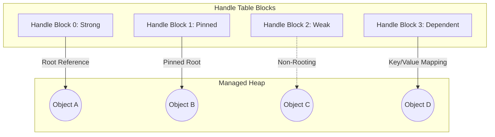
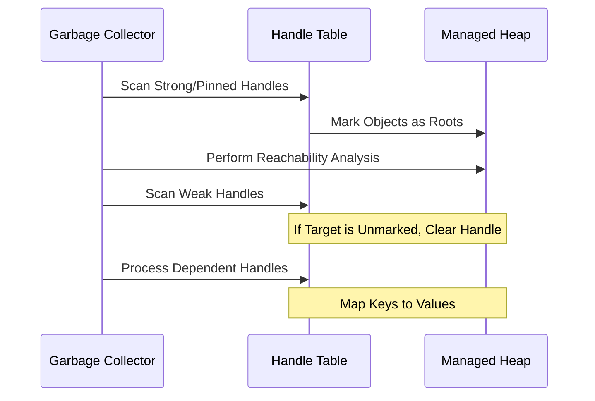

Most developers think of garbage collection roots as just the stack and static fields. That is a massive oversimplification. There is a third, silent category of roots that the runtime manages in a specialized structure called the Handle Table. If you have ever used a WeakReference, pinned a buffer for a P/Invoke call, or leveraged a ConditionalWeakTable, you were interacting with this table. It acts as a bridge between the managed heap and the rest of the world, and it is often the hidden culprit behind performance degradation in high-throughput .NET applications.

The Handle Table is essentially a collection of pointers to managed objects. These pointers are stored in memory that is not managed by the GC itself. During the mark phase of a collection, the GC doesn't just scan the stack. It walks the Handle Table and treats the pointers inside as roots. The catch is that not all handles are equal. Each handle has a type that tells the GC exactly how to treat the object it points to. This determines if the object can be moved, if it can be collected, and when the handle itself should be cleared.

The structure of the table is not just one giant array. To avoid massive lock contention, the table is divided into blocks. Each block is roughly the size of a page and contains slots for handles of a specific type. This partitioning is critical because the GC needs to scan different types of handles at different stages of the collection cycle. For instance, Strong and Pinned handles are scanned early because they represent definite roots. Weak handles are processed later, after the GC has determined which objects are truly unreachable.

Strong handles are the simplest. They act exactly like a local variable or a static field. If a Strong handle points to an object, that object is alive. These are frequently used by the runtime itself to keep internal metadata objects alive across collections. Pinned handles are the more dangerous cousins. Not only do they keep an object alive, but they also forbid the GC from moving it. This is a nightmare for a compacting collector. When the GC tries to slide objects together to eliminate fragmentation, it hits a pinned object and has to stop or work around it. This creates islands of memory that cannot be reclaimed or compacted, leading to heap fragmentation. Modern .NET has mitigated this with the Pinned Object Heap (POH), but the Handle Table still has to manage the entries for those objects.

Weak handles come in two flavors: Short and Long. A Short Weak handle is cleared as soon as the GC discovers the object is no longer reachable through strong paths. A Long Weak handle survives even after the object is collected, remaining valid until the object's finalizer has finished running. This is how the runtime supports the Finalizable state of an object. The GC checks these handles after the initial mark phase. If it finds a Weak handle pointing to an unmarked object, it clears the pointer in the table but doesn't necessarily collect the object if it has a finalizer that needs to run.

Dependent handles are probably the most architecturally interesting part of the system. They are the engine behind the ConditionalWeakTable. A standard dictionary that maps an object to some data would keep that object alive forever because the dictionary holds a strong reference to the key. A Dependent handle solves this by telling the GC that the value is only alive if the key is alive. During the mark phase, if the GC marks the key of a Dependent handle, it must immediately mark the value as well. This requires a specific secondary pass in the GC where it transitively propagates liveness from keys to values. It is a complex dance that prevents memory leaks while still allowing you to attach metadata to objects you do not own.

The performance cost of the Handle Table is mostly felt during the scan phase. Since the table is outside the managed heap, it does not benefit from the same locality as objects. If you have millions of WeakReferences, the GC has to spend a significant amount of time iterating through those blocks and checking the status of each target object. This is why you should be wary of patterns that rely on massive numbers of handles. Each handle is a slot that the GC must touch. If your application creates and destroys thousands of GCHandles per second, you are likely putting more pressure on the runtime's internal lock management for handle blocks than you realize. Understanding that the Handle Table exists helps you realize that memory management in .NET is not just about what is on the heap, but also how you are tracking it from the outside.
