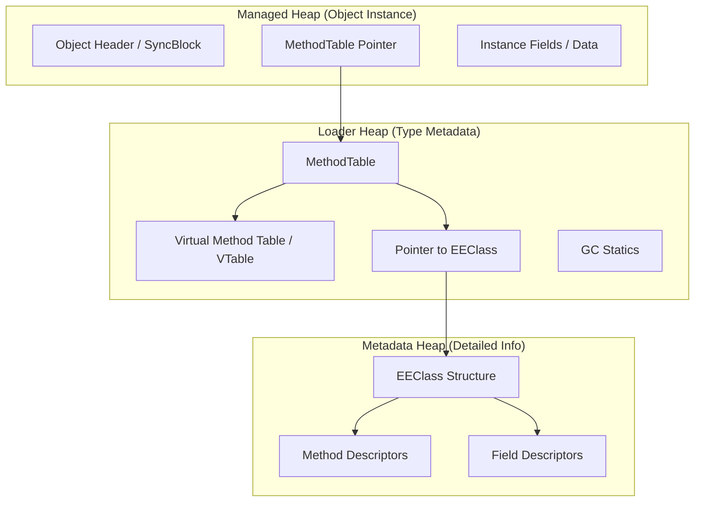

When you instantiate a class in C#, you probably don't think much about the overhead beyond the fields you defined. You allocate a new object, the heap gives you back a pointer, and you move on with your life. But the Common Language Runtime (CLR) is doing a massive amount of bookkeeping behind the scenes to make polymorphism, reflection, and garbage collection actually work. If you want to understand why .NET behaves the way it does at the memory level, you have to look at the relationship between the object instance, its MethodTable, and the deeper EEClass structure.

Every managed object on the heap starts with an object header and a MethodTable pointer. The header is a 4 or 8 byte field that handles the sync block index used for locks and some GC bits. Immediately following that is the MethodTable pointer. This pointer is the identity of the type. It is how the runtime knows that an instance of `Customer` is actually a `Customer` and not a `string`. When you call a virtual method, the CLR doesn't look at your source code. It follows the object's MethodTable pointer to find the jump table for virtual functions.

The MethodTable is designed for speed. It contains the information the runtime needs during hot execution paths. This includes the size of the instance, the vtable for virtual method dispatch, and a pointer to the interface map. If the runtime needs to check if an object implements an interface or call a virtual method, it stays within the MethodTable. This is a deliberate performance optimization. We want the stuff used at runtime to be tightly packed and cache friendly.

Then we have the EEClass. While the MethodTable is for execution, the EEClass is for description. It is a cold data structure that contains the gritty details like field names, method signatures, and other metadata that isn't required for every single method call. There is a one-to-one mapping between a MethodTable and an EEClass for non-generic types, but things get weirder when generics are involved. Because the runtime tries to share code between generic instantiations (like `List<string>` and `List<object>`), multiple MethodTables can actually point back to the same EEClass to save memory.

One of the most interesting parts of the MethodTable is how it handles the object size. The runtime needs to know exactly how many bytes to skip when the Garbage Collector scans the heap. For a regular class, this is a fixed value stored in the MethodTable. For variable-sized objects like arrays or strings, the MethodTable identifies them as such, and the GC looks at a separate field in the object instance to calculate the total length. This is why you can't just resize an array in place. The object layout is baked into the heap and the MethodTable's understanding of that type.

Method descriptors are another layer deep. Each entry in the vtable eventually points to a MethodDesc structure. This is where the JIT compiler lives. The first time a method is called, the MethodDesc contains a slot that points to a bit of stub code. That stub triggers the JIT, compiles the IL into machine code, and then patches the MethodTable or the vtable slot to point directly to the native code. It's a self-modifying system that ensures you only pay for the compilation of the methods you actually execute.

You can see this in action if you use the SOS (Son of Strike) debugger extension in WinDbg or dotnet-dump. Running the `!DumpObj` command on an address will show you the MethodTable address first. From there, `!DumpMT -md` will list every method and its corresponding MethodDesc. It reveals the mechanical reality that your C# classes are just a series of pointers and jump tables organized to balance memory usage against execution speed. The separation of MethodTable and EEClass is a classic example of the hot/cold data split, ensuring that the most frequent operations don't get slowed down by the massive weight of the type's full metadata.
