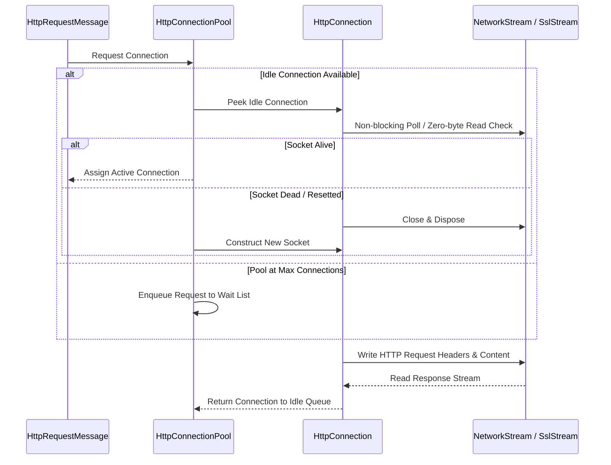

For years, .NET relied on OS-native libraries to drive outgoing HTTP traffic. On Windows, HttpClient called into WinHttp. On Linux and macOS, it wrapped libcurl. This native bridge created unpredictable cross-platform discrepancies. Connection pool settings behaved differently depending on kernel abstractions, socket options were inconsistently applied, and context switching across the P/Invoke boundary introduced latency during heavy async processing.

Starting with .NET Core 2.1, Microsoft replaced those platform wrappers with SocketsHttpHandler. Written entirely in managed C#, SocketsHttpHandler bypasses native OS HTTP stacks by talking directly to platform socket APIs via System.Net.Sockets. It leverages modern C# primitives like Span<T>, Memory<T>, ValueTask, and System.IO.Pipelines to handle high-throughput network I/O with minimal allocations.

Understanding how SocketsHttpHandler functions under high load requires dissecting its core subsystems. The pipeline moves requests from the public HttpClient interface down through connection pool managers, socket connection state engines, and multiplexed protocol frame readers.

```mermaid
graph TD
    A[HttpClient.SendAsync] --> B[SocketsHttpHandler.SendAsync]
    B --> C[HttpConnectionPoolManager]
    C --> D{Get or Create HttpConnectionPool}
    D --> E[Pool Key: Host, Port, Scheme, Proxy, SSL Options]
    E --> F{Protocol Version}
    F -- HTTP/1.1 --G[HttpConnectionPool / Http11Pool]
    F -- HTTP/2 -- H[Http2Connection / Stream Multiplexer]
    G --> I[HttpConnection: Single Request Loop]
    H --> J[Http2Stream 1]
    H --> K[Http2Stream 2]
    H --> L[Http2Stream N]
    I --> M[System.Net.Sockets.Socket / SslStream]
    J --> M
    K --> M
    L --> M
```

## Pool Keying and HttpConnectionPoolManager

Every request processed by SocketsHttpHandler passes into HttpConnectionPoolManager. This manager maintains a thread-safe cache of connection pools keyed by destination parameters. A single HttpConnectionPool cannot be shared across requests that require different transport or security configurations.

The key structure, represented internally by HttpConnectionKey, incorporates several properties beyond host and port. It includes the URI scheme, proxy credentials, custom SSL parameters such as ClientCertificates and RemoteCertificateValidationCallback, and explicit socket configuration flags. If two requests target api.example.com on port 443, but one uses a custom ServerCertificateCustomValidationCallback while the other uses the default validator, they map to two distinct connection pools.

When a request arrives, HttpConnectionPoolManager performs a lookup using a concurrent collection. If a matching pool exists, the request delegates to that pool. If no match is found, a new HttpConnectionPool instance is created, initialized with the key constraints, and registered. This pooling model prevents cross-contamination of security credentials and ensures socket settings remain deterministic across concurrent requests.

## Connection Life Cycle and HTTP/1.1 Queuing

Inside an HTTP/1.1 connection pool, sockets are exclusive resources. An HTTP/1.1 connection handles exactly one active request-response pair at a time. The pool maintains two principal internal queues: an idle connection queue and a waiting request queue.

When SendAsync runs for an HTTP/1.1 target, HttpConnectionPool first attempts to dequeue an available idle HttpConnection. Reusing an idle socket avoids TCP handshakes, TLS negotiation overhead, and OS socket allocation cost. However, idle sockets exposed to the public internet can be closed silently by intermediate firewalls, load balancers, or remote servers.

To prevent assigning a dead socket to a fresh request, SocketsHttpHandler evaluates the socket status before returning it from the pool. It executes a non-blocking poll call on the underlying native handle or checks whether zero-byte read notifications have been signaled. If the socket reports EOF or a reset signal, the pool quietly disposes of the connection and attempts to pull the next available connection from the queue.



If no idle connections exist and the pool has not reached its MaxConnectionsPerServer limit, it instantiates a new HttpConnection. Creating a connection involves creating a Socket, setting TCP socket options like SocketOptionName.NoDelay to suppress Nagle's algorithm, calling Socket.ConnectAsync, and optionally wrapping the stream in an SslStream if TLS is required.

When the active connection count hits MaxConnectionsPerServer, fresh requests cannot spin up new sockets. Instead, the pool enqueues an asynchronous waiter using a task-based completion source. When an active request finishes and returns its connection to the pool, the pool dequeues the top waiter and transfers connection ownership directly to that waiting task without dropping the socket back into the general idle pool.

## HTTP/2 State Engines and Stream Multiplexing

While HTTP/1.1 requires a dedicated connection per concurrent request, HTTP/2 multiplexes hundreds of logical streams over a single TCP connection. In SocketsHttpHandler, this is managed by Http2Connection.

When HttpConnectionPool receives a request configured for HTTP/2, it does not assign exclusive ownership of the socket. Instead, it obtains a reference to an active Http2Connection. The Http2Connection runs a permanent, asynchronous background loop called ReadLoopAsync that owns the read side of the physical socket for its entire lifetime.

```mermaid
graph LR
    SubSocket[Physical Socket / SslStream] --> ReadLoop[Http2Connection.ReadLoopAsync]
    ReadLoop --> FrameParser[Http2FrameReader]
    FrameParser --> Demux{Frame Type}
    Demux -- HEADERS / DATA -- Stream1[Http2Stream ID 1]
    Demux -- HEADERS / DATA -- Stream3[Http2Stream ID 3]
    Demux -- WINDOW_UPDATE -- FlowCtrl[CreditManager / Flow Control]
    Demux -- RST_STREAM -- AbortStream[Complete Stream with Exception]
    Demux -- SETTINGS / PING -- ConnControl[Process Connection State]
```

When a request runs over HTTP/2, Http2Connection assigns it a unique odd-numbered stream ID and registers an Http2Stream state object in a concurrent dictionary keyed by that stream ID. The request thread constructs the HTTP/2 HEADERS frame and optional DATA frames, serializes them using binary frame formats, and writes them directly to the socket write lock queue.

The single background ReadLoopAsync continuously parses incoming bytes using an internal Http2FrameReader. As frames arrive over the wire, ReadLoopAsync inspects the stream ID in the frame header and routes the payload to the corresponding Http2Stream:

If a HEADERS frame arrives, ReadLoopAsync parses the HPACK-compressed header block, materializes the HttpResponseMessage, and completes the TaskCompletionSource associated with that request stream.

If a DATA frame arrives, the payload bytes are written into an internal channel owned by that specific Http2Stream. The application reading the response stream consumes data from this channel asynchronously.

If a WINDOW_UPDATE or RST_STREAM frame arrives, the connection updates its flow control window credits or marks the specific Http2Stream as faulted, unblocking any pending writers without terminating the underlying TCP connection.

This continuous frame demultiplexing eliminates head-of-line blocking at the HTTP layer. A stalled request on stream ID 5 does not block ReadLoopAsync from processing incoming DATA frames for stream ID 7 on the exact same socket.

## Window-Based Flow Control and CreditManager

HTTP/2 requires explicit flow control to prevent a fast sender from swamping a slow receiver. Both the connection as a whole and each individual stream maintain independent sliding receive and send windows.

In SocketsHttpHandler, flow control credit is governed by an internal class named CreditManager. When an application prepares to send a DATA frame, it requests write credits from both the connection-level CreditManager and the stream-level CreditManager.

If sufficient credit exists, the write succeeds, decreasing available credit in both managers. If available credit falls to zero, the write operation pauses asynchronously by awaiting a ValueTask exposed by CreditManager. The task remains uncompleted until the remote server returns a WINDOW_UPDATE frame. When ReadLoopAsync processes that frame, it adds the byte count back into CreditManager, completing the pending task and allowing the writer thread to resume execution.

On the receive path, SocketsHttpHandler automatically calculates consumed buffer sizes. As the user code reads data out of the response stream, the Http2Stream tracks how many bytes were freed from memory. Once consumed bytes cross a predefined threshold, SocketsHttpHandler queues an outbound WINDOW_UPDATE frame back to the server, keeping the throughput pipeline saturated without risking unbounded heap allocations.

## Idle Cleanup and Stale Socket Eviction

To manage memory and prevent stale sockets from consuming kernel resources, SocketsHttpHandler enforces strict life-cycle invariants through timer-based eviction engines.

Two properties control socket longevity: PooledConnectionIdleTimeout and PooledConnectionLifetime. PooledConnectionIdleTimeout defines how long a connection can sit in the idle queue without handling traffic. PooledConnectionLifetime sets a strict upper bound on how long a socket can remain active, regardless of whether it is continuously servicing requests.

An internal timer periodically scans the idle queues inside each HttpConnectionPool. Sockets whose idle timestamp exceeds the timeout threshold are removed from the queue and gracefully shutdown by sending TCP FIN segments.

PooledConnectionLifetime handles connection recycling for load balancing, such as rotating IP addresses behind DNS endpoints. When a connection exceeds its configured lifetime, it is marked as expired. In HTTP/1.1, an expired connection is closed immediately upon completing its active request rather than returning to the idle queue. In HTTP/2, an expired connection initiates a graceful GOAWAY handshake with the server, allowing existing active streams to finish while forcing new requests to establish a fresh TCP connection to a newly resolved IP address.

By building this connection management, protocol parsing, and stream multiplexing directly in C#, .NET provides a predictable, high-performance HTTP stack. Removing platform-specific native wrappers yields consistent behavior across environments and gives developers fine-grained control over execution mechanics.
