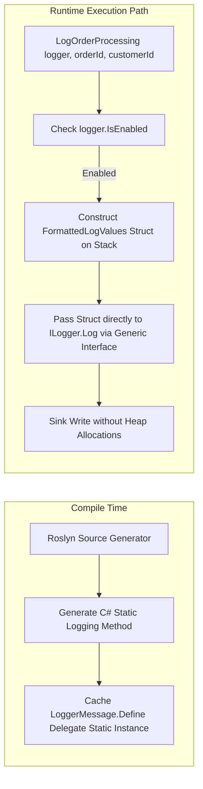

Logging is usually treated as an afterthought until high-throughput backend services hit GC pause spikes under heavy load. Every time your system logs an informational event like `logger.LogInformation($"Order {orderId} processed in {elapsedMs}ms")`, standard C# runtime mechanisms allocate memory behind your back. Traditional string interpolation converts that statement into a `string.Format` call or an `object[]` array allocation, while boxing value types like integers and GUIDs onto the managed heap. When processing hundreds of thousands of requests per second, those micro-allocations accumulate into tens of gigabytes of heap garbage per minute, triggering frequent Garbage Collector collections.

Modern .NET completely changes this equation. Through a combination of C# 10 custom interpolated string handlers and Roslyn-driven `[LoggerMessage]` source generators, Microsoft built a zero-allocation logging pipeline. Understanding how these mechanics operate at the compiler and runtime levels reveals how memory allocation can be completely eliminated from your critical telemetry paths.

### The Hidden Allocation Cost of Classical Logging

Before inspecting modern optimizations, we need to analyze why naive string interpolation destroys memory efficiency. Consider a standard logging call:

```csharp
logger.LogInformation($"Processing order {orderId} for customer {customerId} with amount {amount}");
```

Prior to C# 10, the compiler lowered string interpolation into `string.Format`. The runtime had to construct a format string, construct an `object[]` array to hold the parameters, and box any value types like `orderId` (an integer) or `amount` (a decimal) so they could fit into the reference-type array.

Even if you rewrote the log statement to use structured template placeholders like `logger.LogInformation("Processing order {OrderId} for customer {CustomerId} with amount {Amount}", orderId, customerId, amount)`, standard overload resolution called `ILogger.LogInformation(string message, params object[] args)`. The `params` keyword automatically allocated an `object[]` array on every single execution. Values were boxed into heap-allocated `object` references before being passed into the logging provider.

Worst of all, those allocations occurred even if the target log level was disabled. If your application log level was set to `LogLevel.Warning`, calling `logger.LogDebug(...)` with string interpolation still executed the string formatting, created the arrays, boxed the values, and built the string in memory, only for the logger implementation to inspect `IsEnabled(LogLevel.Debug)` and discard the formatted string immediately.

### C# 10 Custom Interpolated String Handlers and Guarded Execution

C# 10 introduced custom interpolated string handlers, allowing framework authors to hook directly into the compiler's code generation for interpolated strings. `Microsoft.Extensions.Logging` leverages this via `DefaultInterpolatedStringHandler` and specialized logging handlers like `LoggerMessageInterpolatedStringHandler`.

When a method accepts an argument marked with `[InterpolatedStringHandlerArgument]`, the compiler does not call `string.Format`. Instead, it allocates a stack-based `ref struct` handler and lowers the interpolated string into a series of strongly-typed `AppendLiteral` and `AppendFormatted` method calls.

```mermaid
graph TD
    A[Code: logger.LogDebug $"User {userId}"] --> B[Compiler checks IsEnabled Debug]
    B -- Log Level Disabled --> C[Handler constructor sets shouldAppend = false]
    C --> D[Skip all AppendLiteral & AppendFormatted calls]
    D --> E[Zero Allocations & Zero Format Overhead]
    B -- Log Level Enabled --> F[Handler constructor sets shouldAppend = true]
    F --> G[Execute AppendLiteral and AppendFormatted on Stack Ref Struct]
    G --> H[Pass Formatted Log State to Logger Provider]
```

The lowered code generated by the C# compiler looks conceptually like this:

```csharp
bool isEnabled;
var handler = new LoggerMessageInterpolatedStringHandler(
    literalLength: 17, 
    formattedCount: 1, 
    logger: logger, 
    logLevel: LogLevel.Debug, 
    out isEnabled
);

if (isEnabled)
{
    handler.AppendLiteral("Processing order ");
    handler.AppendFormatted(orderId);
    logger.LogDebug(ref handler);
}
```

Notice the critical parameter `out isEnabled`. The handler's constructor receives the `logger` and the active `LogLevel`. It immediately executes `logger.IsEnabled(LogLevel.Debug)`. If the log level is disabled, `isEnabled` is set to `false`. The C# compiler wraps all subsequent `AppendLiteral` and `AppendFormatted` calls inside an `if (isEnabled)` conditional block.

When logging is turned off for that level, not a single formatting method runs. Arguments are not evaluated, strings are not concatenated, and value types are not boxed. Because `LoggerMessageInterpolatedStringHandler` is a `ref struct`, it lives entirely on the thread stack and leaves zero footprint on the managed heap.

### The Ultimate Zero-Allocation Pattern: LoggerMessage Source Generators

While interpolated string handlers eliminate allocations for disabled log levels, emitting an enabled log using interpolated strings still requires constructing a final formatted string or parsing template parameters at runtime. To achieve pure zero-allocation logging even when log statements are enabled, .NET provides the `[LoggerMessage]` source generator.

Introduced in .NET 6, the `[LoggerMessage]` attribute instructs the Roslyn compiler to generate strongly-typed static logging methods at compile time.

```csharp
public static partial class LogMessages
{
    [LoggerMessage(
        EventId = 1001,
        Level = LogLevel.Information,
        Message = "Processing order {OrderId} for customer {CustomerId}")]
    public static partial void LogOrderProcessing(
        this ILogger logger, 
        int orderId, 
        Guid customerId);
}
```

Roslyn analyzes this partial method definition and generates the implementation under the hood during compilation. The generated code bypasses dynamic template parsing, bypasses `params object[]` array creation, and completely avoids boxing value types.



### Deconstructing the Generated Source Code

To understand why this is so fast, we need to dissect what Roslyn outputs into your build artifacts. The generated partial method uses internal helper types designed specifically for memory efficiency:

```csharp
public static partial class LogMessages
{
    private static readonly Action<ILogger, int, Guid, Exception?> s_LogOrderProcessing =
        LoggerMessage.Define<int, Guid>(
            LogLevel.Information,
            new EventId(1001, nameof(LogOrderProcessing)),
            "Processing order {OrderId} for customer {CustomerId}");

    public static partial void LogOrderProcessing(
        this ILogger logger, 
        int orderId, 
        Guid customerId)
    {
        if (logger.IsEnabled(LogLevel.Information))
        {
            s_LogOrderProcessing(logger, orderId, customerId, null);
        }
    }
}
```

The source generator creates a static, read-only `Action<ILogger, T1, T2, Exception?>` delegate instance during class initialization. The string template `"Processing order {OrderId} for customer {CustomerId}"` is parsed exactly once when the application boots, rather than being parsed every time the log statement executes.

Inside `LoggerMessage.Define<T1, T2>`, the runtime constructs an optimized state object called `FormattedLogValues<T1, T2>`. This struct implements `IReadOnlyList<KeyValuePair<string, object?>>`.

Crucially, `FormattedLogValues` is a generic struct. It stores `orderId` and `customerId` in strongly-typed, unboxed fields:

```csharp
internal readonly struct FormattedLogValues<T1, T2> : IReadOnlyList<KeyValuePair<string, object?>>
{
    private readonly T1 _value1;
    private readonly T2 _value2;
    private readonly string _template;

    public FormattedLogValues(string template, T1 value1, T2 value2)
    {
        _template = template;
        _value1 = value1;
        _value2 = value2;
    }

    public KeyValuePair<string, object?> this[int index] => index switch
    {
        0 => new KeyValuePair<string, object?>("OrderId", _value1),
        1 => new KeyValuePair<string, object?>("CustomerId", _value2),
        2 => new KeyValuePair<string, object?>("{OriginalFormat}", _template),
        _ => throw new IndexOutOfRangeException()
    };

    public int Count => 3;
}
```

When `ILogger.Log` is called, `FormattedLogValues` is passed as a generic `TState` parameter. In .NET, generic methods instantiated with value types generate specialized machine code. The stack-allocated struct is passed by reference directly down the logging pipeline into sinks like Console, OpenTelemetry, or Serilog.

Boxing only occurs if an external logging provider explicitly casts the struct values to `object`. If you are using high-performance telemetry sinks like OpenTelemetry .NET SDK or native JSON loggers that inspect structural values directly through generic visitor patterns, zero heap allocations take place across the entire call stack.

### Comparative Allocation Mechanics

To illustrate the performance divergence, consider four distinct logging techniques running 100,000 iterations under an enabled log level:

Standard string interpolation with `LogInformation($"...")` generates roughly 4.8 megabytes of heap allocations due to string formatting and parameter array creation.

Structured logging with `params object[]` arguments generates roughly 2.4 megabytes of heap allocations, caused entirely by `object[]` array creation and boxing integer and Guid parameters.

Interpolated string handlers with `LoggerMessageInterpolatedStringHandler` reduces allocations down to the single final formatted string instance, generating approximately 1.2 megabytes of heap memory.

Roslyn `[LoggerMessage]` source generators generate exactly 0 bytes of heap memory. The execution time drops by over 80 percent compared to naive string interpolation because the runtime spends zero cycles in memory allocation or Garbage Collector collection routines.

### Best Practices for High-Performance Telemetry

To keep your application's hot paths entirely allocation-free, adopt `[LoggerMessage]` source generators for all high-frequency log messages. Reserve string interpolation for application startup paths or low-throughput exception handlers where microsecond latency and GC pressure are not constraints.

Define your log methods as `static partial` extension methods on structured log class files. Grouping log events by domain context keeps code clean while making it impossible for developers to accidentally regress log performance via unoptimized string concatenation.
