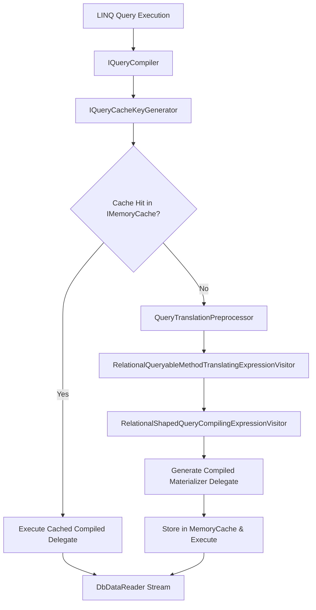
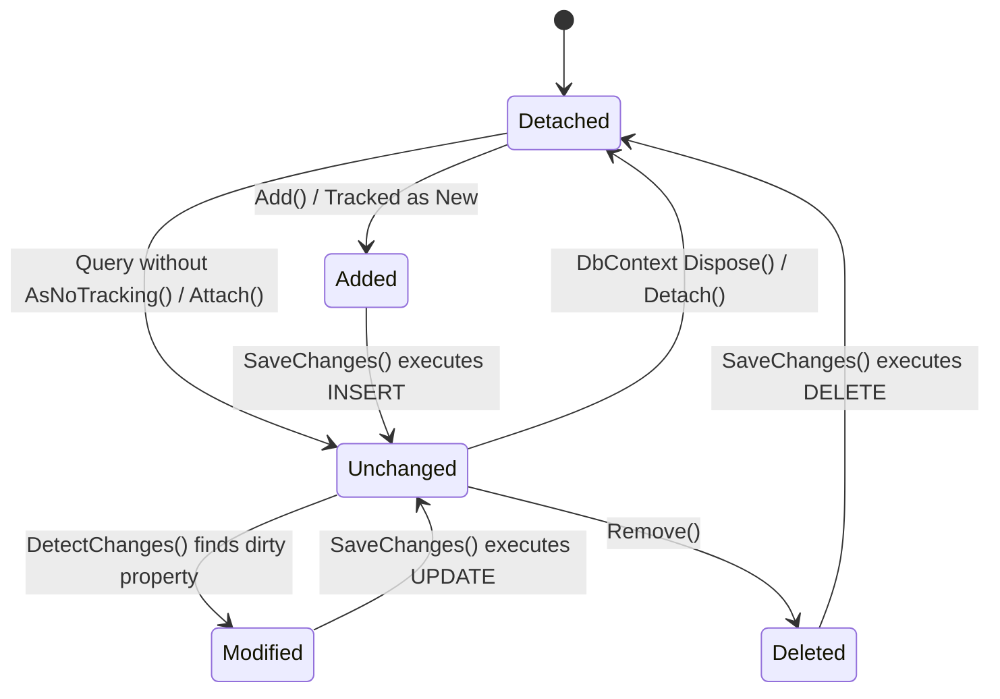

Most developers interact with Entity Framework Core through simple LINQ expressions and quick calls to SaveChanges. Underneath that developer-friendly API sits a sophisticated compiler and state tracking engine. EF Core does not just parse your C# code at runtime with reflection. It accepts abstract syntax trees from C# expressions, decomposes them through multiple visitor passes, optimizes them against a compiled relational model, generates native SQL ASTs, and emits dynamic C# delegates to materialize raw database readers directly into managed objects.

Understanding this pipeline is what separates engineers who struggle with unexpected N+1 queries or memory spikes from those who write high-throughput persistence layers.

### The LINQ Expression Pipeline and Query Compilation Cache

When you execute a LINQ query against a DbSet, you are constructing an IQueryable backed by an EntityQueryProvider. The LINQ expression is not evaluated immediately. Instead, the expression tree sits dormant until an enumerator requests the first result. At that moment, EF Core hands the expression tree to the IQueryCompiler.

Parsing an expression tree on every invocation would cause severe performance degradation. EF Core uses a two-stage compilation pipeline backed by an IMemoryCache instance. Before doing any compilation, EF Core must create a unique cache key for the query. The IQueryCacheKeyGenerator evaluates the expression tree and extracts parameters. Constants inside the expression that represent query parameters are evaluated and lifted out of the tree. This process replaces literal values with parameter placeholders so that queries differing only by parameter values hit the same compiled query cache entry.



If the query is not in the cache, the full compilation pipeline kicks off. The QueryTranslationPreprocessor cleans up the expression tree. It processes client-side evaluations, simplifies redundant logic, and rewrites LINQ methods like Where, Select, and Join into normalized internal representation structures.

Next, the RelationalQueryableMethodTranslatingExpressionVisitor takes over. This component translates high-level C# expressions into relational domain concepts. It maps C# types to database types, methods like string.Contains to database functions like LIKE, and navigation properties into relational JOIN expressions.

### Relational AST Compilation and Materializer Delegate Generation

The translation pass produces a SelectExpression, which is a specialized expression tree node representing an abstract SQL SELECT statement. The SelectExpression holds structural trees for projection columns, table sources, JOIN clauses, predicate trees for WHERE clauses, grouping terms, and sorting expressions.

Once the SelectExpression tree is built, EF Core runs relational optimization passes. The query optimizer reorders JOINs, eliminates redundant subqueries, pushes down predicates where possible, and resolves shadow properties. The finalized SelectExpression is passed to the QuerySqlGeneratorFactory, which constructs a QuerySqlGenerator. This visitor walks the relational AST and appends SQL text to a string builder, generating parameterized SQL alongside the corresponding DbParameter bindings.

```
+-----------------------------------------------------------------------+
|                         LINQ Expression AST                           |
|  .Where(u => u.IsActive && u.Orders.Any(o => o.Total > 100))          |
+-----------------------------------------------------------------------+
                                   |
                                   v
+-----------------------------------------------------------------------+
|                      Relational SelectExpression                      |
|  Tables: [Users AS u]                                                 |
|  Joins:  [EXISTS (SELECT 1 FROM Orders AS o WHERE o.UserId = u.Id)]   |
|  Where:  [u.IsActive = TRUE]                                          |
+-----------------------------------------------------------------------+
                                   |
                                   v
+-----------------------------------------------------------------------+
|                      QuerySqlGenerator Engine                         |
|  SELECT u."Id", u."Email" FROM "Users" AS u                           |
|  WHERE u."IsActive" = TRUE AND EXISTS (                               |
|      SELECT 1 FROM "Orders" AS o                                      |
|      WHERE o."UserId" = u."Id" AND o."Total" > @p0)                   |
+-----------------------------------------------------------------------+
```

The second half of compilation handles object materialization. Historically, object mappers used reflection to assign properties on newly instantiated objects, which choked throughput. EF Core generates dynamic code for materialization. The RelationalShapedQueryCompilingExpressionVisitor builds an expression tree that reads primitive values directly from an active DbDataReader by ordinal index, handles nullability checks, converts database column types to target properties, and calls constructors.

EF Core compiles this expression tree into a strongly typed delegate. When executing a cached query, EF Core skips the visitor transformations and SQL generation entirely. It fetches the cached SQL string and compiled materializer delegate, binds current runtime parameter values, sends the SQL to the database driver over the wire, and feeds the DbDataReader directly into the compiled delegate.

### The Change Tracker State Machine and Entity Graph Snapshotting

When queries run without AsNoTracking(), materialized entities are attached to the DbContext through the StateManager. The StateManager tracks entities using InternalEntityEntry wrapper objects. These wrappers track current property values, original property values, shadow property storage, and the entity state within an internal lookup table.

An entity tracked by EF Core transitions across five primary states: Detached, Unchanged, Modified, Added, and Deleted. Understanding state mechanics requires looking at how EF Core detects property changes.

By default, EF Core uses snapshot change tracking. When an entity is materialized from the reader, EF Core clones its property values into an array stored inside the InternalEntityEntry. This snapshot represents the baseline state. When you call SaveChanges() or trigger an operation that requires state synchronization, EF Core invokes ChangeTracker.DetectChanges().

During DetectChanges(), EF Core loops through every tracked InternalEntityEntry, compares the current property value on the object instance against the saved value in the baseline snapshot, and flags dirty properties. If a property value differs, the entry state transitions from Unchanged to Modified, and a bitmask corresponding to modified property indices is updated.



Snapshot tracking creates overhead proportional to the number of tracked entities because DetectChanges() must inspect every property across the entire tracking graph. For performance-critical contexts, entities can implement INotifyPropertyChanged and INotifyPropertyChanging. When these interfaces are implemented and configured, EF Core hooks into entity property setter events. The InternalEntityEntry marks properties dirty instantaneously as changes occur, bypassing the full snapshot scan entirely.

### Topological Dependency Sorting and SaveChanges Batching

Once changes are identified, calling SaveChanges() transitions EF Core into command execution. The StateManager must convert entity state modifications into ordered database commands. This step is fraught with potential execution errors, especially when foreign key relationships exist between entities created or deleted in the same transaction.

EF Core constructs a topological dependency graph of entities using the Multigraph data structure. Entities marked as Added or Deleted are nodes in this graph, while foreign key relationships define directed edges. For insertions, parent entities must be inserted before child entities so generated primary keys can be populated into child foreign key properties. For deletions, child entities must be deleted before parent entities to avoid foreign key constraint violations.

EF Core runs Tarjan's strongly connected components algorithm or a depth-first topological sort over the dependency graph. If a cyclic dependency exists, such as a User referencing a primary Account, and the Account referencing a primary User, EF Core breaks the cycle by splitting operations. It generates an initial INSERT with a null foreign key, executes the child INSERT, and follows up with an UPDATE to set the foreign key constraint.

```
    Dependency Ordering Graph (Topological Sort)

         [ Parent Entity: Customer (Added) ]
                         |
                         | (Generates Id via Database / Sequence)
                         v
          [ Child Entity: Order (Added) ]
                         |
                         v
     [ Grandchild Entity: OrderLine (Added) ]

   Execution Sequence:
   1. INSERT INTO Customers ... RETURNING Id;
   2. Fixup Foreign Keys on Order entries with generated Customer.Id
   3. INSERT INTO Orders ... RETURNING Id;
   4. Fixup Foreign Keys on OrderLine entries with generated Order.Id
   5. INSERT INTO OrderLines ...
```

After determining the execution sequence, EF Core passes the operations to the ICommandBuffer and IModificationCommandBatchFactory. Rather than executing individual SqlCommand statements in serial network round-trips, EF Core batches commands into combined SQL payloads.

The batching engine respects database provider limits, such as parameter count limits or maximum statement lengths. For instance, the SQL Server provider combines multiple INSERT, UPDATE, and DELETE commands into a single SQL batch separated by semicolons, retrieving generated auto-increment keys using OUTPUT clauses or SCOPE_IDENTITY(). A single network payload carries the batch to the database, where it executes inside an explicit transaction managed by the IRelationalConnection.

Upon successful execution, the StateManager processes the batch results. Auto-generated primary key values are assigned to entity instances, original value snapshots are updated to match current values, and entity states transition to Unchanged. Deleted entries transition to Detached and are removed from the StateManager lookup map.
