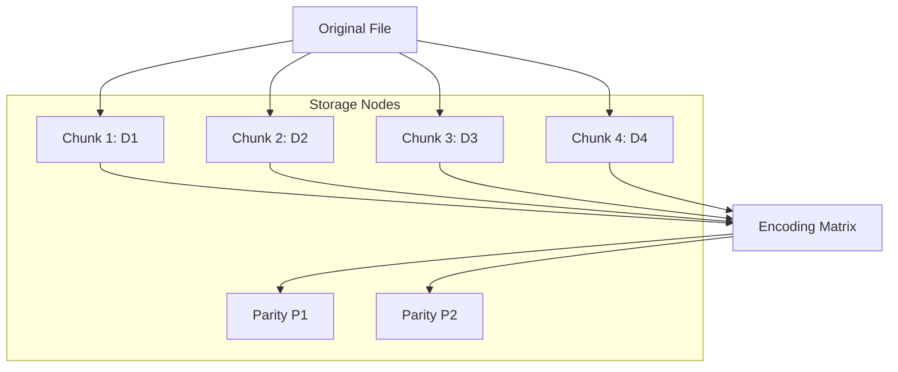
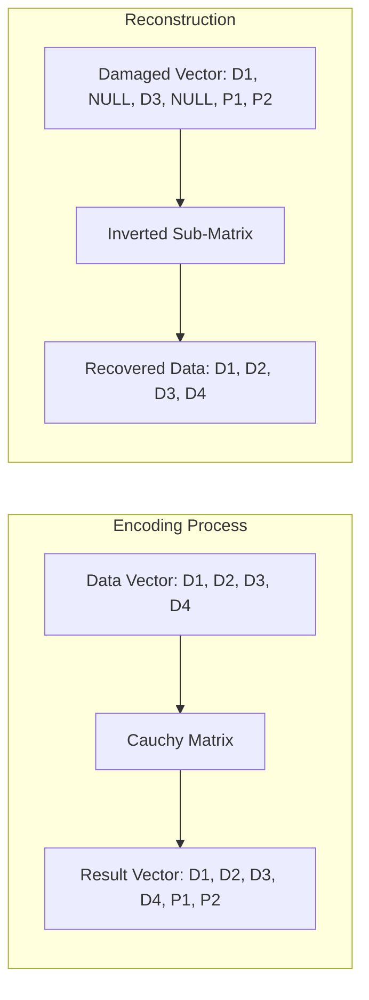

If you are running a massive object store, replication is your worst enemy. Storing three copies of every byte just to survive two disk failures is a 200 percent storage tax that burns through hardware budgets. This is why distributed systems like MinIO, Ceph, and S3 do not just copy data. They use Erasure Coding. It sounds like magic. You take four blocks of data, generate two blocks of parity, and now you can lose any two of those six blocks and still get your files back. The math behind this is not just simple addition. It is a specific flavor of linear algebra called Reed-Solomon coding that operates over finite fields.

At the most basic level, Erasure Coding (EC) splits a file into k data chunks and computes m parity chunks. The total number of chunks n is k plus m. The system can tolerate the loss of any m chunks. If you have a 4+2 configuration, you can lose any two disks and still reconstruct the original data. This is significantly more efficient than RAID 10. While RAID 10 requires 100 percent overhead to survive a single failure in a mirror, a 4+2 EC setup only requires 50 percent overhead to survive two failures. The trade-off is the massive increase in CPU cycles needed to calculate those parity blocks and the latency involved in a degraded read when a disk actually dies.

Standard arithmetic does not work for this. If you just add bytes together to create parity, you will quickly overflow the 8 bit or 16 bit boundaries of your data types. We need a system where addition, subtraction, multiplication, and division always result in a value within the same range. This is where Galois Fields, specifically GF(2^w), come in. In these fields, addition and subtraction are replaced by the XOR operation. This is incredibly fast for CPUs because it does not involve carries. Multiplication is more complex and usually involves looking up values in pre-computed tables or using carry-less multiplication instructions like PCLMULQDQ on modern x86 chips.

To generate the parity blocks, we use an encoding matrix. We treat our data blocks as a vector and multiply them by this matrix. The matrix is designed so that any sub-matrix formed by picking k rows is invertible. This is the crucial property. If you lose two chunks, you are essentially looking at a system of linear equations where two variables are missing. As long as the matrix remains invertible, you can solve for the missing data. Most implementations use a Vandermonde matrix or a Cauchy matrix for this purpose. Cauchy matrices are generally preferred because they are guaranteed to have every sub-matrix be invertible over a finite field, which avoids the nasty edge cases where a Vandermonde matrix might fail to provide a solution.

When a read request comes in and a disk is missing, the system enters a degraded read state. It fetches the remaining k chunks, which might include parity blocks if some data blocks are missing. It then constructs a new matrix by taking the rows of the original encoding matrix that correspond to the chunks we still have. By inverting this new matrix and multiplying it by the surviving chunks, the CPU can mathematically derive the missing bytes. This is why your CPU spikes when a node goes down in a storage cluster. The system is no longer just moving bytes from disk to network. It is performing matrix inversions and multiplications for every single block of data being served.

The performance of Erasure Coding depends heavily on the word size w. Most systems use GF(2^8) because it fits perfectly into a byte. However, this limits you to a total of 255 chunks in a single stripe. Larger clusters might use GF(2^16), but the multiplication tables for that field are too large to fit in a CPU cache, which slows down the encoding process. High-performance implementations like those in the Linux kernel or ISA-L use SIMD instructions to process multiple data streams in parallel. They treat the multiplication as a series of XOR operations on shifted bit patterns, which bypasses the need for massive lookup tables and lets the hardware scream through parity calculations.

Choosing the right k and m values is a balancing act between durability and performance. A high k value reduces the storage overhead but increases the blast radius of a single failure because more nodes are involved in every read and write. It also makes recovery much slower because you have to gather more pieces from across the network to reconstruct a single missing block. Most production environments land on something like 12+4 or 8+2, which provides a sweet spot where you can lose multiple racks of gear without losing data while keeping the computational overhead manageable for the storage controllers.
