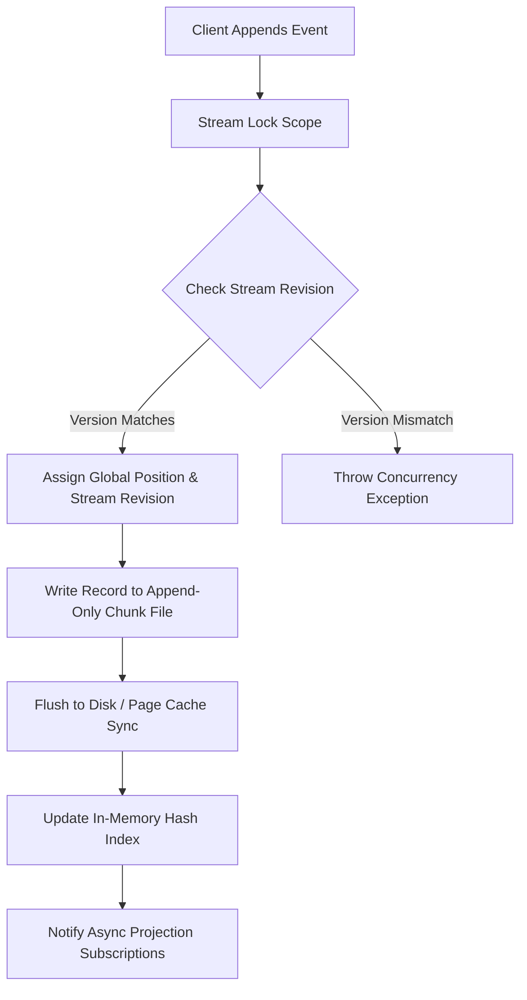
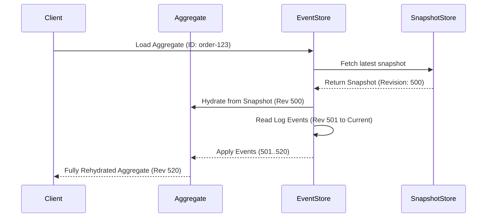

## The Anatomy of an Append-Only Event Store

When building standard relational or document systems, state mutation overwrites existing records in place. Event store engines take the opposite approach by modeling reality as an immutable sequence of facts appended strictly to the end of a log. Every domain change is captured as an event structure containing a unique global sequence position, a stream identifier, a stream-specific revision number, a payload blob, and arbitrary metadata.

Writing to an event store requires sequential disk append performance, which avoids random write penalties and eliminates expensive in-place page splits. The physical layout on disk typically splits into two primary structures, namely the physical event log and stream index files. The physical log holds contiguous binary records, where each record begins with a fixed-length header encoding magic bytes, record length, global transaction ID, stream ID hash, CRC32 checksum, and timestamp, followed by payload and metadata byte arrays.



## Stream Versioning and Optimistic Concurrency Control

Because event sourcing relies on mutating state in memory by replaying past events and asserting new domain facts, concurrent writes to the same aggregate root present severe data integrity risks. Event stores enforce state consistency through stream revision validation rather than locking database rows for extended durations. When a client reads an aggregate stream, it records the current revision number. When appending new events generated by that aggregate, the client submits the append command along with the expected stream revision.

The engine executes this write within an isolated lock scope tied to the specific stream identifier. It inspects the highest current stream version in the index. If the expected version is specified as exact, the append proceeds only if the index revision matches the expected revision precisely. If another concurrent thread wrote an event to that stream in the intervening milliseconds, the highest revision will have advanced. The engine immediately rejects the transaction with a concurrency conflict exception, forcing the caller to reload the aggregate, reapply uncommitted domain logic on top of newly appended events, and retry the write.

```
+-----------------------------------------------------------------------------------+
| Record Layout on Disk                                                             |
+-------------------+-------------------+--------------------+----------------------+
| Magic (4B)        | Record Len (4B)   | Global Pos (8B)    | Stream ID Len (2B)   |
+-------------------+-------------------+--------------------+----------------------+
| Stream ID (Var)   | Stream Rev (8B)   | Metadata Len (4B)  | Payload Len (4B)     |
+-------------------+-------------------+--------------------+----------------------+
| Metadata (Var)    | Payload (Var)     | CRC32 (4B)         | Padding              |
+-------------------+-------------------+--------------------+----------------------+
```

## Snapshot Mechanics and Storage Compactness

As an aggregate stream grows to thousands of events, replaying the full history from revision zero every time an aggregate is loaded into memory becomes a major CPU and I/O bottleneck. Snapshot engines mitigate this by periodically serializing the in-memory state of an aggregate root at a specific stream revision and persisting it in a dedicated snapshot store.

When loading an aggregate, the event store queries the snapshot index for the latest snapshot associated with the target stream. If a snapshot exists at revision 500, the store reads the snapshot record, inflates the aggregate state directly to revision 500 in a single operation, and then reads only the events from revision 501 onward from the primary event log. Snapshots act as a pure read optimization and never alter or truncate the underlying event stream itself. The immutable historical stream remains fully preserved, allowing historical auditability and temporal debugging to remain intact while keeping runtime rehydrations fast.



## Asynchronous Projection Pipeline and Read Model Indexing

Command handlers write immutable events into append-only logs, but user interfaces and search queries require structured read models optimized for fast lookup, such as relational tables, document stores, or search indexes. Event stores bridge this gap using an asynchronous projection pipeline, often implemented via catch-up subscriptions and persistent checkpoint tracking.

The projection engine tails the event store from a global sequence position using a continuous streaming subscription. As new events append to disk, the log stream dispatcher broadcasts serialized events to running background projection workers. Each projection worker processes events sequentially, mapping event payloads into optimized read model tables in a separate database system. To guarantee fault tolerance, the worker maintains a projection checkpoint table that stores its last successfully processed global sequence position inside a database transaction alongside the read model write. If a projection worker crashes or undergoes a restart, it queries its checkpoint table, reads its last processed global position, and requests the event stream from that exact position forward.

Idempotency plays a critical role here. Because network delays or unexpected node failures might cause an event batch to be delivered more than once, projection logic must either execute idempotent database operations like UPSERTs or leverage the global event position as a deduplication token. By decoupling write-side aggregate state persistence from read-side materialization, the overall system scales write operations without slowing down under complex relational queries.
