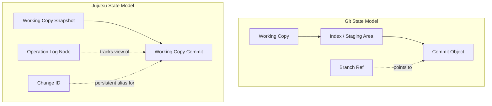
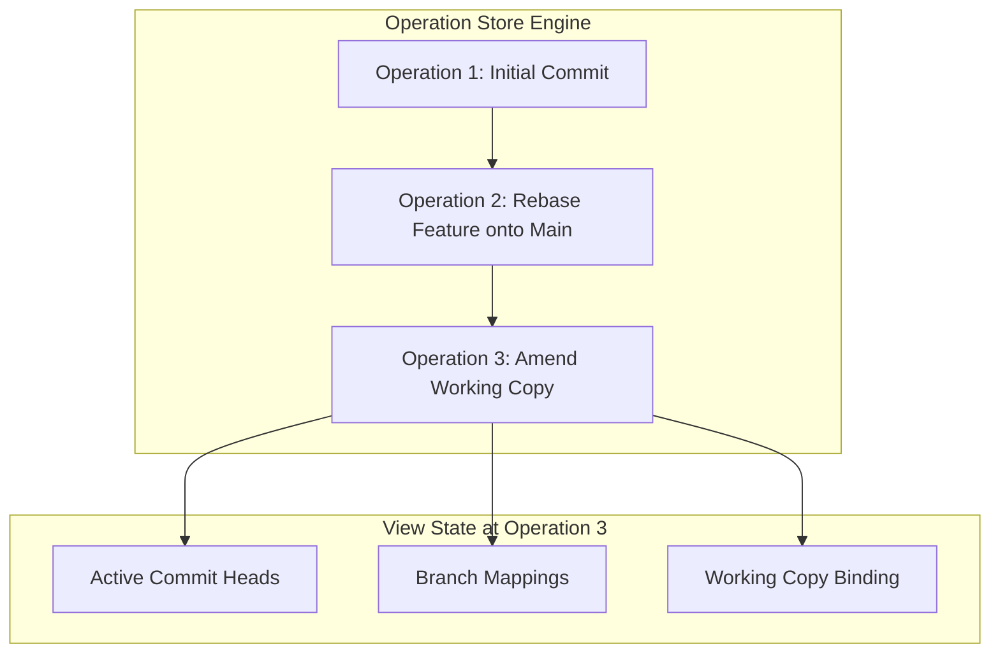
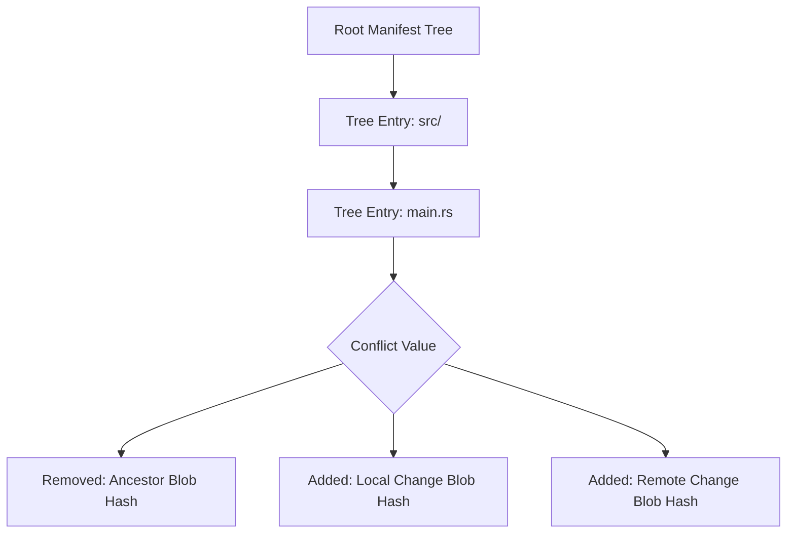
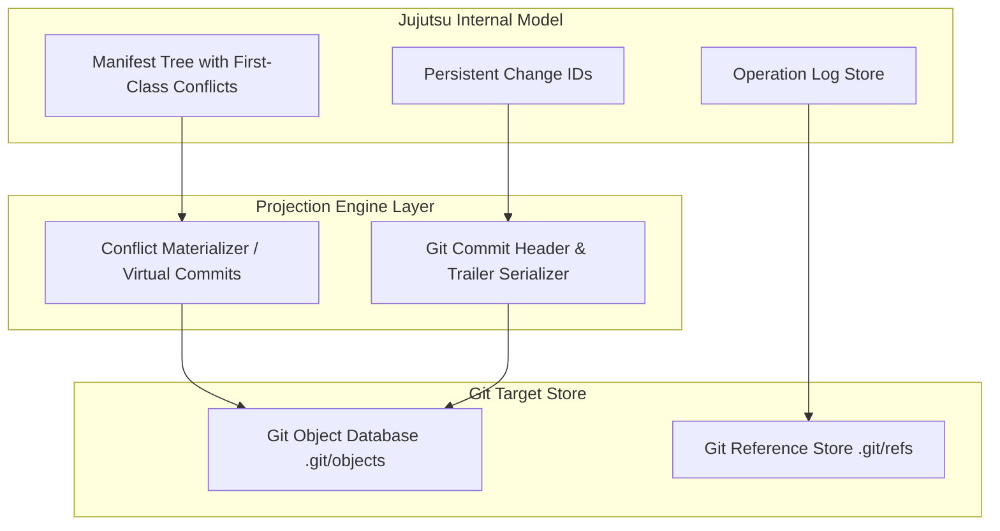

## The Failure Modes of Ref-Centric Version Control

Git models history as a directed acyclic graph of commits, but its interaction surface relies entirely on mutable reference files pointing to commit hashes. When you run commands in Git, you mutate references like HEAD or branch tips while manipulating a staging index that acts as an intermediate buffer between your file system and object database. This state model breaks down when operations fail mid-flight. Merging two branches with conflicting changes halts execution, alters the working directory with text markers, leaves the index in a partially resolved state across three staging slots, and blocks you from executing other operations until the conflict is manually resolved or aborted.

Jujutsu alters this baseline by eliminating the staging area, making every working copy modification an implicit commit, and modeling repository states through an immutable operation log. Instead of halting execution on structural or file conflicts, Jujutsu stores conflicts as valid, first-class mathematical entities directly within tree objects. You can commit, rebase, and branch off conflicting states without fixing them immediately, moving version control from a sequential procedural tool into a declarative graph engine.



## Operation Logs and Immutable Repository States

At the foundation of Jujutsu is the operation store located inside the repository database directory. Traditional version control systems store commit objects and update plain text ref files to point to new hashes. Reflogs exist as local append-only journals of where refs used to point, but they lack structural metadata about the exact operation that performed the change. Jujutsu replaces raw ref manipulation with an operation log graph.

Every user invocation that mutates the repository, whether modifying a file, running a rebase, splitting a change, or pulling from a remote, creates a new immutable Operation object. Each Operation contains a list of parent operation IDs, metadata detailing the command string and execution timestamp, and a hash pointing to a View object. The View represents the complete state of the repository at that precise moment. It contains sets of commit IDs representing active branch heads, public published commit IDs, local and remote branch mappings, and local working copy commit bindings.



Because every operation creates a node in the operation log, undoing changes becomes trivial. Reverting an operation does not require complex reset commands or reflog hunting. The engine reads the parent operation ID, loads its associated View object, and updates the repository pointer to that prior View. If concurrent processes alter the repository, Jujutsu merges operation log branches using three-way operational merges, keeping the execution state completely deterministic.

## First-Class Conflicts in the Manifest Tree

Git resolves conflicts by comparing files line by line and halting when changes overlap. Its index file tracks unmerged paths using stage one for the common ancestor, stage two for the target branch, and stage three for the incoming branch. If a merge fails, Git writes text markers into your source files and locks down repository operations until you stage a resolved file.

Jujutsu eliminates this lockstep flow by embedding conflict objects into its tree objects. In a standard Git directory tree, a directory listing maps path strings to individual blob hashes or subtree hashes. In Jujutsu, a tree entry can point to a standard blob, a subtree, or a Conflict payload. A Conflict payload explicitly records the tree operations required to reconstruct the conflict state, structured as an array of removed blob hashes and added blob hashes.



A standard three-way merge conflict is expressed as subtracting the common ancestor blob and adding the blob versions from both sides of the merge. Because the conflict is serialized directly into the tree manifest, the repository considers a commit containing conflicts to be completely valid and well-formed. You can run commands, rebase the commit onto another parent, split the commit, or switch to a different working copy commit without resolving the conflict first. The engine only materializes conflict markers into the working copy files when a conflicting commit is checked out into the working workspace directory.

## Stable Identity via Change IDs and Automated Rebasing

Git tracks commits purely by cryptographic hash. Altering a commit message, changing an author timestamp, or rebasing a commit onto a new parent yields an entirely new commit hash. Git loses track of the logical entity representing that feature, treating the rebased commit as a disconnected object.

Jujutsu splits commit identity into two distinct structures. The commit ID remains a cryptographic hash computed over the tree manifest, parent hashes, author information, and commit metadata. Alongside the commit ID, Jujutsu assigns a persistent, random Change ID when a commit is created. While the commit ID changes every time the commit content or parent references change, the Change ID remains invariant across amendments, rebases, and squashes.

```mermaid
graph LR
    subgraph Historical Graph State
        P1[Parent Hash: a1b2] --> C1[Commit Hash: c3d4 | Change ID: ch_99x]
        C1 --> C2[Child Hash: e5f6 | Parent: c3d4]
    end
    subgraph Parent Amendment Trigger
        P1 --> P1_Amended[Parent Hash: a1b2_new]
    end
    subgraph Automatic Rebase Engine Execution
        P1_Amended --> C1_Rebased[Commit Hash: c3d4_new | Change ID: ch_99x]
        C1_Rebased --> C2_Rebased[Child Hash: e5f6_new | Parent: c3d4_new]
    end
```

This persistent Change ID enables automated DAG rebasing. When you amend a commit in the middle of a history graph, Jujutsu queries its indices for all descendant commits referencing the old commit ID as a parent. It automatically cascades a rebase operation down the entire descendant DAG. For every child commit, the engine computes a three-way diff between the old parent tree, the child tree, and the newly amended parent tree. It applies this delta to produce a new tree hash for the child, retaining the child's original Change ID. If an auto-rebase causes a conflict in a downstream commit, Jujutsu converts that child commit's tree into a Conflict value and continues rebasing remaining descendants without stopping execution.

## Working Copy Commit Automation and Snapshot Machinery

In traditional Git, working on code requires explicitly staging modified files into an index before creating a commit. Switching branches with uncommitted working directory changes often fails if modified paths overlap with the target branch files, forcing developers to stash changes or create temporary throwaway commits.

Jujutsu eliminates the distinction between working directory state and commit history. Every workspace is perpetually bound to an active working copy commit object in the DAG. A background file monitor or pre-command trigger scans the file system for changes whenever a Jujutsu command executes. If files have changed, Jujutsu instantly writes new blob objects into the storage engine, constructs a new tree manifest, and amends the current working copy commit.

When you execute a checkout or switch command, Jujutsu creates a new empty working copy commit as a child of your selected commit and points your workspace to it. You are always editing inside a real commit. Because every edit is already stored as a commit object within the repository graph, you can jump between different points in history at any time without stashing files or dirtying index files.

## Git Engine Projection and Dual-Backend Synchronization

Jujutsu is designed to work seamlessly as a frontend for existing Git repositories without requiring changes to remote server infrastructure. It accomplishes this through a dual-backend projection layer that interfaces directly with local Git object databases and reference stores.

When operating inside a Git-backed workspace, Jujutsu maps its internal storage calls to read and write directly to `.git/objects`. However, because standard Git client tooling cannot parse Jujutsu Conflict trees or Change ID fields, the synchronization engine maintains an explicit projection layer between Jujutsu internal representations and Git repository expectations.



Change IDs are serialized directly into Git commit log messages using standard header trailers, allowing Jujutsu to recover stable identity when importing commits created on other machines or fetched from remotes. When exporting local commits with unresolved Conflicts to Git tracking branches, Jujutsu materializes conflict markers directly into single blob snapshots or generates synthetic commit nodes, protecting standard Git clients from invalid object errors while preserving the full conflict state in its local operation store.
