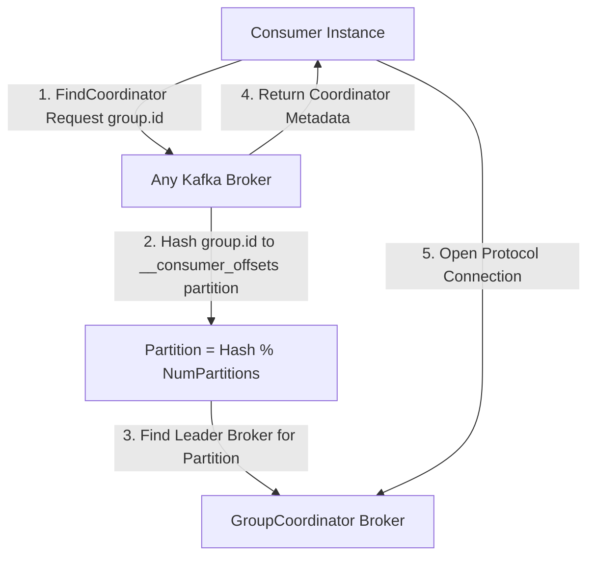
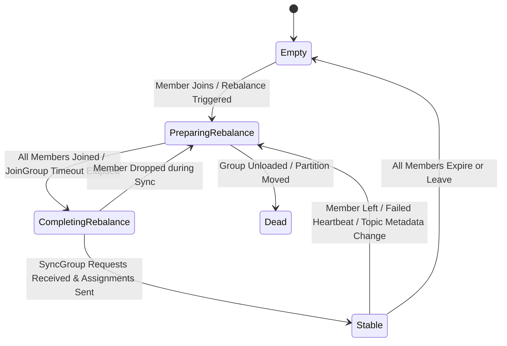
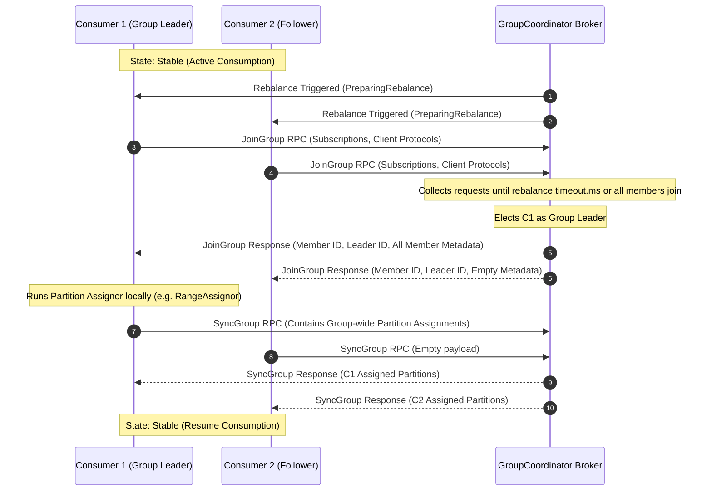
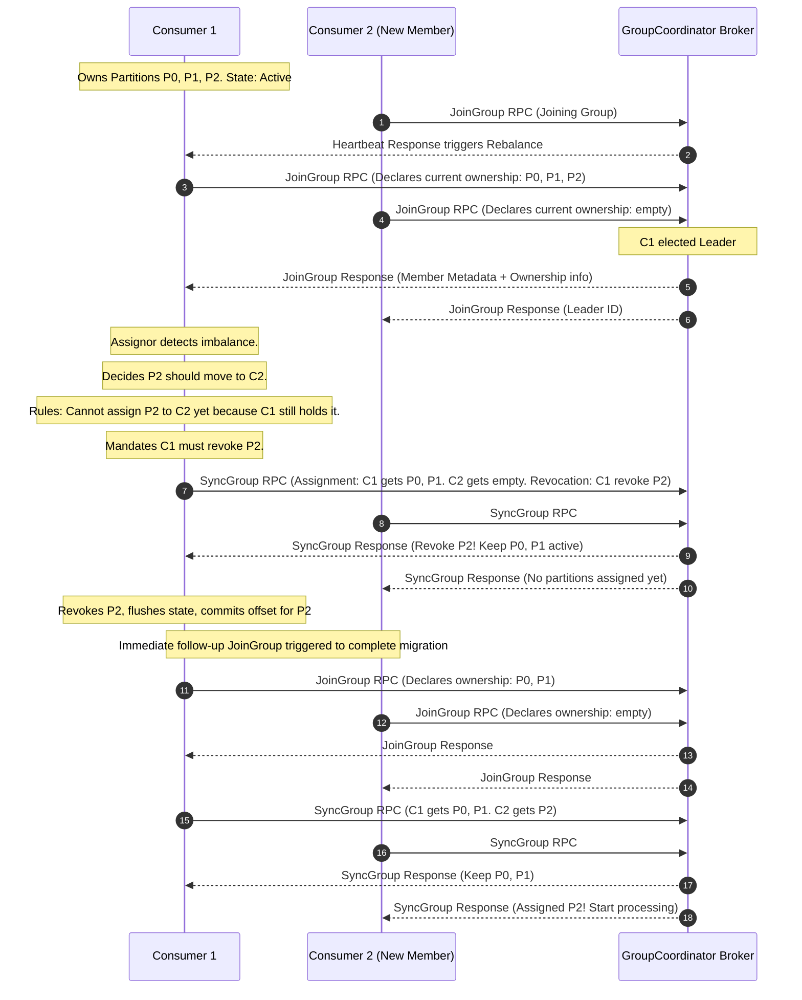

Distributed messaging systems hit a wall the moment consumer nodes join, leave, or crash. Scaling out partition consumption requires distributing work evenly without allowing two nodes to process the same partition concurrently. Apache Kafka delegates this coordination dynamic to consumer group rebalancing, a protocol mechanism that balances topic partitions across active consumer instances.

Under the hood, Kafka does not use a centralized orchestrator like Kubernetes or ZooKeeper to enforce partition maps on consumers during a rebalance. Instead, it runs an embedded state machine inside broker nodes called the GroupCoordinator and pairs it with a decentralized, client-side partition assignment strategy. Understanding how this protocol executes handshakes, handles failures, and evolved from stop-the-world eager rebalancing to incremental cooperative rebalancing reveals the fundamental trade-offs of distributed state coordination.

## Finding the GroupCoordinator

When a consumer process starts up with a configured `group.id`, its first task is locating the specific Kafka broker acting as its GroupCoordinator. Kafka stores all consumer group metadata, execution state, and committed offsets inside an internal, compacted topic named `__consumer_offsets`. This topic is split across multiple partitions across the cluster.

To determine which broker hosts the GroupCoordinator for a given group, the client runs a deterministic hash calculation. It computes `Math.abs(group.id.hashCode()) % offsets.topic.num.partitions`. The broker hosting the leader replica for that calculated partition becomes the designated GroupCoordinator for the entire group.



The client sends a `FindCoordinator` RPC to any bootstrap broker in the cluster. The broker computes the partition index, looks up the metadata for that internal partition, and returns the endpoint of the lead broker. From that moment on, all group lifecycle operations, heartbeats, and offset commits route directly to that single coordinator broker.

## The GroupCoordinator State Machine

On the broker, the GroupCoordinator manages each consumer group using a finite state machine. This state machine dictates when consumers can fetch records and when they must pause to recalculate partition ownership.



The coordinator transitions through specific states during normal operation and rebalances:

In the `Empty` state, the group has no active members, though committed offsets might still exist in the `__consumer_offsets` partition.

In `PreparingRebalance`, the coordinator halts normal group operations and waits for all expected members to send a `JoinGroup` request. While in this state, members cannot fetch data or commit offsets.

In `CompletingRebalance`, the coordinator received `JoinGroup` requests from all members and selected a leader consumer. It now waits for the leader to send partition assignments via `SyncGroup` requests.

In `Stable`, partition assignments are active. Members periodically send heartbeats and consume data from their assigned partitions.

In `Dead`, the coordinator partition migrated to another broker or the group was destroyed, requiring clients to re-locate their coordinator.

## The Classical Two-Phase Rebalance Protocol

Kafka delegates partition assignment calculation to the consumer client rather than performing it on the broker. This architectural decision keeps broker logic light and allows developers to swap partition assignment strategies on the client without upgrading the cluster. Executing this requires a two-phase protocol handshake consisting of `JoinGroup` and `SyncGroup` RPCs.

When a rebalance triggers, every consumer in the group pauses fetching and sends a `JoinGroup` RPC to the coordinator. This request includes the consumer supported assignment protocols, topic subscriptions, and client configuration parameters.



The coordinator collects these requests during a configurable window governed by `max.poll.interval.ms` or `rebalance.timeout.ms`. Once all known members respond or the timer expires, the coordinator picks one consumer to be the group leader. Typically, this is the first member to issue a `JoinGroup` request.

The coordinator constructs the `JoinGroup` response. For follower consumers, the response contains only their assigned `member_id` and the elected leader ID. For the group leader, the response includes the complete metadata and subscription array for every single member in the group.

Next, the group leader runs the configured `ConsumerPartitionAssignor` implementation locally. It evaluates all subscribed topics, available topic partitions, and active member IDs to create a target assignment map. Once computed, the leader wraps this map inside a `SyncGroup` request and sends it to the GroupCoordinator. Follower consumers also send a `SyncGroup` request, but with an empty payload.

The GroupCoordinator unpacks the leader `SyncGroup` payload, persists the new generation metadata to `__consumer_offsets`, and returns the specific partition assignments to each consumer in their `SyncGroup` response. Once unpacked, members resume fetching from their newly assigned partitions.

## The Eager Rebalance Stop-The-World Problem

Historically, Kafka relied strictly on the Eager Rebalance protocol. While simple, the eager model presents severe performance bottlenecks at scale.

Under the eager protocol, as soon as a rebalance is triggered, every consumer in the group revokes all of its assigned partitions immediately before sending its `JoinGroup` request. Partition processing drops to zero across the entire cluster while the protocol handshakes execute.

```
Eager Timeline:
Consumer 1: [Processing P0, P1] -> (Revoke All) -> [Waiting Join/Sync] -> [Processing P0]
Consumer 2: [Processing P2, P3] -> (Revoke All) -> [Waiting Join/Sync] -> [Processing P1, P2, P3]
System Impact: Global processing freeze during the protocol window.
```

If a cluster contains hundreds of topics and thousands of partitions, computing and serializing member assignments takes time. If a single consumer crashes, or if network latency delays a heartbeat, the group enters `PreparingRebalance`. Every healthy consumer surrenders its partitions, flushes state, commits offsets, and waits for the handshake to finish. This creates cascading lag, spikes thread contention, and overwhelms the broker with rapid metadata flushes.

## Incremental Cooperative Rebalancing Mechanics

To eliminate stop-the-world pauses, Kafka introduced Incremental Cooperative Rebalancing. The fundamental shift here is simple: consumers do not revoke their partitions up front when a rebalance starts. They continue fetching data from their current partitions throughout the protocol exchange, revoking only the specific partitions that must actually shift ownership.

Instead of resolving assignments in a single pass, Cooperative Rebalancing executes as a multi-round state machine using the `CooperativeStickyAssignor`.



In round one, when a new consumer joins, active members send their `JoinGroup` RPC while maintaining record consumption. They include their current owned partition assignments inside the protocol metadata.

The group leader computes the desired target distribution. It notices that Consumer 2 needs partitions to balance the load, but Consumer 1 currently holds Partition 2. A partition cannot be owned by two nodes simultaneously without breaking delivery semantics.

Rather than forcing Consumer 1 to drop everything, the leader issues an incremental assignment. It tells Consumer 1 to keep P0 and P1, but instructs it to revoke P2. It leaves Consumer 2 with no assignments for now.

When Consumer 1 receives its `SyncGroup` response, it pauses consumption exclusively on Partition 2, flushes state, commits offsets for P2, and immediately triggers a second `JoinGroup` request.

In round two, Consumer 1 reports its updated ownership array containing only P0 and P1. The leader sees that P2 is now completely unowned and safely assigns P2 to Consumer 2 in the second `SyncGroup` response. Consumer 1 never stopped processing P0 and P1 throughout the entire transition.

## Session Health, Heartbeats, and Zombie Fencing

Coordinator state tracking depends heavily on background network management. Kafka separates partition consumption loops from health checking by running an independent heartbeat thread inside the Java client.

Three configuration parameters dictate how the coordinator detects consumer failures:

The `session.timeout.ms` defines the max time the GroupCoordinator will wait without receiving a heartbeat signal from a client. If this window elapses, the broker marks the consumer dead and triggers a rebalance.

The `heartbeat.interval.ms` controls how frequently the consumer heartbeat thread sends `Heartbeat` RPCs to the GroupCoordinator. This is typically set to one-third of the session timeout.

The `max.poll.interval.ms` defines the maximum allowable delay between consecutive calls to `KafkaConsumer.poll()` in the user processing thread. If application logic blocks processing longer than this limit, the consumer intentionally leaves the group by sending a `LeaveGroup` RPC, preventing an unmanaged timeout.

When a consumer hangs or loses network connection, it might attempt to write offsets after the GroupCoordinator has already evicted it and assigned its partitions elsewhere. Kafka prevents data corruption through Generation IDs.

Every time the GroupCoordinator completes a rebalance, it increments the group Generation ID integer. The coordinator embeds this generation value in every `SyncGroup` response sent to consumers.

```
Client Offset Commit Payload:
Group: 'payment-processors'
GenerationId: 42
MemberId: 'consumer-1-a8f3b'
Partition: 0, Offset: 104521
```

When a consumer sends an `OffsetCommit` RPC, the GroupCoordinator checks the generation ID inside the request against the current generation ID stored in its `__consumer_offsets` partition.

If a zombie consumer attempts to commit an offset using Generation 41 while the group has advanced to Generation 42, the broker rejects the commit with a `FencedInstanceIdException` or `RebalanceInProgressException`. The zombie client catches this error, drops its local partition state, and executes a full `JoinGroup` re-initialization sequence.
