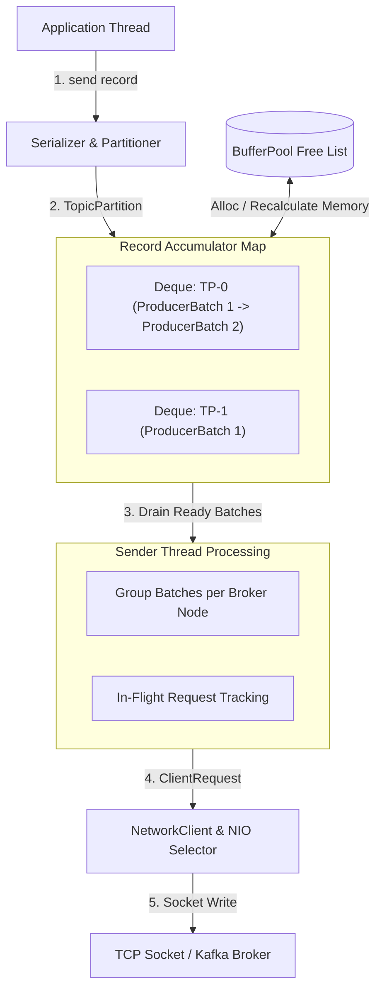
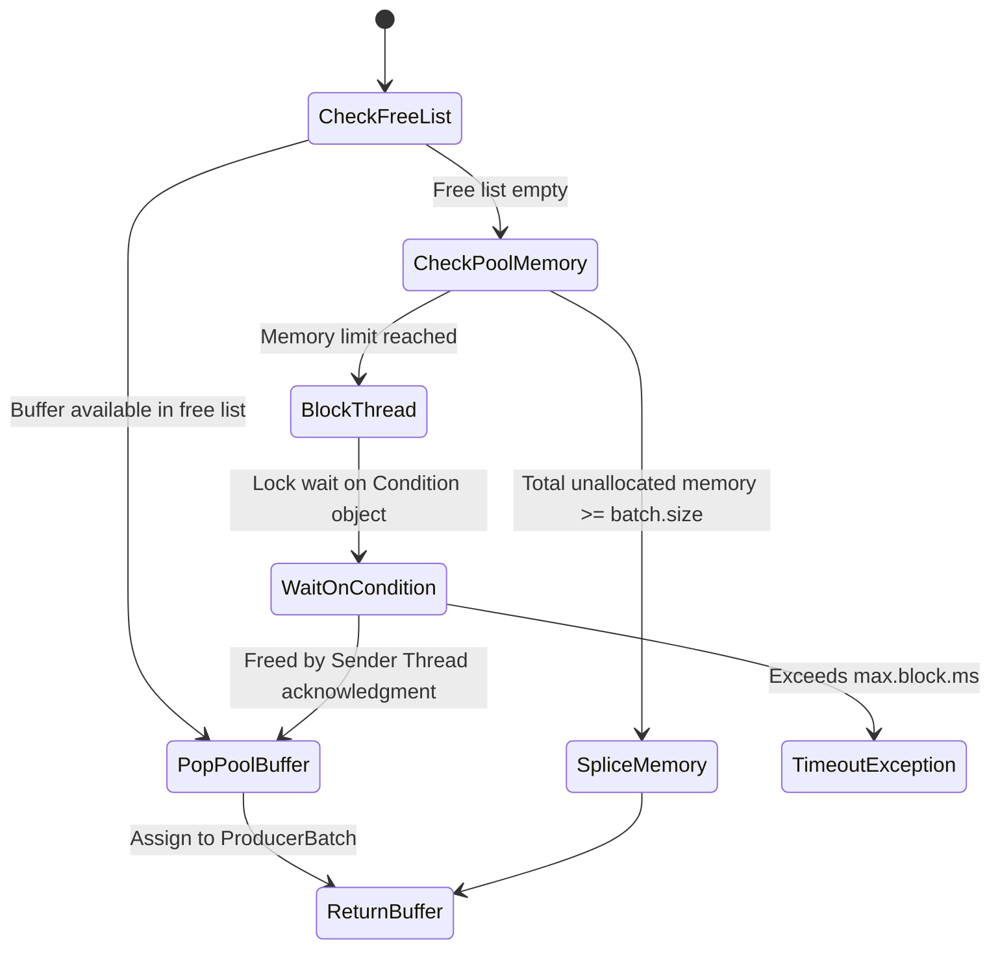
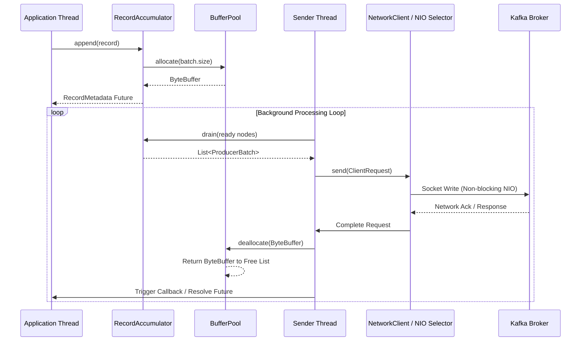

High-throughput messaging systems cannot afford the latency tax of synchronous network I/O. When an application calls the send method on a Kafka producer, it does not initiate a TCP handshake or block waiting for disk persistence on a remote broker. Doing so would throttle throughput to the round-trip latency of the network. Instead, the producer decouples thread invocation from actual network transmission through an aggressive memory-buffering architecture.

The entire ingestion pipeline relies on an asynchronous design where caller threads serialize, partition, and hand off messages into a concurrent memory structure called the RecordAccumulator. A dedicated background thread then drains this accumulator, formats node-level network payloads, and manages non-blocking socket I/O through Java NIO. Understanding how bytes move through these internal components is critical when tuning producers for extreme throughput or strict latency SLAs.

When a thread calls send, the producer first runs the key and value serializers to convert high-level objects into byte arrays. Next, the partitioner determines the destination partition based on the explicit target partition, a key hash, or a round-robin calculation. Once the target partition is known, the message enters the RecordAccumulator.

The RecordAccumulator acts as an in-memory staging area. Internally, it holds a concurrent hash map where keys are TopicPartition instances and values are double-ended queues of ProducerBatch objects. Each ProducerBatch is a contiguous memory buffer containing multiple record representations. The application thread attempts to append the serialized record to the last ProducerBatch in the deque for that partition.

To append a record, the application thread acquires a lightweight synchronized lock on the specific partition deque. If a batch exists and has enough remaining memory, the record bytes are appended directly into the existing batch buffer. If no batch exists or the trailing batch lacks sufficient headroom, a new batch must be allocated. This design keeps lock contention localized to individual partitions rather than locking the entire accumulator.

Allocating raw byte arrays continuously during high-throughput ingestion would quickly overwhelm the JVM garbage collector. To avoid memory fragmentation and frequent stop-the-world pauses, the producer delegates memory management to an internal BufferPool engine.

The BufferPool allocates a single chunk of memory upfront, defined by the buffer.memory configuration, default at 32 megabytes. This pool is divided into fixed-size byte buffers matching the batch.size property, which defaults to 16 kilobytes. Free buffers are tracked in an internal deque. When the RecordAccumulator needs a new ProducerBatch, it requests a 16KB ByteBuffer from the pool.

If the free list contains an available buffer, the pool pops it and returns it instantly. If the free list is empty but the unallocated pool capacity can fit a new allocation, the pool allocates a buffer. If total memory usage hits buffer.memory, caller threads block on a condition variable until the background thread completes a network request and recycles an existing buffer. If the block duration exceeds max.block.ms, a timeout exception is thrown to the application.

Not all records fit into the standard 16KB batch size. When a producer encounters an oversized record that exceeds batch.size, the BufferPool bypasses its free list entirely. It allocates a custom byte buffer matching the exact record size. Once the Sender thread transmits this oversized batch and receives an acknowledgment from the broker, the custom memory is not returned to the pool free list. Instead, it is left for garbage collection, while the pool updates its internal accounting metrics to reclaim the allocated memory quota.

While application threads append records into partition deques, a separate background thread named Sender executes a continuous loop to extract batches and send them over the wire. The Sender thread operates as a state machine that converts partition-oriented storage into broker-oriented network packets.

During each iteration, the Sender iterates over the partition queues in the RecordAccumulator to find batches ready for transmission. A batch is considered ready if it meets specific structural conditions. It reaches readiness if its total byte size meets or exceeds batch.size, or if the time elapsed since the batch creation exceeds the configured linger.ms threshold. Additionally, if the accumulator runs out of available memory, or if a flush call is invoked, pending batches are marked ready immediately.

Once ready batches are identified, the Sender groups them by target broker node ID. A single Kafka broker might host leaders for multiple partitions across different topics. Sending separate TCP packets for every partition would destroy network performance. The Sender thread merges batches destined for the same broker into a single logical ClientRequest, packing multiple partition payloads into a unified network frame.

Before queueing requests to the socket, the Sender checks the NetworkClient to ensure the destination node is capable of accepting more data. The producer enforces an in-flight request limit per connection, defined by max.in.flight.requests.per.connection. If the destination node already has the maximum number of unacknowledged requests pending in its pipeline, the Sender skips draining batches for that node during the current loop iteration.

For pipelines configured with idempotent delivery enabled, the Sender inserts sequence metadata before handing payloads to the transport layer. Each batch is tagged with the Producer ID and an incrementing Sequence Number per partition. This metadata allows the Kafka broker to detect duplicate transmissions caused by network retries and write records to disk exactly once.

The low-level socket operations are managed by the NetworkClient layer, which wraps Java NIO Selector mechanisms. The NetworkClient maps broker IDs to persistent TCP socket channels. When a ClientRequest arrives from the Sender thread, it is converted into a send payload and registered with the underlying NIO Selector for write readiness.

Kafka uses non-blocking I/O to handle socket operations efficiently. The Selector polls the OS kernel for socket channels ready to accept bytes. When a socket buffer is writable, the NetworkClient transfers bytes directly from the ProducerBatch byte buffers into the kernel socket buffer. This execution model avoids unnecessary intermediate byte copying between user-space buffers.

When the broker processes the payload and returns an acknowledgment packet, the NIO Selector reads the response and matches it to the in-flight request state machine. Upon success, the associated ProducerBatch completes its lifecycle. The Sender invokes any user-defined callbacks attached to the records and notifies completion futures. Finally, the byte buffer that held the batch payload is passed back to the BufferPool, returning directly to the free list to be reused by future application send calls.

If the broker returns a retriable error such as a metadata mismatch or leader migration, the Sender thread catches the failure. If retries are enabled and the record timeout has not expired, the batches are re-queued at the head of their respective partition deques in the RecordAccumulator. This ensures that retried records preserve their relative ordering when resent to the broker.

Understanding the interplay between RecordAccumulator queuing, BufferPool allocation, and NetworkClient polling unlocks precise control over producer performance. Tuning batch.size and linger.ms adjusts the balance between throughput and latency. Setting buffer.memory prevents memory exhaustion under backpressure. This tight coordination between in-memory layout and non-blocking I/O is precisely what enables Kafka producers to sustain millions of events per second on standard hardware.
