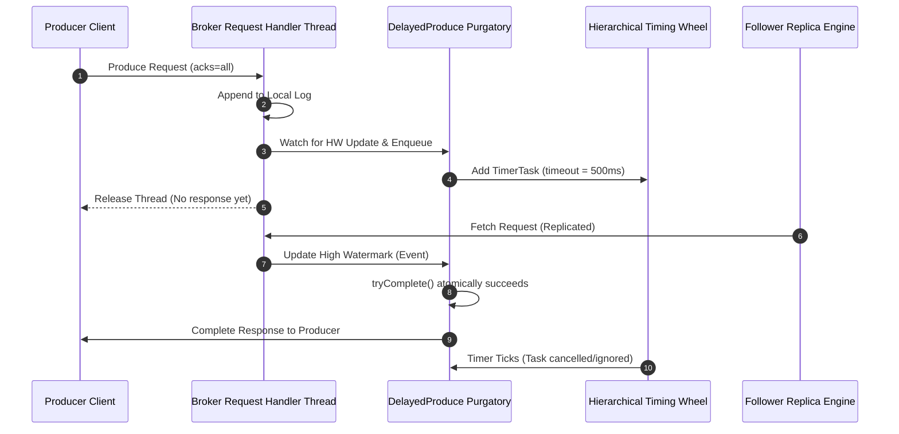
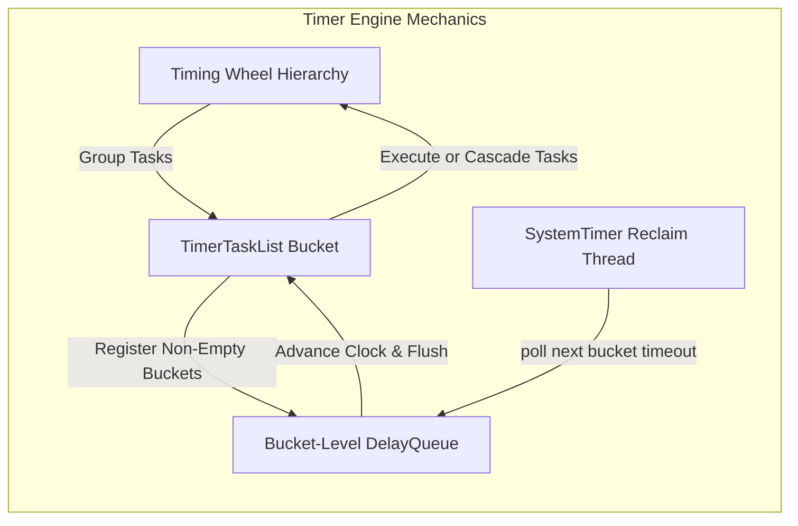
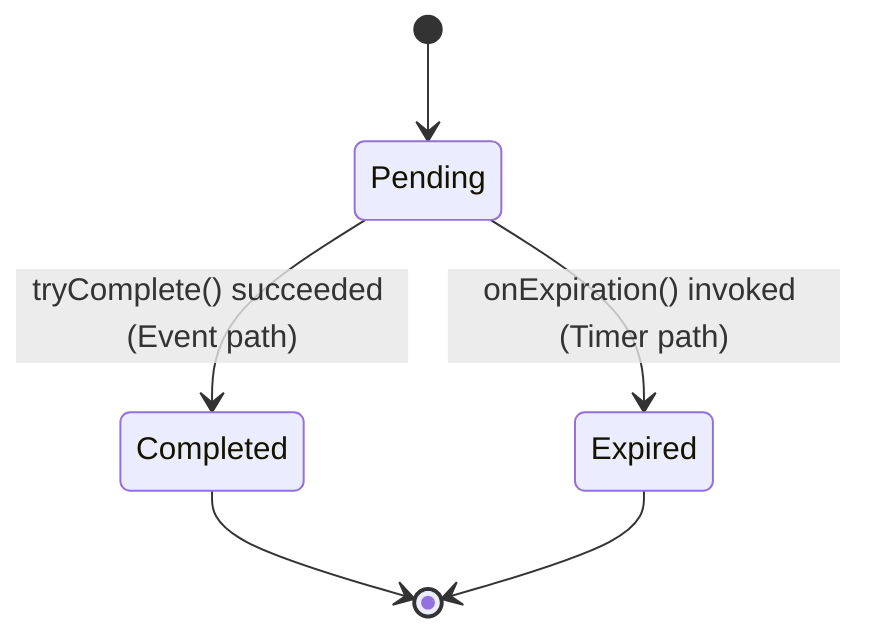
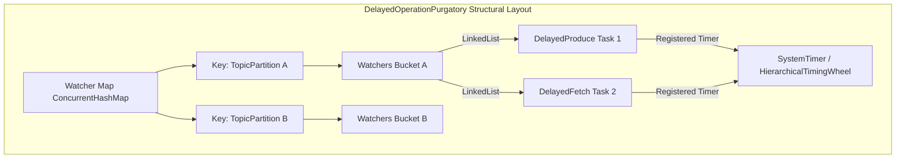

When a Kafka producer sends a message with acks set to all, the broker cannot reply immediately. It has to wait until all in-sync replicas pull the message and flush it to their local logs. If you handle this synchronously by letting the request handler thread block until replication finishes, your broker will run out of worker threads almost instantly. Under heavy load with thousands of concurrent produce requests and fetch requests, holding threads hostage to disk I/O or network round-trips destroys throughput and leads to lock starvation.

Kafka solves this problem through a component called Request Purgatory. Instead of holding a request handler thread, Kafka offloads unfulfilled requests into Purgatory as non-blocking delayed operations. The request handler thread is immediately freed up to process incoming socket frames. Once the required replication completes or a timeout expires, Purgatory finishes the request and sends the response back down the wire.

The challenge is managing tens of thousands of concurrent delayed operations, each with its own expiration timer and triggering conditions. Standard Java constructs like java.util.concurrent.DelayQueue rely on a priority heap implementation. Adding or removing elements from a heap takes O(log N) time. When scaled to hundreds of thousands of active timers, heap insertion overhead and lock contention on the heap's internal reentrant lock choke the CPU. Kafka replaces heap-based delay queues with a Hierarchical Timing Wheel structure, achieving O(1) timer insertions, cancellations, and bucket advances.



To understand how Purgatory operates, you have to look closely at its core data structure: the hierarchical timing wheel. Introduced conceptually by George Varghese and Anthony Lauck, a timing wheel is a circular array of buckets where each bucket represents a discrete unit of time. A single timing wheel has a fixed number of slots, called ticks, and a specific tick duration.

Imagine a wheel with 20 buckets where each bucket spans 1 millisecond. This wheel can handle timers ranging from 0 to 20 milliseconds. If you want to insert an operation that expires 5 milliseconds from now, you calculate the target bucket index using the current time plus offset modulo the wheel size, and insert the task into a doubly linked list residing in that bucket.

Single timing wheels break down when you need to handle wide dynamic time ranges. If a client sets a request timeout of 30 seconds, a 1 millisecond tick wheel would require 30,000 array slots, leading to massive memory wastage for sparse timer distributions. Increasing the tick size to 1 second reduces array size, but destroys timing granularity for fast operations.

Kafka solves this using hierarchy. When a timer target falls beyond the capacity of the current wheel level, Kafka dynamically instantiates an overflow timing wheel at the next level up. The overflow wheel operates with a tick size equal to the total span of the wheel beneath it.

```mermaid
graph TD
    subgraph Level 0 [Level 0 Wheel: Tick = 1ms, Size = 20ms]
        B0[Bucket 0: 0-1ms]
        B1[Bucket 1: 1-2ms]
        B19[Bucket 19: 19-20ms]
    end
    subgraph Level 1 [Level 1 Overflow Wheel: Tick = 20ms, Size = 400ms]
        OB0[Bucket 0: 0-20ms]
        OB1[Bucket 1: 20-40ms]
        OB19[Bucket 19: 380-400ms]
    end
    subgraph Level 2 [Level 2 Overflow Wheel: Tick = 400ms, Size = 8000ms]
        OOB0[Bucket 0: 0-400ms]
        OOB1[Bucket 1: 400-800ms]
    end
    Level 0 -- Exceeds 20ms --> Level 1
    Level 1 -- Exceeds 400ms --> Level 2
    OB1 --> |Holds TimerTaskList| TaskNode1[DelayedProduce Task A]
    TaskNode1 --> TaskNode2[DelayedFetch Task B]
```

Consider a setup where Level 0 has 20 buckets of 1 millisecond each, spanning 20 milliseconds total. Level 1 will also have 20 buckets, but each bucket spans 20 milliseconds, covering up to 400 milliseconds. Level 2 will have 20 buckets of 400 milliseconds each, covering up to 8,000 milliseconds. 

When a delayed operation with a 350 millisecond timeout arrives, it exceeds Level 0's range. Kafka passes the operation to Level 1. Level 1 identifies the target bucket based on its 20 millisecond tick granularity and enqueues the task into Level 1's corresponding bucket. The operation costs a simple array lookup and a doubly linked list append, both strictly O(1) operations.

As time ticks forward, high-level buckets must eventually descend into lower-level wheels. This process is called cascading. When Level 0 completes a full revolution of 20 milliseconds, Level 1 advances by one tick. The bucket at Level 1 that just expired is flushed. All timer tasks sitting in that Level 1 bucket are re-inserted into the timing wheel system.

Because the remaining time on those flushed tasks is now under 20 milliseconds, the re-insertion algorithm routes them directly into Level 0 buckets. They are now placed with 1 millisecond precision. Cascading happens lazily, distributing the re-sorting cost so the system avoids catastrophic pause times.

Kafka needs a way to advance time efficiently without running a busy-wait thread that ticks every single millisecond when no events are happening. To drive time forward, Kafka combines Hierarchical Timing Wheels with a specialized, low-overhead DelayQueue that stores non-empty TimerTaskList buckets rather than individual operations.

Because the DelayQueue only stores non-empty buckets, the number of elements in the priority queue is bounded by the number of active buckets, which is dramatically smaller than the total number of scheduled tasks. If 100,000 delayed requests fall into 50 distinct time buckets across the timing wheel hierarchy, the priority queue holds only 50 items. The background execution thread calls poll on this queue, sleeping until the nearest bucket expires. When it wakes, it advances the timing wheel clock to the bucket's expiration timestamp, flushes the tasks in that bucket, and processes or cascades them.



A delayed request in Kafka rarely stays in Purgatory until it times out. In healthy clusters, a delayed produce request waits just a few milliseconds for follower replicas to fetch the data. The request completes early due to an external event, long before its expiration bucket is reached by the timer thread.

This creates a classic concurrency problem: race conditions between the event-driven completion path and the timer expiration path. If a follower fetch updates the High Watermark, the request handler thread attempts to complete the `DelayedProduce` operation. Simultaneously, if the request reaches its timeout, the timing wheel thread attempts to cancel and expire the same operation. Without strict synchronization, the broker could send duplicate responses or free memory prematurely.

Kafka avoids heavy lock contention here by implementing atomic state machine transitions inside `DelayedOperation` using Java's Compare-And-Swap primitives. Every delayed operation extends a base class maintaining an atomic state variable with three primary states: Pending, Completed, and Expired.



When an event occurs, the thread handling the event calls `tryComplete()`. This method executes domain logic to check if conditions are met, such as checking if the replica fetch offset satisfies the required High Watermark. If conditions are met, the thread attempts an atomic state transition from Pending to Completed using a Compare-And-Swap instruction.

If the swap succeeds, that thread wins the right to execute the completion callback and send the response to the client. If the timer thread wakes up at the exact same moment and invokes `onExpiration()`, its attempt to Compare-And-Swap the state from Pending to Expired fails because the state is already Completed. The timer thread backs off instantly, realizing the operation was already resolved.

If the operation completes early via an event, its entry remains inside its assigned `TimerTaskList` bucket in the timing wheel. Removing a node from the middle of a doubly linked list when an event completes would require fine-grained lock synchronization across bucket arrays. Instead, Kafka uses a lazy cancellation strategy.

The operation's reference inside the `TimerTaskList` is left intact. When the timing wheel clock eventually reaches that bucket and flushes it, the timer thread inspects the atomic state of each task. Upon seeing that the operation is already in the Completed state, the timer thread silently drops the reference, allowing garbage collection to reclaim it.

To manage delayed operations safely across topics and partitions, Kafka structures Purgatory using a combination of metric-specific key watchers and watcher lists. The main entry point is `DelayedOperationPurgatory`, which wraps the timing wheel system and maintains a thread-safe map of watch keys to `Watchers` objects.



When a request handler places a `DelayedProduce` operation into Purgatory, it provides a set of watch keys corresponding to the topic-partitions the produce request targets. The Purgatory inserts the operation into the `Watchers` list associated with each key. It then enqueues the operation into the `SystemTimer` hierarchical timing wheel.

Whenever new data arrives on a partition via a replication fetch or client write, the request handler calls `checkAndComplete(key)`. This method retrieves the `Watchers` object registered for that key, iterates through its list of active delayed operations, and calls `tryComplete()` on each one. Operations that return true are removed from the watcher list immediately, cutting off any further event checks.

Memory management in Purgatory requires careful balance. Under high request throughput, watcher lists can accumulate millions of completed or expired references if left unchecked. Kafka prevents memory leaks by tracking total watched operations and performing periodic purge sweeps. When the ratio of cancelled operations inside watcher lists exceeds a configured threshold, a background thread purges dead references from the doubly linked lists.

The performance difference between a priority heap delay queue and Kafka's hierarchical timing wheel is striking under load. Heap queues require O(log N) lock-holding insertions, scaling poorly as active task counts grow. Hierarchical timing wheels reduce task insertion, cancellation, and bucket access to O(1) time complexity. The only O(log M) component in Kafka's design is the auxiliary DelayQueue, where M represents the number of non-empty time buckets rather than individual tasks. Since M is capped by the timing wheel array dimensions, M remains tiny even when millions of operations are pending.

By decoupling request holding from thread execution, leveraging hierarchical timing wheels for O(1) scheduling, and using lock-free atomic state transitions for early completion, Kafka's Request Purgatory achieves high concurrency and predictable tail latency under intense multi-tenant workloads.
