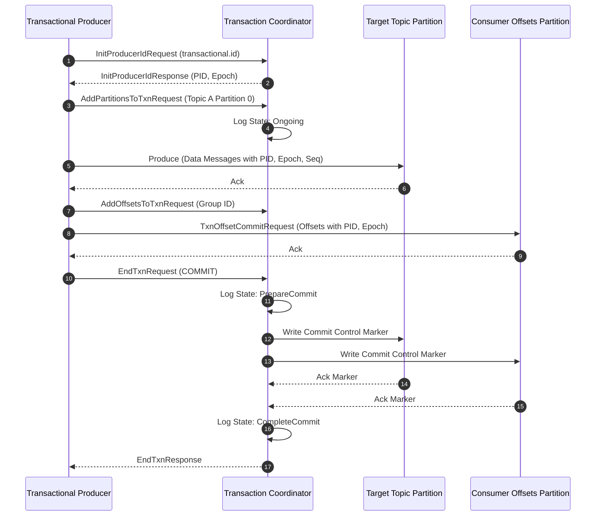
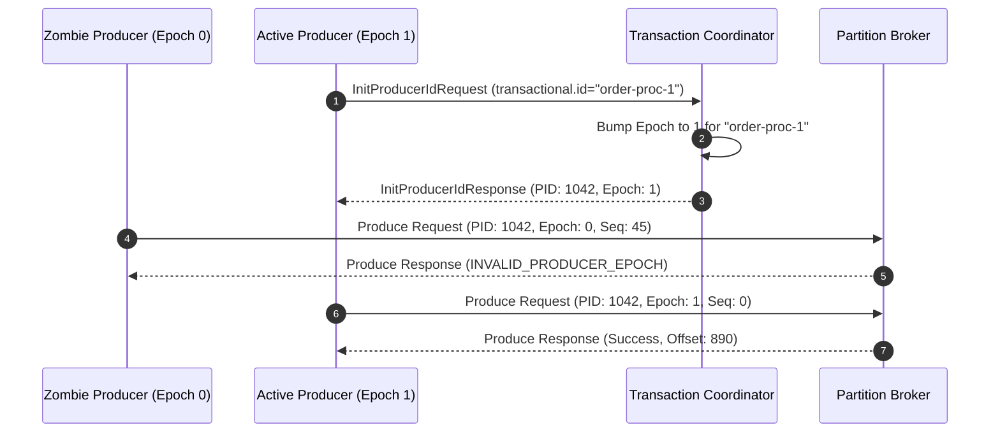
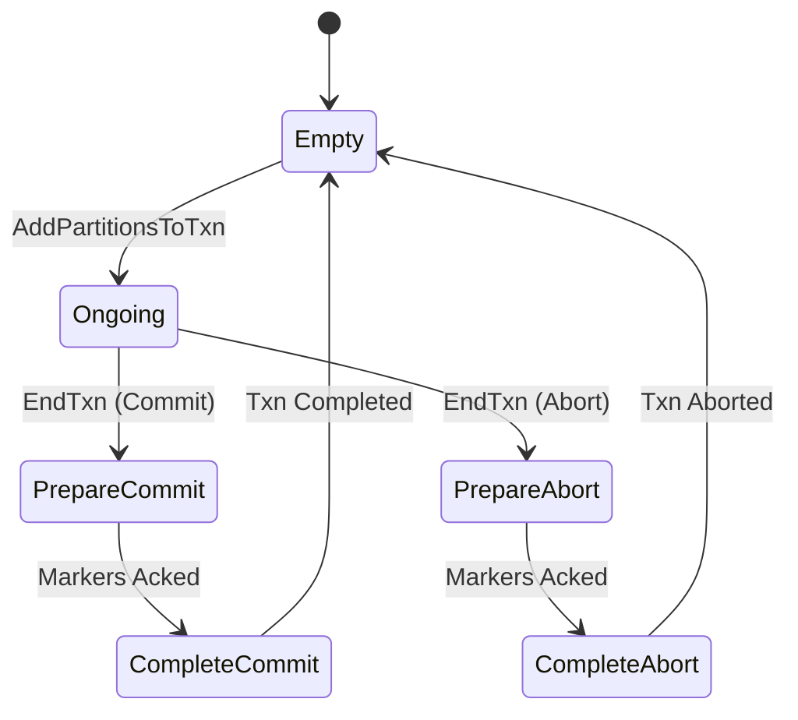
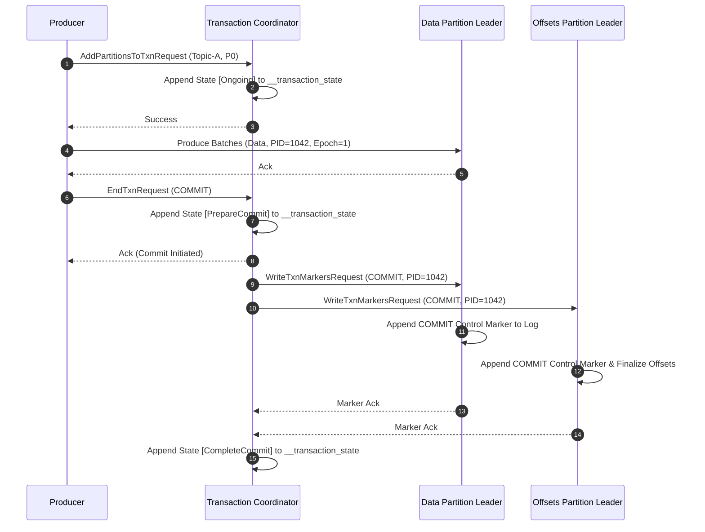
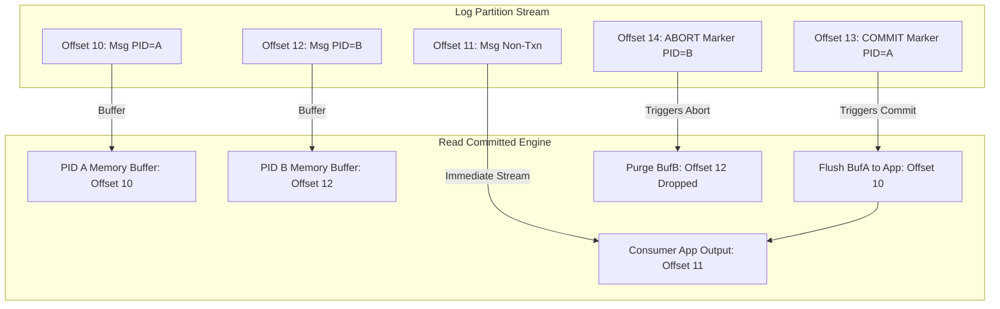

# Inside Kafka Transaction Engine Mechanics: Producer Epochs, Control Markers, and Two-Phase Commit

Building transactional guarantees on top of an append-only distributed log is a masterclass in compromise. In traditional relational systems, ACID transactions rely on centralized lock managers, undo logs, and shared-buffer dirty pages. Distributed event streaming systems like Apache Kafka cannot afford global locks or synchronous multi-node coordination for every write without dropping throughput into the gutter.

Kafka solves atomic multi-partition writes through its Exactly-Once Semantics (EOS) execution engine. Under the hood, EOS does not eliminate network failures or broker crashes. It provides a state machine driven by a dedicated broker component called the Transaction Coordinator, short-lived producer epochs, an append-only transaction log, and special control markers injected directly into partition stream segments.

## The Problem with Distributed Dual-Writes

Consider a typical stream processing pipeline that reads from an input topic, performs a transformation, and writes to an output topic while committing the consumed offset. This read-process-write loop involves three distinct network writes: sending the output message to partition A, writing the updated consumer offset to the internal consumer offsets topic, and committing local application state.

If the producer process crashes after emitting the output message but before committing its consumer offset, a restarted instance will reprocess the same input message, emitting a duplicate to the output topic. Conversely, if an offset is committed before the output message reaches the destination broker due to a transient timeout, messages get lost.

Achieving atomic processing requires wrapping partition writes and offset commits into a single logical unit. Either all produced messages and consumer offsets land on their respective partition logs permanently, or none of them become visible to downstream consumers.

## Identifiers, Producer Epochs, and Zombie Fencing

Idempotent messaging forms the baseline layer of Kafka transactions. A standard idempotent producer receives a 64-bit Producer ID (PID) and maintains a monotonically increasing 32-bit sequence number for every message batch targeted at a specific partition. Brokers track the highest sequence number received for each PID on every partition, dropping duplicate batches caused by retry attempts.

Transactions expand this mechanism across multiple partitions through a persistent client-side configuration called the transactional ID. Unlike a temporary PID that gets generated fresh on client startup, the transactional ID is a stable string shared across restarts of the same logical producer application.

When a transactional producer initializes, it issues an `InitProducerId` request containing its transactional ID to the broker. The broker routes this request to the Transaction Coordinator responsible for that specific ID.

The Transaction Coordinator increments a 16-bit Producer Epoch counter bound to that transactional ID and assigns a new PID or reuses the existing one with the updated epoch. This epoch bump is the foundation of zombie fencing. If an older instance of the producer was stuck in a garbage collection pause or network partition and suddenly attempts to write data using the old epoch, the destination broker rejects the write with an `INVALID_PRODUCER_EPOCH` error. The zombie producer is instantly isolated, preventing split-brain log corruption.

## Transaction Coordinator and the Transaction Log

The Transaction Coordinator is not a standalone process or a single leader node. It is a logical module running inside every Kafka broker. Every transactional ID maps to a specific Transaction Coordinator instance through a deterministic hashing scheme.

Kafka maintains an internal, highly available topic named `__transaction_state` configured with key-based log compaction and a default partition count of 50. When a producer initializes, the client computes the murmur hash of its transactional ID modulo 50 to determine the target partition inside `__transaction_state`. The broker hosting the leader replica of that specific transaction partition acts as the Transaction Coordinator for that producer.

The transaction log tracks state transitions for every registered transactional ID. The records written to `__transaction_state` contain the transactional ID, the current PID, the current epoch, the transaction state, the array of participating topic partitions, and timeout metadata.

The state machine transitions through distinct phases during a transaction lifecycle. It moves from Empty to Ongoing when partitions are registered, then to PrepareCommit or PrepareAbort when a commit or abort request arrives, and finally to CompleteCommit or CompleteAbort once control markers are acknowledged across all target partitions before returning back to Empty.

## Execution Anatomy of a Two-Phase Commit

A complete transaction proceeds through distinct phases that guarantee atomicity even if the client or the Transaction Coordinator crashes mid-stream.

Phase one begins when the application calls `beginTransaction`. The client library marks its internal state as active but does not issue a network call. The actual network registration happens on demand when the application attempts to produce records to a target topic partition.

Before the producer sends data batches to a target partition, it sends an `AddPartitionsToTxnRequest` to its Transaction Coordinator. This request registers the partition in the coordinator memory state and appends an `Ongoing` state record to the `__transaction_state` log. The coordinator must flush this log entry to a quorum of replicas before replying to the producer. This step ensures that the coordinator remembers which partitions were involved in the transaction if it crashes later.

Once the coordinator responds, the producer transmits data message batches to the destination partition brokers using standard produce requests. These batches contain the PID, the epoch, and the incrementing sequence numbers. Brokers write these records into their local segment files immediately, but they do not make them available to read-committed consumers yet.

For applications consuming and producing in the same loop, the application commits consumed offsets using `sendOffsetsToTransaction`. The producer sends an `AddOffsetsToTxnRequest` to the Transaction Coordinator specifying the consumer group ID. The coordinator calculates which partition of `__consumer_offsets` owns that consumer group and registers that offset partition as part of the transaction. The producer then sends a `TxnOffsetCommitRequest` directly to the coordinator of the consumer group, which stashes the pending offset with the associated PID and epoch without marking it finalized.

Phase two begins when the application invokes `commitTransaction`. The producer sends an `EndTxnRequest` with the commit decision to the Transaction Coordinator.

The coordinator initiates two-phase commit by appending a `PrepareCommit` record to `__transaction_state`. Once that state record is replicated across the transaction state log quorum, the commit decision becomes irrevocable. Even if the coordinator broker dies immediately after writing `PrepareCommit`, the newly elected coordinator leader will read this state from the log and finish driving the transaction to completion.

Next, the coordinator sends an `WriteTxnMarkersRequest` to every partition leader recorded in the transaction state, including the data topic partitions and the `__consumer_offsets` partitions.

## Control Markers and Read-Committed Consumers

Control markers are internal structural records written directly into standard partition log segments alongside user data. They do not contain application payloads. Instead, a control marker header specifies its key type as a commit or abort marker, along with the PID and epoch of the transaction it closes.

Partition brokers maintain a moving boundary called the Last Stable Offset (LSO) for every log segment. The LSO represents the lowest uncommitted offset among all active transactions currently open on that partition.

When a consumer connects with `isolation.level=read_committed`, it reads log segments up to the current LSO without delay. If there are no open transactions, the LSO equals the High Watermark, allowing the consumer to read at full speed.

When an uncommitted transaction is present on the partition, the LSO halts at the first message offset written by that pending transaction. As the consumer reads messages past the LSO toward the High Watermark, it routes incoming batches into an internal transactional memory buffer.

If a commit marker arrives in the log for that PID, the consumer flushes all buffered messages belonging to that PID to the application downstream and advances its LSO past the transaction boundaries. If an abort marker arrives, the consumer purges all buffered messages matching that PID and epoch from memory without exposing them to the application. The consumer then updates its internal LSO to point past the aborted range.

Read-uncommitted consumers simply ignore control markers and LSO tracking entirely. They consume all records straight up to the High Watermark, receiving uncommitted data and aborted transactions alike.

## Recovery Mechanics and Timeout Handling

System resilience depends on how the engine cleans up dangling state when nodes crash. The Transaction Coordinator tracks active transactions using a configurable timeout parameter, `transaction.timeout.ms`, which defaults to 15 minutes.

If a producer process crashes or suffers an extended network disconnect while a transaction is in the `Ongoing` state, the coordinator detects the inactivity when the transaction timeout expires. The coordinator automatically initiates an abort sequence. It appends a `PrepareAbort` state record to `__transaction_state` and proceeds to broadcast abort control markers to all registered partition leaders.

If the Transaction Coordinator broker itself crashes mid-transaction, Kafka relies on standard partition replication for `__transaction_state`. A new broker takes over as the leader of that transaction log partition.

Upon startup, the new coordinator reads the partition log from offset zero up to the latest record to reconstruct its in-memory transaction state map.

If the state map reveals a transaction stuck in `PrepareCommit`, the new coordinator knows the decision to commit was already made prior to the crash. It immediately re-issues `WriteTxnMarkersRequest` with `COMMIT` to all registered partitions. If the state map shows `PrepareAbort`, it re-issues abort markers. If the transaction was still marked as `Ongoing` when the crash occurred, the coordinator leaves the transaction open, waiting for the producer to send an explicit commit or for the transaction timeout to trigger an abort.

By forcing every decision through an append-only state log replicated via consensus, Kafka ensures that transaction boundaries remain deterministic regardless of node failures, client restarts, or network partitions.
