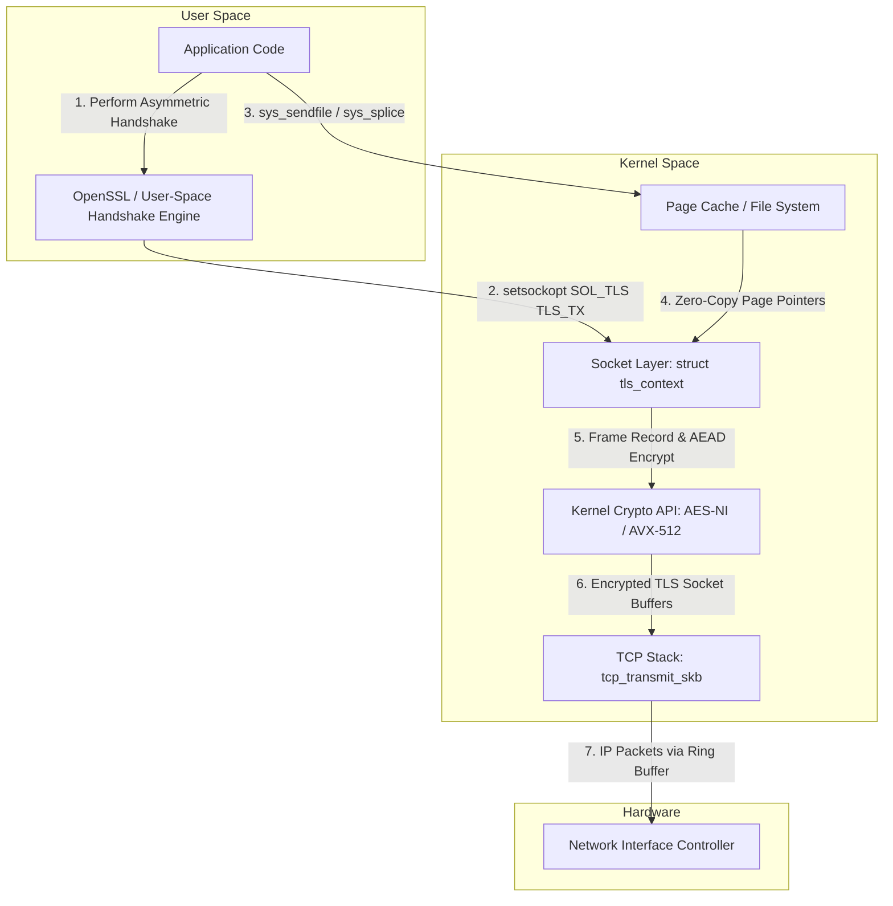
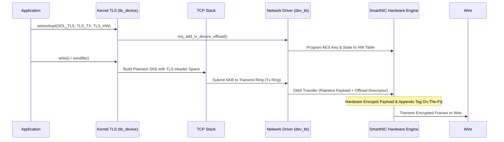

High-performance web servers serving static media or proxying bulk data historically faced a performance wall when switching from plain HTTP to HTTPS. For unencrypted HTTP, Linux engineers relying on high-throughput I/O pipelines used `sendfile()` or `splice()`. These system calls transfer page cache buffers straight into network socket queues without copying data into user space, keeping memory bus traffic low and avoiding context switch overhead. Once TLS enters the picture, traditional architectures break down. Encryption requires processing the plaintext inside user space through cryptographic libraries like OpenSSL or BoringSSL.

Data must travel from the storage controller into kernel page cache, get copied into user-space memory, run through AES vector instructions in an application buffer, get copied back into kernel socket buffers, and finally land on the wire. This four-copy pipeline consumes substantial CPU cycles and memory bandwidth. Linux kTLS, introduced in kernel 4.13 and expanded in subsequent releases, resolves this bottleneck by pushing symmetric encryption and record framing directly into the kernel networking stack.

## The Boundary Problem of TLS Offload

Designing kernel-level TLS requires resolving a structural dilemma. TLS is divided into two distinct components: the complex control plane handshake and the high-throughput record protocol data plane. The control plane handles asymmetric key exchange, X.509 certificate validation, session tickets, ClientHello/ServerHello negotiations, and extension processing. Putting this massive, frequently updated logic into kernel space would expand the attack surface of the Linux kernel to an acceptable risk level.

kTLS solves this by enforcing a strict separation of concerns. The asymmetric handshake remains entirely in user space. Application runtimes or cryptographic libraries like OpenSSL, BoringSSL, or Rustls process the handshake overhead using standard user-space logic. Once the negotiation completes and symmetric secrets are generated, the user-space process extracts the keying material, initialization vectors, cipher suites, and implicit sequence numbers. It then uses the `setsockopt()` system call to pass these symmetric keys down to the kernel socket context. From that moment onward, the kernel handles record framing, AES-GCM or ChaCha20-Poly1305 payload encryption, MAC integrity verification, and segment assembly.



## Socket Protocol Swapping & Internal Data Structures

To understand how kTLS hooks into Linux networking, we need to examine how Linux manages sockets. Every TCP socket is represented in kernel memory by a `struct sock` and its associated protocol operation pointer table `sk_prot`, which normally points to `tcp_prot`. When an application executes `setsockopt(fd, SOL_TLS, TLS_TX, ...)` or `TLS_RX`, the kernel overrides this table using dynamic function pointer swapping.

The kernel allocates a `struct tls_context` and attaches it to `sk->sk_user_data`. It swaps out the standard `tcp_prot` table for `tls_sw_prot` when using software kTLS, or `tls_device_prot` when hardware offload is enabled. The standard operational pointers inside `sk_prot` are replaced with kTLS-specific routines. Calls to `sendmsg` are redirected to `tls_sw_sendmsg`, `recvmsg` calls go to `tls_sw_recvmsg`, and calls to `splice_read` are serviced by `tls_sw_splice_read`.

```
Traditional TCP Socket Operations:
struct sock -> sk_prot -> tcp_prot {
    .sendmsg     = tcp_sendmsg,
    .recvmsg     = tcp_recvmsg,
    .splice_read = tcp_splice_read,
}

kTLS Swapped Protocol Operations:
struct sock -> sk_prot -> tls_sw_prot {
    .sendmsg     = tls_sw_sendmsg,
    .recvmsg     = tls_sw_recvmsg,
    .splice_read = tls_sw_splice_read,
}
```

This dynamic substitution ensures that upper-layer system call interfaces remain completely unmodified. Applications continue issuing `write()`, `sendfile()`, or `splice()` system calls on standard socket file descriptors. The kernel transparently intercepts these calls at the socket layer and applies TLS encapsulation before handing the payload down to the TCP transmission pipeline.

Programming the symmetric encryption parameters into the kernel requires submitting cryptographic state blocks via socket options. Here is how user space establishes a kTLS transmit context using AES-128-GCM:

```c
#include <sys/socket.h>
#include <netinet/tcp.h>
#include <linux/tls.h>
#include <string.h>

int enable_ktls_tx(int socket_fd, const unsigned char *key, const unsigned char *iv, uint64_t seq) {
    // 1. Enable kTLS protocol on the socket level
    if (setsockopt(socket_fd, SOL_TCP, TCP_ULP, "tls", sizeof("tls")) < 0) {
        return -1;
    }

    // 2. Prepare the cryptographic context structure
    struct tls12_crypto_info_aes_gcm_128 crypto_info;
    memset(&crypto_info, 0, sizeof(crypto_info));

    crypto_info.info.version = TLS_1_2_VERSION;
    crypto_info.info.cipher_type = TLS_CIPHER_AES_GCM_128;

    // Copy explicit IV, salt, secret key, and sequence counter
    memcpy(crypto_info.iv, iv + 4, TLS_CIPHER_AES_GCM_128_IV_SIZE);
    memcpy(crypto_info.salt, iv, TLS_CIPHER_AES_GCM_128_SALT_SIZE);
    memcpy(crypto_info.key, key, TLS_CIPHER_AES_GCM_128_KEY_SIZE);
    memcpy(crypto_info.rec_seq, &seq, sizeof(seq));

    // 3. Register cryptographic state with kernel socket layer
    return setsockopt(socket_fd, SOL_TLS, TLS_TX, &crypto_info, sizeof(crypto_info));
}
```

When this system call executes, the kernel initializes its internal symmetric state. The `struct tls_sw_context_tx` stores scatterlist allocations, cipher handles allocated from the Linux Kernel Crypto API (`crypto_aead`), and record construction buffers.

## In-Kernel TLS Framing and Encryption Mechanics

Once kTLS is active, transmitting data over the socket bypasses user-space encryption steps completely. When `sendfile()` is invoked, the kernel transfers page frame references from the VFS page cache straight into the kTLS transmission routine `tls_sw_sendmsg()`.

The kernel constructs the outer TLS record header in memory. For application data, this is a 5-byte header containing record type 0x17 (Application Data), protocol version 0x0303 (TLS 1.2) or 0x0301, and the length of the upcoming encrypted payload plus tag.

```
+-------------------+-------------------+-------------------+
| ContentType (1B)  | Version (2 Bytes) | Record Length (2B)|
+-------------------+-------------------+-------------------+
| Explicit Nonce / IV (8 Bytes for TLS 1.2 GCM)             |
+-----------------------------------------------------------+
| Payload Data (Directly referenced from Page Cache pages)  |
+-----------------------------------------------------------+
| Authentication Tag / MAC (16 Bytes for AES-GCM)          |
+-----------------------------------------------------------+
```

To encrypt data without performing unnecessary memory copies, `tls_sw_sendmsg()` uses scatter-gather lists (`struct scatterlist`). The kernel builds a scatterlist mapping that references four distinct regions.
First, the freshly created 5-byte header buffer allocated by the socket.
Second, the explicit initialization vector bytes.
Third, the actual physical memory pages from the page cache holding the plaintext file content.
Fourth, a tail buffer reserved for the 16-byte authentication tag output.

The kernel submits this scatterlist directly to the Linux Kernel Crypto API using asynchronous AEAD encryption functions like `crypto_aead_encrypt()`. The crypto subsystem routes the request to hardware-accelerated CPU instructions such as AES-NI and AVX-512. Encryption occurs directly as data is staged into socket buffers (`struct sk_buff` or `skb`). The resulting encrypted memory pages are then queued into the standard TCP transmit queue (`sk_write_queue`) and processed by `tcp_transmit_skb()`.

Because physical pages from the page cache are referenced directly in the scatterlist, data never hops through user-space memory buffers. Host memory bus saturation is drastically reduced, and CPU instruction count drops because user-space context switches for bulk crypto operations are eliminated.

## In-Kernel Receive Handling and Deferred Decryption

Receiving TLS data through kTLS (`TLS_RX`) operates under a dual-mode mechanism involving inline decryption versus deferred copy processing. When encrypted TLS records arrive at the network interface, the IP and TCP stacks reassemble packets into logical socket buffers.

When user space calls `read()` or `recvmsg()`, execution enters `tls_sw_recvmsg()`. The kernel inspects incoming TCP streams, parses the 5-byte TLS record headers, and determines if a full record has arrived. If a full record exists in the socket receive queue, the kernel allocates a scatterlist pointing to the encrypted `skb` payload buffers and an output user-space buffer provided by the application.

The Kernel Crypto API executes `crypto_aead_decrypt()`, which decrypts the bytes directly into the destination user-space address while simultaneously checking authentication tag validity. If tag verification fails, the kernel drops the payload, increments error counters, and returns an `EBADMSG` error to the calling process.

Receiving data via kTLS is slightly more constrained than sending data. While sending can leverage pure zero-copy page cache transfers via `sendfile()`, receiving always requires copying decrypted bytes into application memory pointers unless zero-copy network RX mechanisms like `io_uring` registered buffers or socket memory mapping are explicitly combined with kTLS. However, kTLS RX still eliminates intermediate user-space buffer allocations and redundant cryptographic state management.

## Hardware Offload: Direct Inline SmartNIC Offload

Software kTLS removes user-space memory copies, but encryption still executes on host CPU cores using AES-NI instructions. Modern high-speed environments running 100GbE or 400GbE interfaces can saturate multiple host CPU cores purely calculating AES-GCM authentication tags. kTLS provides a hardware offload mode (`TLS_HW`) that offloads symmetric crypto directly to hardware Network Interface Cards (NICs).

When hardware offload is initialized, the kernel hands session keys, initial sequence numbers, and cipher parameters to the network driver via `dev_tls`. The NIC firmware programs hardware key tables inside its on-board cryptographic engine.



Under `TLS_HW`, the kernel host CPU does not run AES-NI instructions at all. The TCP stack formats standard TCP packets containing unencrypted payload alongside TLS header structural metadata and offload descriptors. When the network driver DMA-transfers these packet buffers down to the NIC transmit queue, inline hardware engines inside the NIC encrypt bytes on-the-fly as bits pass through the physical network MAC layer.

If a packet drop occurs and TCP retransmission is triggered out of sequence, the NIC hardware offload engine detects the sequence gap. The kernel fallback handler seamlessly steps in, performs software encryption for the out-of-order segment using CPU fallback functions, and posts the retransmitted packet to the wire without breaking the TLS session state.

## Operational Constraints and Implementation Trade-offs

Using kTLS introduces operational tradeoffs that system architects must consider. Debugging encrypted traffic becomes significantly harder. Traditional user-space tools like `lsof` or inspecting memory dumps will not easily expose unencrypted buffers once data enters kTLS pipelines.

Session renegotiation or TLS key updates require returning control to user space. If a TLS 1.3 session triggers a key update, the kernel cannot perform key derivation independently. The kernel flags the socket context, interrupts pending socket read or write operations, and returns control to user-space libraries like OpenSSL to compute new symmetric keying material before issuing another `setsockopt()` update.

Despite these complexities, kTLS represents a fundamental evolution in Linux networking performance. By isolating asymmetric handshakes to user space while offloading high-volume record framing and symmetric encryption to kernel drivers or SmartNIC hardware engines, kTLS unlocks full line-rate throughput for modern encrypted web architectures.
