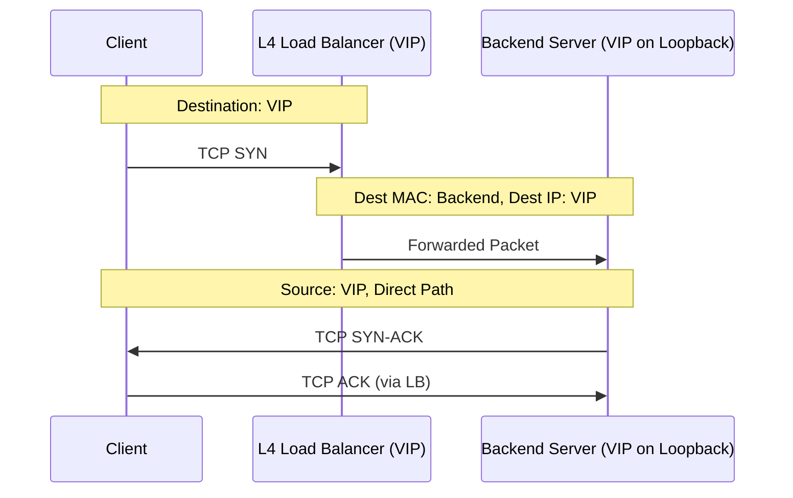
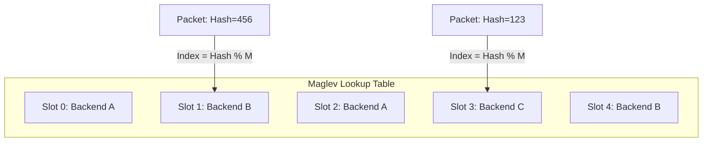

Most developers spend their time at Layer 7. We talk about Envoy, Nginx, or HAProxy terminating TLS, looking at HTTP headers, and making routing decisions based on cookies. But when you are dealing with millions of packets per second, Layer 7 is too slow. Terminating a TCP connection just to pass it along involves a massive amount of overhead in the form of buffer copies, context switches, and memory allocations. This is where Layer 4 load balancing takes over. Instead of being a proxy that talks to the client on one side and the server on the other, an L4 balancer acts more like a sophisticated router. It looks at the IP and port, makes a decision, and shuffles the packet toward a backend as fast as possible. If you do this right, you don't even have to see the packet on the way back.

The most common way to handle L4 balancing is through Network Address Translation, or NAT. In a NAT setup, the load balancer sits in the middle of the traffic flow. When a packet arrives for the Virtual IP, the balancer swaps the destination IP for the address of a backend server. It has to keep a state table to remember that this specific client-to-VIP flow belongs to that specific backend. When the backend responds, the packet goes back to the balancer, which swaps the source IP from the backend back to the VIP. It is simple to understand, but it is a total scalability trap. The load balancer becomes the bottleneck because every single byte of the response traffic, which is usually much larger than the request traffic, has to flow back through the balancer's CPU and NIC. This is why many high-scale architectures abandon NAT as fast as they can.

Direct Server Return, or DSR, is the industry standard for high-performance L4 balancing. In a DSR setup, the load balancer only handles the incoming requests. It does not touch the return path. To make this work, the balancer takes the incoming packet and modifies the destination MAC address to match the chosen backend server, but it leaves the destination IP address as the VIP. The backend server must be configured with that same VIP bound to a loopback interface. Because the IP matches, the backend's application picks up the packet. When it is time to respond, the backend sends the packet directly to the client's IP with the source set to the VIP. The load balancer is completely out of the loop for the response, which effectively decouples the egress bandwidth from the load balancer's capacity.

Setting up DSR is not free. You have to deal with the ARP problem. If you have ten backend servers all configured with the same VIP on their loopback interfaces, they might all try to answer ARP requests for that VIP, which would create total chaos on the local network. You have to carefully suppress ARP responses on the backends so that only the load balancer answers for that IP. It is a bit of a networking headache, but the performance gains are massive. This is exactly how the Linux IPVS, or IP Virtual Server, module handles high-performance traffic when configured in Direct Routing mode. IPVS lives inside the Linux kernel as part of the Netfilter framework, hooking into the INPUT chain to intercept packets before they reach the local socket layer.

Once you have the packet delivery mechanism figured out, you need a way to decide which backend gets the traffic. Standard consistent hashing is great, but at the scale of Google or Cloudflare, it has limitations. Google's answer was Maglev. Most consistent hashing algorithms use a ring and virtual nodes, but Maglev uses a fixed-size lookup table. Each backend generates a permutation of all possible slots in that table using two different hashes of its name. One hash provides an offset and the other provides a skip value. The backend then walks through the table and claims slots based on its preference list until the table is full. This creates an incredibly even distribution of traffic. More importantly, if a backend is added or removed, the table is recalculated in a way that minimizes the number of existing mappings that change.

The magic of Maglev is that it does not require the load balancers to share state with each other. In a traditional NAT-based L4 balancer, if the balancer node that handled the SYN packet dies, the connection is dropped because the new balancer doesn't have the session in its state table. With Maglev, as long as all balancers use the same lookup table and the hashing is consistent, any balancer node can receive any packet from a flow and it will still pick the same backend. This allows you to use ECMP (Equal-Cost Multi-Path) routing at the edge to spread traffic across a fleet of load balancers without worrying about connection state synchronization. It turns the load balancing tier into a stateless, horizontally scalable layer that can survive the loss of individual nodes without breaking a single TCP connection.
