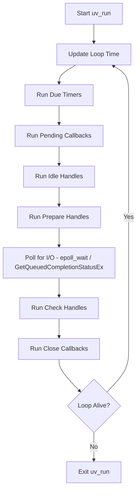

Building high-performance asynchronous runtimes requires solving a fundamental platform contradiction. Linux provides readiness-based I/O notifications through epoll or submission-based queues via io_uring. macOS relies on kqueue filter events. Windows operates on a completely different paradigm using I/O Completion Ports, which notify the application only after an I/O operation has fully finished. Runtimes like Node.js and frameworks using C-based event engines cannot afford to leak these platform quirks into high-level application code. They rely on libuv, a multi-platform support library built originally for Node.js, to translate OS-level primitives into a single, unified state machine.

At its core, libuv is an event-driven loop that tracks file descriptors, handles timers, schedules process signals, and dispatches callbacks. It abstracts heterogeneous operating system APIs into a coherent lifecycle. Understanding how libuv coordinates system calls, memory allocations, and worker threads reveals how modern asynchronous platforms handle tens of thousands of concurrent connections on a single thread without collapsing under lock contention.



The entry point to libuv execution is the uv_run function, which executes an explicit, deterministic set of phases inside a continuous loop. Every iteration begins by updating the loop's internal notion of time using uv__update_time. This step queries the system monotonic clock and caches the timestamp inside the loop structure to prevent redundant clock_gettime system calls throughout the iteration. 

Directly after updating time, libuv processes expired timers. Timers inside libuv are organized inside a binary min-heap structured around absolute expiration timestamps. The min-heap node with the smallest timestamp sits at the root, allowing libuv to evaluate whether any timer has expired in O(1) time. If the top timer's expiration timestamp is less than or equal to the cached loop time, libuv pops the node, cleans up its heap placement in O(log N) operations, and executes the associated timer callback. It continues unrolling the heap until it hits a timer whose target execution time lies in the future.

Once timer callbacks complete, the loop enters the pending callbacks phase. Most I/O callbacks are invoked immediately during the polling phase, but certain errors or deferred operations get queued onto a pending queue. For example, if a write call fails with an immediate error inside a stream handle, libuv queues the write callback to fire in the next iteration's pending phase rather than invoking it synchronously within the current call stack. This prevents stack overflow issues caused by recursive callback execution.

Next, libuv sequentially processes idle handles and prepare handles. Despite the name, idle handles run on every single iteration of the loop regardless of whether the system is actually idle. Prepare handles execute right before the event loop blocks for I/O. Runtimes use prepare handles to flush state, run garbage collection checks, or commit internal mutations before the main thread yields control to kernel polling mechanisms.

The most heavy-duty phase of the entire loop is I/O polling. The loop calculates a poll timeout value based on several factors. If the loop was invoked with UV_RUN_NOWAIT, the timeout is zero. If there are pending work items, idle handles, or closing handles queued up, the timeout is set to zero so the loop does not block. Otherwise, libuv looks at the root node of the timer min-heap. If a timer is scheduled to run in 50 milliseconds, the poll phase timeout is set to exactly 50 milliseconds. If no timers exist, the timeout becomes infinity, causing the loop to sleep until the OS kernel signals an incoming network event or file descriptor activity.

Platform abstraction becomes acute inside this polling phase. On Linux systems, libuv delegates polling to epoll_wait. The library maintains an array of watched file descriptors wrapped inside uv__io_t structs. Each watcher registers interest flags like EPOLLIN or EPOLLOUT using epoll_ctl. When epoll_wait unblocks, it returns an array of epoll_event structs. Libuv iterates over these returned structures, matches the file descriptors back to their uv__io_t watchers, and fires the corresponding read or write event handlers.

```mermaid
sequenceDiagram
    participant Kernel as OS Kernel (epoll / IOCP)
    participant Loop as libuv Main Loop Thread
    participant Queue as Thread Pool Queue (wq)
    participant Worker as Worker Thread

    Loop->>Kernel: Poll for I/O (epoll_wait / GetQueuedCompletionStatusEx)
    Kernel-->>Loop: Returned Events / Completion Packets
    Loop->>Loop: Fire Non-Blocking I/O Callbacks
    Loop->>Queue: Submit Blocking Operation (uv_queue_work)
    Queue->>Worker: Pick Task via Condition Variable
    Worker->>Worker: Execute Blocking C Code (FS, DNS)
    Worker->>Loop: Signal Completion via Internal uv_async_t (eventfd)
    Loop->>Loop: Fire after_work_cb on Main Thread
```

Windows forces a completely different architectural approach because I/O Completion Ports are asynchronous and completion-driven. Instead of waiting for a socket to become readable, a Windows application initiates an asynchronous read request upfront by invoking WSARecv or ReadFile with an OVERLAPPED structure. The kernel processes the operation in the background and posts a completion packet to the IOCP kernel queue when the data lands in user-space memory buffers.

To bridge this gap, libuv uses GetQueuedCompletionStatusEx on Windows to fetch multiple completion packets in a single system call. Each IOCP handle managed by libuv embeds a custom UV_REQ structure inside the OVERLAPPED parameter. When GetQueuedCompletionStatusEx returns, libuv casts the OVERLAPPED pointer back to its internal request state, extracts the total bytes transferred and error codes, and directly invokes the callback. This eliminates the readiness check phase entirely, as data has already been copied into the application memory buffer before the thread wakes up.

Following the polling phase, libuv executes check handles. Check handles are the logical counterpart to prepare handles. They execute immediately after the loop wakes up from polling for I/O. Node.js leverages check handles to implement setImmediate timers, ensuring that setImmediate callbacks run immediately after network and socket I/O callbacks complete in the poll phase.

The final phase of an iteration processes close callbacks. When a handle like a socket or a timer is closed using uv_close, libuv does not immediately free the memory or run destruction logic. Doing so while callbacks might still reference the handle would cause use-after-free bugs. Instead, libuv marks the handle with a closing flag, decouples it from active watcher trees, and queues its destruction callback into the close phase. At the tail end of the loop iteration, all registered close callbacks execute, releasing associated memory buffers and native resource pointers safely.

While non-blocking sockets map cleanly to epoll and IOCP, file system operations pose a severe issue on traditional UNIX platforms. POSIX file system APIs like open, read, write, and stat lack robust non-blocking semantics across standard Linux filesystems. Calling read on a disk file descriptor will block the calling thread if the target page is missing from the Linux page cache. If the main loop thread executes a disk read, the entire event loop halts, dropping throughput for thousands of concurrent network connections.

Libuv addresses this by maintaining an internal, multi-threaded worker pool. The thread pool is managed by a work queue structure protected by a mutex and conditioned by a signal variable. When an application requests an asynchronous file system operation like uv_fs_read, libuv constructs a work request and pushes it to the thread pool queue using uv_queue_work.

The default size of the libuv thread pool is four threads, though it can be adjusted at runtime up to a hard ceiling of 1024 threads by overriding the UV_THREADPOOL_SIZE environment variable before startup. Worker threads sit inside a continuous loop, sleeping on a condition variable. When a task arrives, a worker wakes up, pops the work request off the queue, executes the underlying synchronous system call in isolation, and saves the return code and memory payload to the request structure.

Once the worker thread completes the execution of the blocking operation, it must hand control back to the main thread. Worker threads are prohibited from executing application callbacks directly because high-level runtime state is strictly single-threaded. To safely notify the main loop, the worker thread appends the completed request to the loop's completed_wq queue and signals the loop using an internal async handle implemented via uv_async_t.

Under the hood on Linux, uv_async_t creates an eventfd file descriptor registered directly inside the main loop's epoll instance. The worker thread performs an 8-byte write to this eventfd descriptor, which immediately transitions the descriptor into a readable state. During the poll phase, epoll_wait wakes up, detects the eventfd signal, and routes execution to libuv's internal async callback. This callback drains the completed_wq list on the main thread and executes the after_work_cb callback supplied by the application.

On Windows, the thread pool notification uses native kernel primitives. The worker thread calls PostQueuedCompletionStatus on the main loop's IOCP handle, passing a specialized completion key. When the main loop calls GetQueuedCompletionStatusEx inside the polling phase, it dequeues this custom packet, recognizes it as a thread pool completion event, and routes the callback back to the primary execution context without lock contention.

Timer resolution inside libuv demands careful design to avoid performance bottlenecks. Standard linked lists for timers degrade to O(N) traversal time during insertions. Libuv relies on an explicit binary min-heap implementation located inside src/heap-inl.h. Each timer handle contains a heap node structure with three pointers representing the parent, left child, and right child node.

When a timer is registered, libuv calculates its absolute expiration time using uv__hrtime, which queries CLOCK_MONOTONIC on UNIX or QueryPerformanceCounter on Windows. It inserts the node at the bottom of the binary tree and percolates it upward until its parent's expiration timestamp is smaller than or equal to its own. This guarantees O(log N) insertion cost and O(1) peek performance when reading the next expiration target during the polling timeout calculation.

Memory allocation inside libuv prioritizes cache locality and zero-allocation pipelines where possible. Streams and read buffers use a user-allocated buffer allocation strategy. When a socket receives data, libuv invokes an allocation callback provided by the host runtime, passing a requested buffer size. The host allocates or yields a slice of memory wrapped in a uv_buf_t structure, which libuv passes directly down to readv or WSARecv. This design leaves memory lifetime management strictly in the hands of the calling framework, preventing unnecessary buffer copies inside the C engine layer.

Signal handling inside libuv is similarly designed to avoid unsafe asynchronous context execution. Standard POSIX signal handlers execute in an interrupted execution context where calling malloc or complex system functions leads to deadlocks. Libuv resolves this by creating a global signal watcher infrastructure using a signal-to-pipe channel. When a POSIX signal like SIGINT or SIGTERM arrives, the low-level signal handler writes a single byte into a hidden Unix domain socket pair or pipe. The reading end of this pipe is registered as a standard uv__io_t watcher inside the main loop. The event loop catches the incoming pipe byte during its standard epoll_wait phase and dispatches the signal callback safely on the main thread context.

Through this integrated design, libuv cleanly divorces high-level runtime logic from the low-level mechanics of cross-platform asynchronous execution. By encapsulating timer min-heaps, platform-specific readiness and completion models, signal pipes, and thread-pool offloading inside a single deterministic state machine, it achieves predictable execution characteristics under high concurrency loads.
