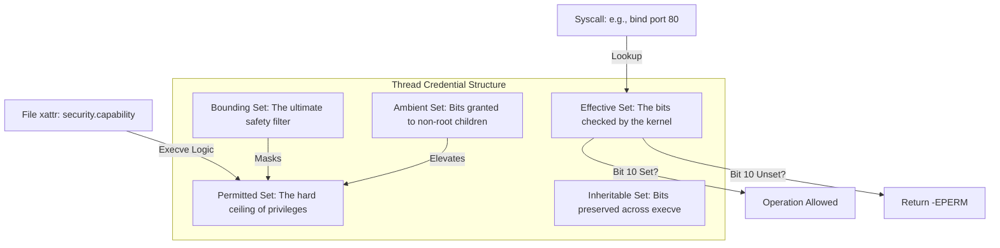

The traditional Unix security model is a crude, binary hammer. You're either the all-powerful root user with UID 0 or you're a lowly unprivileged process with no say in how the system runs. This all-or-nothing approach is a disaster for the principle of least privilege. If a web server needs to bind to port 443, you historically had to run the whole process as root. This gave that process the power to wipe the drive, sniff any packet, and bypass every permission check on the system just so it could listen on a privileged port. Linux capabilities were designed to shatter this monolithic power into distinct, granular bits that can be assigned to threads or files independently.

At the heart of this system is a series of 64-bit masks stored in the kernel task structure. Each bit represents a specific privilege. CAP_NET_BIND_SERVICE allows binding to low-numbered ports. CAP_SYS_RAWIO allows access to device memory. CAP_SYS_ADMIN is the infamous kitchen sink bit that covers everything from mounting filesystems to changing kernel parameters. When a process tries to perform a sensitive operation, the kernel doesn't just check if the UID is 0. It checks if the corresponding bit is set in the process's effective capability set. This check happens deep within the kernel's Security Modules (LSM) hooks and common capability helper functions.

The kernel manages five distinct sets for every thread. The Permitted set is the absolute maximum limit of what the thread can do. The Effective set is what's actually active right now. You can drop bits from your Effective set if you don't need them and pull them back from Permitted later if you need to perform a privileged task. The Inheritable set is a bit of a legacy mess that determines what privileges pass through an execve call to a new program. Because the Inheritable set alone wasn't enough to make non-root processes work correctly without setuid bits, the kernel developers eventually added the Ambient set. Ambient capabilities allow a thread to pass privileges to its children even if they aren't running a special capability-aware binary. This is exactly how container runtimes like runc grant specific powers to a containerized process without making the whole environment insecure.

When a process calls execve, the kernel performs a complex transformation of these bitmasks. It doesn't just copy them over. It looks at the file's extended attributes. If you've used the setcap command on a binary, it has its own Permitted and Inheritable sets stored in the security.capability attribute. The kernel combines these with the caller's sets using a series of bitwise logic gates. The new Permitted set is the Bounding set ANDed with the file's permitted bits, ORed with the intersection of the file's inheritable bits and the process's inheritable bits. It's a dense logic tree designed to ensure that no process ever gains more power than both the caller and the executable intended.

One of the most powerful aspects of this architecture is the Bounding set. It acts as a final safety valve. If you remove a capability from the Bounding set, that process and all its future children can never regain that privilege, even if they execute a setuid-root binary. Systemd uses this heavily with the CapabilityBoundingSet directive in service files. If you know your service never needs to reboot the system or load kernel modules, you can strike those bits from the Bounding set. Even if an attacker gains remote code execution and finds a setuid-root helper on the disk, the kernel will refuse to grant the forbidden privileges because the Bounding set mask will block them during the transition.

Threads manipulate these sets using the capget and capset system calls. These calls don't just let you set any bit you want. You can only move bits from your Permitted set into your Effective set. You can never add a bit to your Permitted set out of thin air. Once you drop a bit from Permitted, it's gone for good for that thread. The only way to get it back is to exec a file that has that specific capability bit set in its extended attributes. This makes the system extremely resilient against privilege escalation within a running process.

Despite the granularity, the system isn't perfect. CAP_SYS_ADMIN is a notorious problem because it's too broad. It's often called the new root because so many different kernel features were stuffed into it over the years. If a process has CAP_SYS_ADMIN, the security boundary is significantly weaker than if it only had CAP_NET_RAW. Security-conscious developers try to avoid it at all costs, but sometimes the kernel's internal checks are hardcoded to look for that specific bit for operations that arguably deserve their own separate capability. Even with that flaw, capabilities remain the primary mechanism for breaking the binary root/user deadlock and building secure, partitioned systems.
