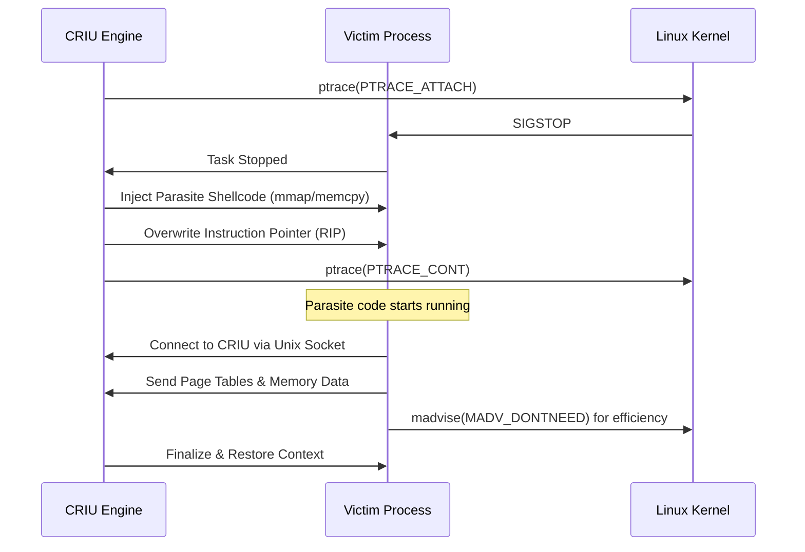

Checkpoint/Restore in Userspace, or CRIU, is one of those pieces of software that sounds like it should be impossible. It allows you to take a running process, freeze it, dump its entire state into a set of files, and then resume it later on a completely different machine. This isn't just about saving a bit of memory. We are talking about capturing file descriptors, TCP connections, registers, and memory maps. While containers give us a way to package an environment, CRIU gives us a way to package a moment in time. Most people encounter CRIU as the backend for Docker's checkpoint command or as the engine behind serverless fast-starts, but the actual mechanics of how it seizes control of a process are fascinatingly invasive.

The core of the checkpointing operation relies on a technique called parasite injection. Since a process won't just politely tell you everything about its internal state upon request, CRIU has to take over the process's execution context. It starts by using ptrace to attach to the target, which stops the victim process in its tracks. Once stopped, CRIU doesn't just read memory through ptrace. That would be too slow. Instead, it literally rewrites a small section of the process's code with a parasite blob. This blob is a tiny piece of shellcode that CRIU forces the process to execute. The parasite is responsible for opening a communication socket back to the CRIU lead process and then dumping the contents of the address space from the inside. By running code within the address space of the victim, CRIU can use system calls like vmsplice to move pages into pipes without unnecessary copying, which makes the whole thing significantly more efficient.

Dumping the memory is actually the easy part. The real nightmare starts with external state like networking and file descriptors. If a process has an open TCP connection, you can't just save the socket number. The remote end of that connection has no idea you are trying to freeze the process, and if you stop responding to ACKs, the connection will time out. To solve this, the CRIU team actually upstreamed a feature into the Linux kernel called TCP_REPAIR mode. When a socket is put into this mode, the kernel stops sending anything on the wire and allows CRIU to peek at and even set the sequence numbers, window sizes, and other internal TCP state variables. During a restore, CRIU creates a new socket, puts it into TCP_REPAIR mode, injects the old state back into the kernel, and then turns the mode off. The remote side is none the wiser, assuming there was just a brief network hiccup.

File descriptors present their own set of challenges because the kernel doesn't give you a straightforward way to ask what file is actually behind a descriptor. CRIU has to crawl through /proc/pid/fd/ and use the kcmp system call to figure out if multiple descriptors are pointing to the same underlying file description. It also has to handle what it calls ghost files. These are files that were deleted but are still held open by the process. CRIU handles this by essentially copying the deleted file's contents from the /proc link into the image files so it can be recreated on the other side. It is a series of clever hacks built on top of each other to reconstruct a reality that the kernel never intended to be portable.

The restore process is arguably weirder than the checkpoint. CRIU has to recreate the process tree with the exact same Process IDs (PIDs) as before. It uses a special kernel interface called ns_last_pid, which is basically a way to tell the kernel what the next PID should be. CRIU then enters a loop of forking until it reaches the desired PID. This is essentially a controlled fork bomb. Once the processes are created with the right IDs, they use the same parasite injection logic in reverse. They map the memory back into the correct locations, restore the registers, and then perform a jump back to the original instruction pointer. It is a resurrection that requires the environment to look exactly like the moment of death, right down to the mount points and user namespaces.

There are limits to this magic, of course. If the process is using hardware that has its own opaque state, like a GPU or a specific hardware crypto accelerator, CRIU will likely fail unless there is a specific plugin to handle that state. But for standard backend workloads, it's a remarkably robust system. It turns the ephemeral nature of a Linux process into something durable and movable. Understanding CRIU makes you realize that the boundary between a process and the kernel isn't nearly as rigid as the man pages make it seem.
