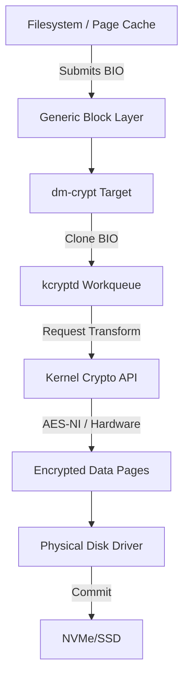

Most developers treat disk encryption as a checkbox in an installer. You toggle a button, provide a passphrase, and the kernel handles the rest. But if you look closer at how the Linux kernel actually manages transparent disk encryption, you find a sophisticated dance between the device-mapper framework and the crypto API. At the heart of this system is dm-crypt. It is not a filesystem. It is a block-level transformation layer that sits between the generic block layer and the physical disk drivers. When the kernel wants to write data to an encrypted partition, dm-crypt intercepts the request, encrypts the data in-place using kernel workqueues, and then passes a new request down to the actual hardware. 

To understand dm-crypt, you have to understand the Device Mapper. The Device Mapper is a generic framework for creating virtual block devices. It maps ranges of logical blocks to ranges of physical blocks. When you use dm-crypt, you are creating a virtual device where every single read and write operation is passed through a specific crypto target. This target is responsible for the heavy lifting of AES or whatever cipher you've chosen. The data path begins when a filesystem like ext4 or XFS submits a bio structure. The bio is the fundamental unit of I/O in the Linux kernel. It contains a list of pages to be transferred and the target sector on the disk. When this bio hits the dm-crypt device, the kernel doesn't just encrypt the buffer in place. That would be dangerous because the original pages might be owned by a user process or the page cache. Instead, dm-crypt clones the bio. It allocates new pages from a dedicated memory pool, copies the original data into them, and then performs the encryption on these clones. 



Performance is always the primary concern with disk encryption. Doing AES-XTS on every block could easily become a bottleneck for modern NVMe drives that can push gigabytes per second. The kernel handles this by using the kcryptd workqueue. Encryption is an inherently CPU-bound task that can be parallelized. By offloading the encryption of different sectors to different CPU cores, the kernel can saturate the bandwidth of the underlying storage. It also leverages specialized CPU instructions like AES-NI. If your processor supports it, the Crypto API will use these instructions to perform the math in hardware, which is significantly faster than any software implementation. This is why you often see high CPU usage across all cores during heavy disk I/O on encrypted volumes. The kernel is literally turning your CPU into a massive encryption engine. 

While dm-crypt handles the data flow, LUKS or Linux Unified Key Setup handles the keys. You can use dm-crypt without LUKS by providing a raw key, but that's a nightmare for usability. LUKS provides a standard header that stores the metadata needed to open the device. The most important thing to understand about LUKS is that your passphrase does not actually encrypt your data. Your data is encrypted by a Master Key that is randomly generated when the partition is created. This Master Key is itself encrypted by your passphrase and stored in one of the eight keyslots in the LUKS header. This architecture is what allows you to have multiple different passphrases for the same disk or to change your passphrase without re-encrypting the entire drive. You just re-encrypt the Master Key with the new passphrase and update the keyslot. 

```text
+---------------------------------------------+
| LUKS2 Header (Primary)                      |
| - JSON Metadata: Cipher, Hash, JSON size    |
| - Binary Header: Checksums, Salt            |
+---------------------------------------------+
| Keyslot 0 (Encrypted Master Key Material)   |
| - Argon2id Parameters                       |
| - Anti-Forensic Splitter Data               |
+---------------------------------------------+
| Keyslot 1 ... 31 (LUKS2 supports more)      |
+---------------------------------------------+
| ...                                         |
+---------------------------------------------+
| Encrypted Data Payload (The Actual Data)    |
+---------------------------------------------+
```

Modern LUKS2 uses Argon2 for key stretching, which is a massive upgrade over the older PBKDF2 used in LUKS1. Key stretching is what makes brute-forcing your passphrase difficult. It forces the attacker to perform millions of iterations of a hash function, or in the case of Argon2, it forces them to use a specific amount of memory. This levels the playing field against ASICs and GPUs. When you enter your passphrase, the kernel runs the Argon2 algorithm to derive a temporary key. It uses this temporary key to attempt to decrypt the data stored in a keyslot. If the decryption is successful, it compares a checksum to verify it got the right Master Key. Only then is that Master Key loaded into the kernel's keyring and passed to dm-crypt to begin the mapping process. 

One of the more interesting aspects of the LUKS design is how it handles the risk of partial writes. The header is stored in a way that minimizes the chance of corruption during a power failure. In LUKS2, there are actually two headers, one at the beginning of the device and one at a specific offset, providing a backup. If the primary header is corrupted during an update, the kernel can fall back to the second one. The Master Key itself is also protected by an anti-forensic splitter. This technique spreads the key across a larger area of the disk so that every single bit of the split key must be read correctly to reconstruct the original. This makes it much harder for an attacker to recover a key from partially damaged or poorly erased flash memory. 

There's a significant trade-off when it comes to the Linux networking and block stacks. Because dm-crypt operates at the block level, it has no idea what a file is. It sees a stream of sectors. This is great for security because it encrypts everything including the filesystem metadata, directory structures, and even the journal. However, it means that features like fstrim (the TRIM command for SSDs) can be a security risk. If you enable TRIM on an encrypted device, the kernel tells the SSD which blocks are no longer in use so the drive can optimize its wear leveling. An attacker looking at the drive can see which blocks are empty and which contain data. This leaks information about the size and fragmentation of your files. Most distributions disable TRIM by default on encrypted volumes for this reason, even though it can lead to slower write performance over time as the SSD fills up. 

Dealing with the interaction between dm-crypt and the rest of the kernel is complex. For example, the kernel's memory management system needs to be aware that these pages are being used for encryption. If the system is low on memory, it might try to reclaim the very pages dm-crypt is using for its cloned bio. To prevent this, dm-crypt uses mempools, which are pre-allocated chunks of memory that the kernel guarantees will always be available for this specific driver. This ensures that even under heavy memory pressure, the system can still perform the I/O operations necessary to swap data to the encrypted disk. If dm-crypt couldn't get memory for a write, the whole system would deadlock. The design is a masterclass in defensive programming within the constraints of a monolithic kernel.
