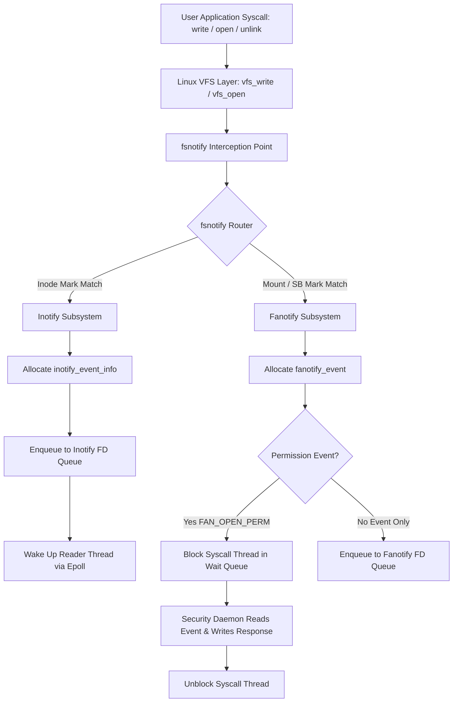

Building live code reloaders, file synchronization daemons, or endpoint security agents requires tracking file changes on disk in real time. Polling directory trees using system calls like stat or getdents burns CPU cycles and saturates storage controllers. The Linux kernel solves this by putting event notification mechanisms directly inside the Virtual File System layer. Two main interfaces expose these events to user space: inotify and fanotify. While both hook into the same kernel infrastructure, their internal data structures, scoping rules, and memory characteristics are completely different.

# The Kernel Interception Gateway: fsnotify

Every file operation on Linux travels through generic VFS helpers. When a thread executes a system call such as write, open, unlink, or mkdir, the kernel routes the request through helper routines like vfs_write, vfs_open, or vfs_unlink. Right after the underlying storage driver modifies the inode or updates block allocations, the kernel executes a call to fsnotify.

Functionally, fsnotify acts as the central event broker inside the kernel. It does not contain logic specific to inotify or fanotify. Instead, it relies on a publish-subscribe model integrated into core VFS structures. Every inode, mount point (struct vfsmount), and filesystem superblock (struct super_block) maintains a pointer to an fsnotify_mark_connector. This connector object anchors a doubly linked list of fsnotify_mark structures.



When an action takes place, fsnotify collects pointers to the affected inode, its parent directory inode, the active mount point, and the parent superblock. It checks mask bitfields attached to these objects. If any of those bitfields match the current event type, fsnotify loops over the registered marks and dispatches a notification payload to every associated notification group.

# Inotify Internals and the Inode Pinning Problem

Inotify operates entirely at the inode granular level. When you initialize an inotify instance using inotify_init1, the kernel allocates a struct inotify_group object and binds it to a anonymous file descriptor. When you add a watch using inotify_add_watch, the kernel allocates an inotify_inode_mark structure, initializes an integer watch descriptor, and inserts the mark into two separate lookup structures. One insertion goes into a radix tree owned by the inotify group to allow O(1) watch descriptor to mark lookups. The second insertion attaches the mark directly to the targeted inode's fsnotify_mark_connector list.

Because inotify marks attach directly to individual inodes, monitoring a directory tree requires registering a watch on every single subdirectory inside that tree. If a directory structure contains a million subdirectories, your application must issue a million separate inotify_add_watch calls. This model causes serious scaling issues for systems programmers.

First, holding a watch on an inode requires keeping that inode pinned in the kernel slab cache. Normally, the VFS shrinker reclaims inactive inodes under memory pressure. Inotify marks increment reference counts on kernel inodes, preventing slab reclamation. High numbers of watches balloon the kernel memory footprint.

Second, inotify cannot track directory moves outside watched trees cleanly. If a user moves an unmonitored directory into a watched tree, or renames a deeply nested directory past a watched boundary, inotify emits an IN_MOVE_SELF or IN_MOVED_FROM event with a cookie value. However, matching cookies across separate directories requires maintaining a massive state map in user space. If event buffers overflow, directory tree synchronization breaks down completely and requires a full manual disk rescan.

# Fanotify and Scalable Event Monitoring

Fanotify was added to the kernel to overcome inotify's structural limitations, specifically targeting antivirus scanners, system auditors, and container runtime engines. Instead of forcing applications to place individual marks on millions of inodes, fanotify introduces mount marks (FAN_MARK_MOUNT) and filesystem marks (FAN_MARK_FILESYSTEM).

When an application sets FAN_MARK_FILESYSTEM on a mount path, fanotify attaches a single fsnotify_mark to the super_block structure of that filesystem. Any file system event occurring anywhere on that entire storage device instantly matches the superblock mark mask. The kernel dispatches the event without requiring per-inode mark allocation, eliminating the memory overhead of tracking massive directory hierarchies.

Modern fanotify also fundamentally changes how file identities are returned. Early versions of fanotify returned an open file descriptor pointing to the touched object inside the event structure. While returning an open descriptor allowed security tools to read file content immediately without race conditions, it quickly ran out of file descriptors when processing high-volume workloads. Recent kernels support the FAN_REPORT_FID and FAN_REPORT_DFID_NAME flags. Instead of passing an open file descriptor, the kernel serializes a variable-length file handle (struct file_handle) into the event buffer, containing the filesystem UUID and internal handle payload. User space applications can resolve these file handles to paths using open_by_handle_at without holding long-lived file handles or pinning inodes.

# Blocking Execution with Fanotify Permission Events

Unlike inotify, which is strictly an asynchronous reporting engine, fanotify supports synchronous execution blocking through permission events like FAN_OPEN_PERM and FAN_ACCESS_PERM. This capability forms the backbone of modern Linux endpoint security agents.

When a thread attempts to open a file monitored by a permission mark, the VFS pipeline enters fsnotify_parent and subsequently fanotify_handle_event. Recognizing a permission bit, the fanotify handler allocates a special fanotify_perm_event object containing a unique event identifier. It places this object into the notification group's queue and instantly puts the calling thread to sleep using wait_event_interruptible.

```
Syscall Thread (vfs_open)             Kernel Fanotify Core             Security Daemon (User Space)
         |                                     |                                     |
         |--- calls open() ------------------->|                                     |
         |                                     |-- enqueues FAN_OPEN_PERM event ---->|
         | (THREAD BLOCKED in wait queue)      |                                     |
         |                                     |<-- reads event from fanotify FD ----|
         |                                     |    inspects file path & content     |
         |                                     |                                     |
         |                                     |<-- writes FAN_ALLOW / FAN_DENY -----|
         |<-- resumes execution ---------------|                                     |
         |    returns FD or -EPERM             |                                     |
```

Execution of the system call pauses inside the kernel. The monitoring daemon reads the event from its fanotify file descriptor, inspects the file, and writes a response structure (struct fanotify_response) back into the fanotify file descriptor. The write handler matches the response object ID to the sleeping thread, updates the response status to FAN_ALLOW or FAN_DENY, and wakes up the blocked thread. If allowed, vfs_open continues normal execution. If denied, the VFS layer aborts the call immediately and returns an EPERM error code to the caller.

If the security daemon crashes while holding open permission requests, every blocked thread inside the kernel would hang indefinitely. To prevent system lockups, closing the fanotify file descriptor automatically flushes the permission queue, unlocking all sleeping threads and returning default denial or success codes depending on initial flag configurations.

# Ring Buffer Mechanics and Queue Overflows

Events generated by both inotify and fanotify must be passed from kernel memory to user space buffers via read calls. Both systems manage queue growth using atomic counters and internal ring buffers, but handles overflows differently.

Each notification group defines a maximum queue length limit, controllable via sysctl parameters like fs.inotify.max_queued_events. When event generation outpaces user space consumption, the queue fills up. When the current queued event count hits the group limit, the kernel rejects new allocations and appends a single overflow event to the queue.

Inotify signals this state by enqueuing an inotify_event struct with the mask set to IN_Q_OVERFLOW and the watch descriptor field set to negative one. Fanotify does the same using the FAN_QUEUE_OVERFLOW flag bit. Once an overflow event is pushed, the kernel drops all subsequent incoming events for that group until user space reads down the buffer and drains the queue. Applications reading an overflow event cannot recover missed intermediate changes and must treat the event stream as corrupted, forcing a complete state sync.

Memory management during event creation demands low allocation overhead. The kernel uses dedicated kmem_cache slabs for inotify_event_info and fanotify_event objects. If an event target involves a filename path component, the kernel allocates variable-sized memory tail buffers directly after the event structure to store the string payload. When user space invokes read on the notification file descriptor, the kernel copies these serialized structures into the provided buffer using copy_to_user, updates ring buffer head pointers, and frees the slab objects back to the kernel pool.

# Choosing Between Notification Subsystems

Designing file system state tracking engines requires matching the tool to the scope of your monitoring boundaries.

Inotify works cleanly for self-contained, shallow directory structures where the monitored application controls the life cycle of the watched paths. Local build tools, configuration hot-reloaders, and isolated developer utility scripts fit nicely into inotify because they only care about a tiny subset of explicitly opened files.

Fanotify is required when building enterprise infrastructure services, security monitors, storage engines, or container management platforms. Mount-level watching avoids path traversal races, filesystem marks eliminate watch exhaustion, and permission hooks grant absolute execution control over file system access across the entire operating system.
