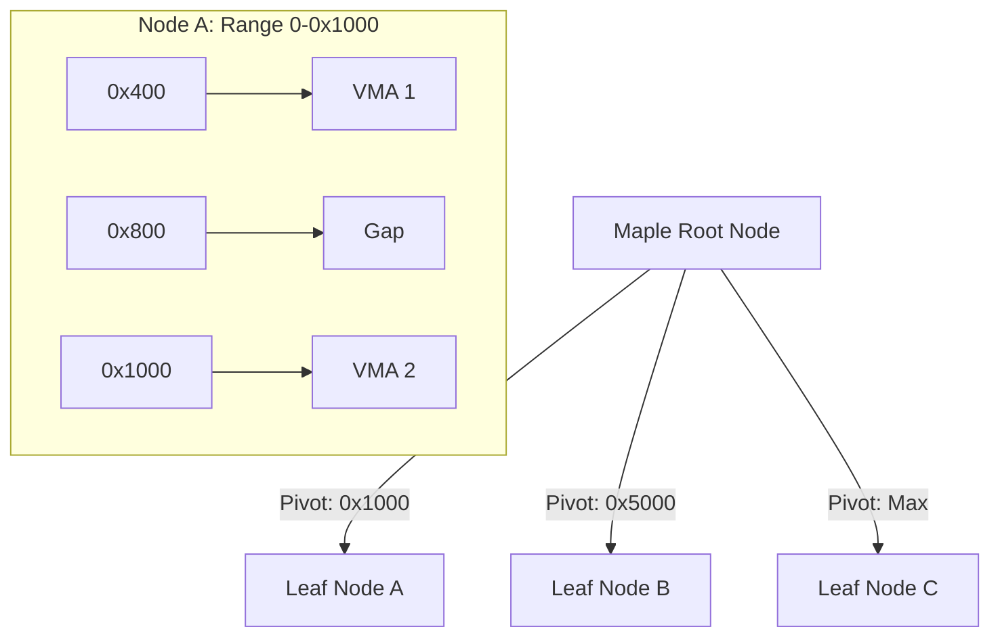
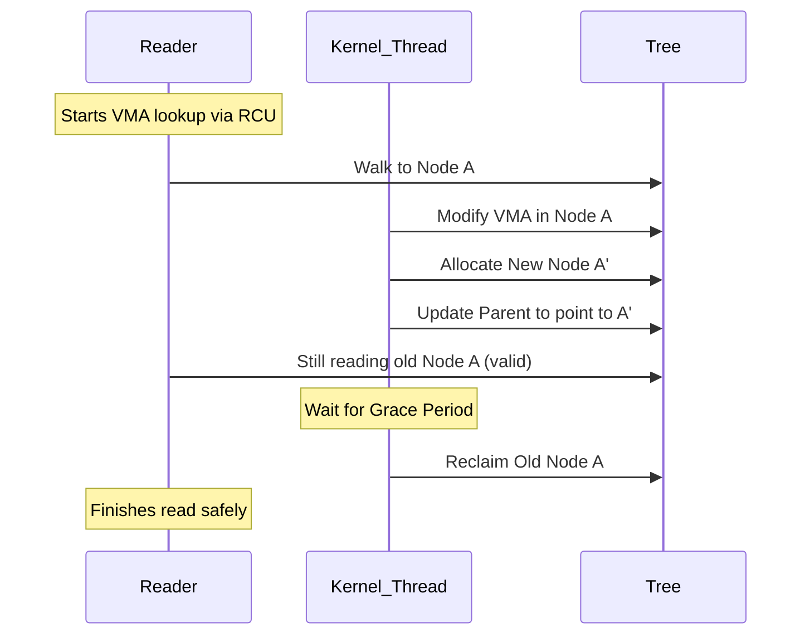

The Linux kernel has a monumental task in managing the virtual memory space of every process. For decades, this was the domain of the red-black tree (rbtree) and a doubly linked list. Every time a process called mmap or handled a page fault, the kernel had to traverse these structures to find the right Virtual Memory Area (VMA). But as modern systems grew to include massive amounts of RAM and highly threaded applications, the rbtree started showing its age. The move to the Maple Tree in the 6.1 kernel wasn't just a minor refactor. It was a complete overhaul of how the kernel tracks memory ranges to support better concurrency and simplify the code. 

The fundamental problem with the red-black tree in a kernel context is that it's a generic balanced binary search tree. It's great for O(log n) lookups of single keys, but memory management isn't about single keys. It is about ranges. A VMA represents a range from address A to address B. When you use a red-black tree to store ranges, you end up with a lot of awkward logic to handle overlaps or find gaps between ranges. Searching for a gap to place a new mapping meant walking the tree in a way it wasn't really designed for. This led to the kernel maintaining a separate doubly linked list just to make linear iteration easier, which meant every insertion or deletion had to update two different data structures under a heavy lock.

Enter the Maple Tree. It's a RCU-friendly range-based B-tree variant. Unlike a binary tree where each node has two children, a Maple Tree node can have many. The nodes are specifically sized to fit into a cache line, which is usually 256 bytes for these structures in the kernel. This significantly reduces cache misses during a walk. More importantly, it's designed to store ranges natively. Each node contains a set of pivots and slots. A pivot is the end point of a range, and the slot is the pointer to either a child node or the actual VMA metadata. This architecture allows the kernel to represent the entire 64-bit address space, including the empty gaps, within the tree itself.

The node structure of the Maple Tree is quite clever. It uses different node types depending on how dense the data is. There are dense nodes for when you have lots of small entries and leaf nodes for standard range storage. A typical leaf node might hold up to 16 ranges. When you search for an address, the CPU compares your address against the pivots in parallel or in a tight loop. Because the pivots are contiguous in memory, the prefetcher handles this beautifully. It is a massive win over the pointer-chasing nature of red-black trees where every child node could be in a completely different part of physical RAM.

One of the biggest drivers for the Maple Tree was RCU (Read-Copy-Update) compatibility. The old rbtree implementation was notoriously difficult to use with RCU for lookups because tree rebalancing (rotations) could move nodes around while a reader was halfway through a walk. This forced the kernel to rely heavily on the `mmap_lock`, a well-known bottleneck in Linux performance. The Maple Tree is designed so that nodes are replaced in an RCU-safe manner. When a node needs to be updated, a new version is created and the pointer in the parent is swapped atomically. This allows readers to walk the tree without taking a single lock, which is a game changer for page fault performance on high-core-count machines.

Finding a gap for a new memory mapping also becomes much simpler. In the old system, finding a hole big enough for a new `mmap` required complex heuristics or a full scan. The Maple Tree nodes can store metadata about the largest gap available in the subtree below them. This is called the 'gap tracking' feature. If you need a 2MB hole, you just look at the root. If the root says the largest gap is 1MB, you don't even bother walking down. If it says 4MB, you follow the branch that contains that gap. This turns an O(n) search for a gap into an O(log n) operation.

There's also the benefit of code simplification. By consolidating the linked list and the tree into a single structure, the kernel developers were able to delete thousands of lines of brittle boilerplate code. The Maple Tree handles the 'null' ranges (the gaps) explicitly, so there's no more special casing for what happens between VMAs. The tree is simply a complete map of the address space from 0 to infinity. If a slot points to a VMA, that's a mapped region. If it points to NULL, that's a hole. It's an elegant way to think about memory that fits the reality of how processes actually use their virtual address space. We are seeing the payoff in more stable systems and better scaling as we move into the era of terabyte-scale memory being common even on commodity servers.
