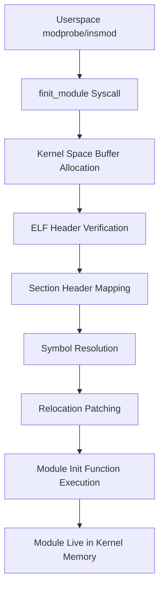

The Linux kernel is often described as a monolithic blob, but that description is a bit of a lie. It is actually a dynamic ecosystem that can grow or shrink at runtime through Kernel Modules. When you run a command like insmod or modprobe, you aren't just starting a userspace process. You are performing live binary linking against a running kernel. It is essentially open-heart surgery on the kernel's memory space. A .ko file is not an executable in the traditional sense. It is a relocatable ELF object, specifically of type ET_REL. This means the code inside has no idea where it will eventually live in memory. The kernel's module loader acts as a specialized dynamic linker that patches the module's binary on the fly to point to the correct addresses for functions like printk or kmalloc.

### The ELF Relocatable Object Structure

To understand the loader, you have to understand the format of the module itself. A relocatable ELF file consists of several sections. There is the .text section containing the actual machine code. There is the .data section for initialized variables. But the most important parts for the loader are the relocation sections, usually named something like .rel.text or .rela.text. These sections are basically a collection of to-do notes for the kernel. They tell the loader that at a specific offset in the code, there is a reference to a symbol that is not yet defined. The compiler leaves a hole in the binary, often filled with zeros or a temporary offset, and it creates a relocation entry that says, hey, when you find out where the function 'kmalloc' is, come back here and overwrite these bytes with the real address.

### The finit_module Syscall and Buffer Management

Modern Linux systems primarily use the finit_module system call. This call is cleaner than the older init_module because it takes a file descriptor rather than a pointer to a userspace memory buffer. Once the kernel receives this descriptor, it allocates a chunk of kernel memory to hold the entire ELF image. It performs a series of sanity checks on the ELF header to make sure the machine architecture matches and the file is actually a relocatable object. After these checks pass, the kernel maps the various sections into their final destination in kernel memory. This is not a simple copy. The kernel must ensure that the memory has the right permissions. Code sections need to be executable but not writable, while data sections should be writable but not executable. The kernel uses the module_alloc function, which is architecture-specific, to carve out this memory from the vmalloc area.

### Symbol Resolution and the Export Table

The kernel maintains an internal dictionary of every function and variable that has been explicitly exported using the EXPORT_SYMBOL macro. This dictionary is the key to symbol resolution. When the loader encounters an undefined symbol in the module, it looks up the name in this global kernel symbol table. If the symbol isn't found, the loading process fails immediately with an 'Unknown symbol' error. This is a common point of frustration when you try to load a module compiled for a different kernel version. The kernel also checks for a special section called __versions in the module. This section contains CRC checksums for every symbol the module depends on. If the CRC for 'printk' in the module doesn't match the CRC of 'printk' in the running kernel, the loader rejects the module to prevent a certain crash. It's a primitive but effective form of ABI protection.

### The Mechanics of Relocation

Relocation is where the real engineering happens. On x86_64, most relocations are of the type R_X86_64_PC32 or R_X86_64_PLT32. These are 32-bit PC-relative offsets. The loader calculates the distance between the instruction that needs the symbol and the actual address of the symbol in kernel memory. It then writes this 32-bit value directly into the code. This is why you can't just move a kernel module around in memory once it's loaded. The addresses are baked into the instructions themselves. If the symbol is too far away to reach with a 32-bit offset, the loader has to use trampolines or jump tables, though this is rare in the standard kernel address space. The logic for this is found in the apply_relocate_add function within the kernel source. It iterates through the relocation entries and performs the math for each one based on the relocation type specified in the ELF file.

### Handling Module Sections and Init Hooks

After all the relocations are patched, the module is almost ready. The kernel still needs to handle special sections like .init.text and .exit.text. The .init.text section contains the code for the module_init function. This code only needs to run once. To save precious kernel memory, the loader marks this section as 'init' memory. Once the initialization function finishes, the kernel can actually free this memory and give it back to the system. This is why you see messages in dmesg about freeing unused kernel memory. The .exit.text section is kept around so that the module can be cleanly unloaded later. Finally, the kernel updates the module's state to MODULE_STATE_LIVE and adds it to the global 'modules' list, making its own exported symbols available to any other modules that might be loaded in the future.

### The Performance and Safety Tradeoffs

Loading a module isn't free. The symbol lookup is a linear search through the kernel's export table, though it's often optimized with a hash table or sorted list in newer kernels. The relocation process involves writing to kernel code pages, which requires temporarily marking those pages as writable. This is done via the text_poke mechanism which handles the dirty details of TLB flushing and CPU synchronization. If you load thousands of small modules, the overhead of these memory allocations and symbol lookups can become noticeable. Furthermore, because the module now shares the same address space as the core kernel, a single mistake in a relocation or a null pointer in the init function will bring down the entire system. There is no isolation here. You're giving the module full reign over the silicon. This is why out-of-tree modules are treated with such suspicion by kernel maintainers. They are essentially unverified binary patches to the most sensitive part of the operating system.
