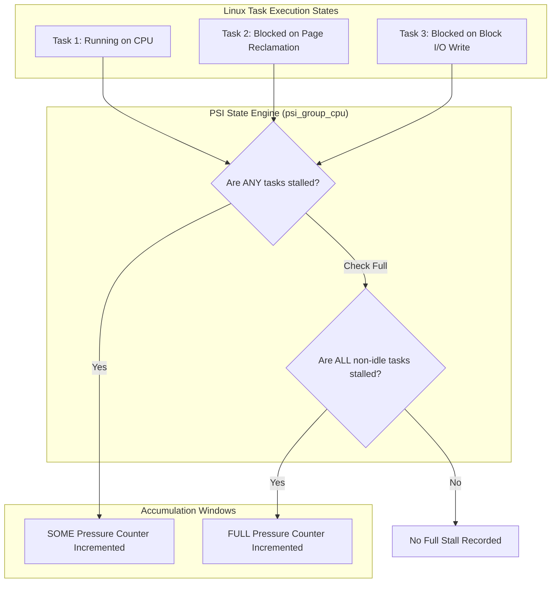
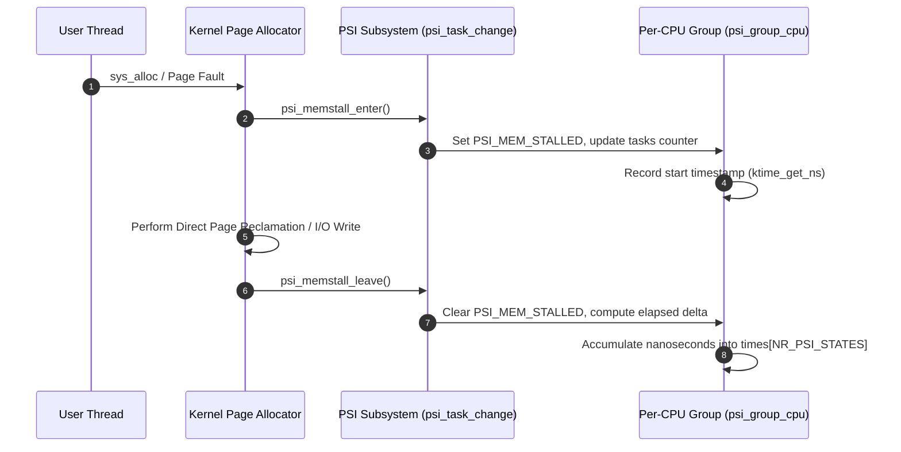
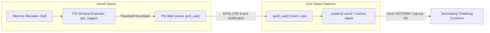

Traditional Linux telemetry metrics give a remarkably poor picture of system health under heavy load. System administrators spent decades relying on system load averages and raw utilization percentages to guess whether a server was overwhelmed. A load average of 16 on a 16-core machine sounds optimal, but if those 16 processes are waiting on slow NVMe block writes or struggling through direct memory page reclamation, system throughput drops to zero while CPU utilization remains low. Utilization tells you how busy a resource is, but it never tells you how much work was delayed because the resource was unavailable.

Pressure Stall Information (PSI) was merged into Linux kernel 4.20 to solve this exact measurement problem. Instead of measuring resource usage, PSI measures resource starvation. It tracks the precise duration of time that runnable tasks spend blocked on memory allocations, disk I/O operations, or CPU scheduling contention. By analyzing task state transitions at the scheduler and page allocator boundaries, PSI produces actionable metrics that quantify severe performance degradation before services drop connections or hit catastrophic kernel Out-Of-Memory events.

## The Two Demarcations: Some Versus Full Pressure

PSI divides resource pressure into two primary states: some and full. Understanding the distinction between these two metrics requires looking at how multi-threaded workloads interact with system hardware.

The some metric tracks the percentage of wall-clock time in which at least one task is stalled waiting on a specific resource while other non-stalled tasks continue executing. If a 64-thread web server has 63 threads actively serving HTTP responses while 1 thread is stalled waiting to allocate a page from physical memory, the system experiences some pressure. The overall service is still making forward progress, but resource contention exists.

The full metric tracks the percentage of wall-clock time in which all non-idle tasks on the system or inside a cgroup are simultaneously stalled on a resource. During full memory pressure, zero threads can execute productive CPU cycles because every running process is blocked inside the kernel waiting for dirty page writebacks or page cache eviction. CPU execution completely halts. The CPU itself does not have a full pressure metric because if a CPU core is actively executing a stalled thread's task, execution is proceeding, making a full CPU stall mathematically impossible.



## Task State Tracking inside the Linux Kernel Scheduler

The kernel tracks pressure by hooking directly into core scheduler transitions and page allocator wait paths. Every task in the kernel carries state flags that indicate whether it is currently stalled on a system resource. These flags live inside the task's kernel context and map to specific PSI state bits.

When a thread attempts to allocate a memory page and finds that physical memory is exhausted, it enters direct reclamation. Inside mm/page_alloc.c, the kernel calls psi_memstall_enter() before beginning page scanning. This function sets the PSI_MEM_STALLED bit in the task state and increments the task's stall depth. When the allocation finally succeeds or fails, psi_memstall_leave() clears the bit.

The central data structure responsible for tracking these states across CPUs is struct psi_group. The global system state uses a default root group, while cgroups v2 instantiate a struct psi_group for every active control group node in the unified hierarchy.

```c
struct psi_group_cpu {
    u32 tasks[NR_PSI_TASK_COUNTS];
    u32 state;
    u32 flags;
    unsigned long update_next;
    u64 times[NR_PSI_STATES];
    u64 total[NR_PSI_STATES];
};
```

Each CPU maintains its own per-cpu instance of struct psi_group_cpu. The tasks array maintains running counts of tasks on that specific CPU that currently reside in various blocked states, such as PSI_MEM_STALLED, PSI_IOWAIT, or PSI_CPU_FULL.

When a task transitions between running and blocked states, the scheduler calls psi_task_change(). This function computes the exact delta of time spent in that state using the CPU's high-resolution clock (ktime_get_ns()) and updates the per-CPU state bitmask.



## Moving Window Math and Decay Calculations

Reading /proc/pressure/memory or /proc/pressure/io reveals output containing three moving average percentages alongside a total raw counter in microseconds:

some avg10=0.00 avg60=0.00 avg300=0.00 total=1420583
full avg10=0.00 avg60=0.00 avg300=0.00 total=482104

The kernel calculates avg10, avg60, and avg300 using exponential moving averages computed over 10-second, 60-second, and 300-second windows. Recounting timestamps across thousands of CPU cores on every file read would introduce prohibitive overhead, so the kernel updates these moving averages lazily using fixed-point arithmetic.

When a reader accesses a PSI control file or a timer tick triggers an update, psi_update_mavgs() processes the delta of time accumulated in psi_group_cpu since the last update.

The update interval LOAD_FREQ is set to 2 seconds. The kernel updates the exponential moving average using the following decay formula:

$$P_{new} = P_{old} \times e^{-\frac{\Delta t}{\tau}} + S \times (1 - e^{-\frac{\Delta t}{\tau}})$$

In this equation, P represents the calculated pressure percentage, \Delta t represents the elapsed time since the previous calculation, \tau represents the window period constant (10, 60, or 300 seconds), and S represents the binary state of stall during that sampling period.

To execute this quickly inside kernel space without floating-point units, the kernel pre-computes fixed-point decay factors using integer bit-shifts. The constant EXP_10 represents e^(-2/10) scaled by 2^11. The calculated pressure percentage updates seamlessly with minimal CPU instruction overhead.

## Epoll-Driven User-Space Triggers

While periodic monitoring of /proc/pressure/ metrics works well for dashboards, high-performance infrastructure requires real-time reactive mechanisms. Waiting 10 seconds for avg10 to reflect severe memory thrashing is far too slow when microservices are dropping connections within milliseconds.

PSI provides a powerful user-space event mechanism using file descriptors and epoll(). A monitoring daemon can write a custom threshold definition to a cgroup's pressure file to register a real-time event trigger.

For example, a user-space memory manager can write "some 150000 1000000" to /sys/fs/cgroup/system.slice/memory.pressure. This string instructs the kernel to trigger an epoll notification whenever tasks inside system.slice experience more than 150 milliseconds (150,000 microseconds) of cumulative memory stall time within any 1-second (1,000,000 microsecond) tracking window.



Inside the kernel, registering a trigger creates a struct psi_trigger. This structure attaches to the target psi_group and allocates a dedicated polling window.

When psi_task_change() updates state counters, it checks if any active triggers exist on the group. If stalls have accumulated beyond the configured threshold inside the moving window, the kernel calls wake_up_interruptible() on the trigger's wait queue. The user-space daemon waiting on epoll_wait() unblocks instantly with an EPOLLPRI signal.

## How systemd-oomd and Kubernetes Leverage PSI

Modern Linux service managers rely heavily on PSI triggers to implement soft resource enforcement. Traditional Linux Out-Of-Memory (OOM) killing was historically a catastrophic fallback. The kernel's built-in OOM killer only activates when physical RAM and swap space are entirely exhausted. By the time the classic kernel OOM killer woke up, the machine was typically locked in severe page thrashing for dozens of seconds, causing cascade failures across distributed systems.

systemd-oomd fixes this by running as an unprivileged user-space daemon that monitors cgroup v2 memory pressure triggers. When a containerized workload begins swapping frantically and page reclamation delays hit a configured threshold (such as 20% stall duration over a 2-second window), systemd-oomd receives an instant epoll notification.

Instead of waiting for system lockup, systemd-oomd evaluates the cgroup tree, identifies the specific cgroup exceeding memory bounds, and terminates its processes using memory.kill. This surgical intervention recovers memory in milliseconds, maintaining low latency for remaining workloads on the host.

Kubernetes node agents like Kubelet and third-party node-problem-detectors use identical PSI trigger mechanisms to detect node pressure before pod eviction limits fire. By bridging low-level scheduler stall tracking directly into user-space event loops, Linux Pressure Stall Information turns resource monitoring from reactive post-mortem analysis into proactive runtime control.
