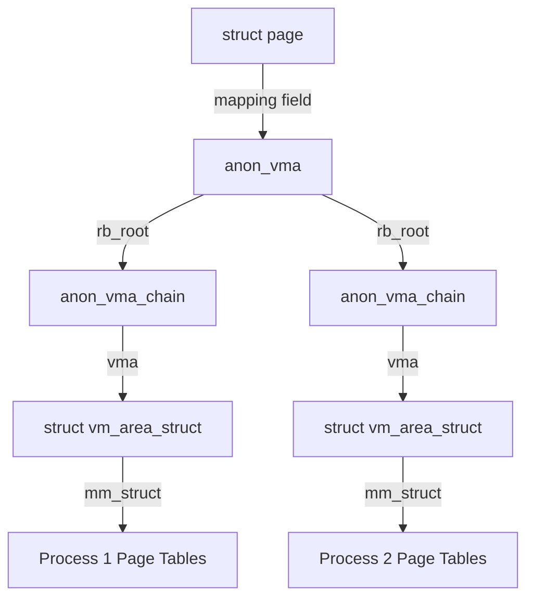

Linux spends an ungodly amount of time translating virtual addresses to physical ones. This is the bread and butter of the Memory Management Unit. It is the easy part. A process wants to read memory, the MMU walks the page tables, finds the physical frame, and the data flows. But the kernel often has to do the exact opposite. When your system is starving for RAM and the Out-Of-Memory killer starts looking for a sacrifice, the kernel has to reclaim pages. If a physical page is shared by ten different processes, the kernel cannot just yank it out from under them. It has to find every single page table entry across all those processes that points to that specific physical frame and invalidate them first. This is where the Reverse Mapping or RMAP system comes in. Without it, memory reclamation would be an O(n) disaster where the kernel scans every process's page tables just to free a single page.

In the early 2.4 kernel days, this was handled by a simple linked list of structures for every page. It worked until you had a shared library like glibc used by hundreds of processes. The overhead of maintaining thousands of list nodes for a single physical frame was a memory hog that scaled poorly. Modern Linux uses an object-based RMAP approach that is much smarter. It leverages the existing relationship between the physical page and the Virtual Memory Area or VMA that owns it. The kernel does not store a list of every user. Instead, it stores a pointer to the higher-level object that knows where the users are. For anonymous memory like your heap or stack, this pointer lives in the struct page and points to an anon_vma object.

The bit-flipping magic happens in the mapping field of the struct page. If the lowest bit is set, the kernel knows this is an anonymous page and treats the pointer as a reference to an anon_vma. This structure is the root of a tree that tracks every VMA mapping that page. When a process forks, it does not just copy the mappings. It creates an anon_vma_chain that links the child's new VMA to the parent's anon_vma. This creates a hierarchy. When it is time to reclaim the page, the kernel follows the pointer to the anon_vma and iterates through the tree of chains. For every VMA it finds, it calculates the virtual address where that page should be. It uses the page's index within the mapping and the VMA's starting address to pinpoint the exact location in the process's virtual address space. Then it walks the page tables for that specific process and clears the entry.

File-backed pages use a different but parallel logic. Instead of an anon_vma, the page points to an address_space object belonging to an inode. This address_space doesn't just manage the page cache. It also maintains an interval tree of all VMAs that have mmap'd that file. If the kernel wants to drop a page that belongs to a shared library on disk, it queries this interval tree to find every process currently mapping that specific offset of the file. It is a highly efficient way to find the needle without searching the entire haystack of system memory.

The complexity of RMAP is why forking a process is still relatively cheap but not free. Every fork adds more nodes to these trees and chains. If the hierarchy gets too deep, the kernel has to spend more cycles traversing it during memory pressure. There are also heavy locking requirements. The kernel uses the anon_vma->rwsem to protect these trees from concurrent modifications. If you have a massive multi-threaded application constantly mapping and unmapping memory, you can actually see contention on the RMAP locks. It is a fundamental piece of the kernel that most developers never see, yet it is the only thing keeping the memory management system from grinding to a halt every time a single page needs to be swapped to disk.
