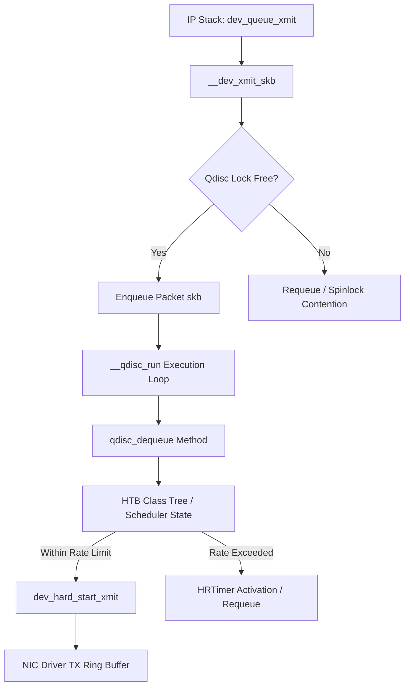
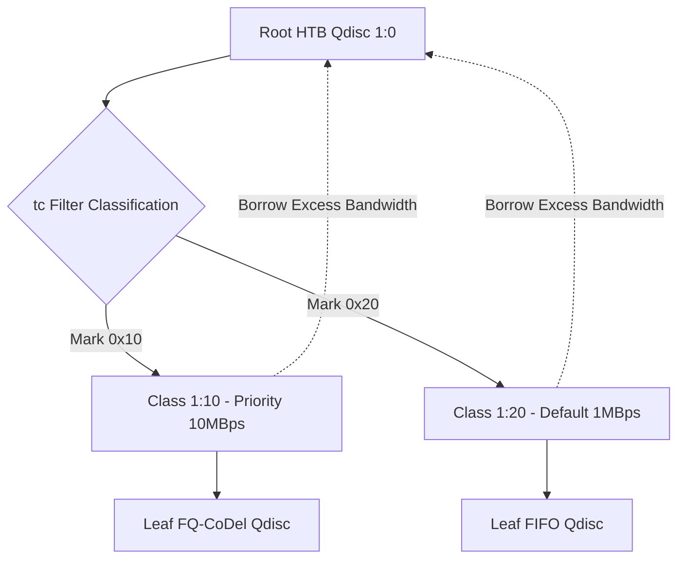

When an application pushes bytes into a TCP socket, the journey through the Linux networking stack is rarely a straight line to the network interface card. Long before the physical driver ring buffer receives an sk_buff, the kernel passes the packet to its egress traffic control framework. This system determines whether packets are transmitted immediately, delayed to enforce bandwidth caps, reordered to prioritize low-latency interactive traffic, or outright dropped to prevent bufferbloat. The Linux Traffic Control framework sits directly between the IP routing engine and the driver transmission queues, operating as a programmable packet scheduling engine.

Understanding traffic control requires looking past high-level userspace wrappers like the tc command line utility. Underneath lies a stateful graph of kernel primitives called Queueing Disciplines, or qdiscs. These primitives implement scheduling algorithms ranging from simple lockless FIFOs to complex classful hierarchies capable of borrowing bandwidth across tenant boundaries in real time.

The entry point to the egress traffic control subsystem is dev_queue_xmit, defined in net/core/dev.c. When a socket buffer arrives at this function, the kernel resolves the destination net_device and evaluates its attached qdisc tree. Every network interface in Linux has a root qdisc attached to its transmit queues. If traffic control is disabled or set to noqueue (common on loopback devices), packets bypass scheduler logic entirely and drop directly into dev_hard_start_xmit. Otherwise, execution routes through __dev_xmit_skb, which manages locking, state evaluation, and enqueue operations.

Every qdisc is defined by struct Qdisc in net/sched/sch_generic.h. The structure holds queue status flags, memory allocations for stored socket buffers, statistics counters, and a pointer to struct Qdisc_ops. The Qdisc_ops structure contains function pointers for the qdisc lifecycle methods: enqueue, dequeue, requeue, and peek.

When __dev_xmit_skb receives a packet, it first invokes the enqueue method on the root qdisc. The return value of enqueue dictates the immediate fate of the sk_buff. NET_XMIT_SUCCESS indicates the packet was queued, NET_XMIT_DROP indicates the queue was full or rate-limited and the packet was freed, and NET_XMIT_CN signals that the packet was enqueued but congestion management thresholds have been breached. If the qdisc is currently unlocked and inactive, __dev_xmit_skb attempts a fast-path transmission by bypassing explicit queueing queues and passing the sk_buff directly to qdisc_run.

The qdisc_run function executes the scheduler's dequeue loop. It continuously calls qdisc_dequeue_head or the qdisc's custom dequeue function to pull sk_buff pointers out of internal memory structures until one of three conditions is met: the qdisc runs out of packets, the device transmit queue becomes throttled, or the scheduler hits its processing quota. The kernel uses a softirq context, specifically NET_TX_SOFTIRQ, to process dequeues asynchronously when driver rings clear or high-resolution kernel timers expire.

Classless qdiscs treat all outgoing packets identically. The default qdisc on single-queue network interfaces was historically pfifo_fast, though modern kernels default to mq or fq_codel. The pfifo_fast qdisc organizes packets into three internal priority bands based on the Type of Service (ToS) byte in the IP header. Band zero handles interactive traffic like SSH, band one handles standard traffic, and band two handles bulk transfers. The dequeue operation always exhausts band zero before touching band one, creating a hard priority model.

Classful qdiscs break this flat paradigm by organizing scheduling logic into a tree hierarchy composed of qdiscs, classes, and filters. The root qdisc acts as the container. Attached to it are one or more class objects, each responsible for managing a portion of total available bandwidth. Classes can themselves contain child qdiscs or child classes, constructing arbitrary scheduling trees.

The Hierarchical Token Bucket (HTB) scheduler, implemented in net/sched/sch_htb.c, is the canonical example of a classful qdisc. HTB relies on token bucket algorithms operating across a tree of classes to enforce minimum guaranteed rates while allowing child classes to borrow idle bandwidth from parent nodes.

Each HTB class maintains two distinct token buckets: a rate bucket and a ceil bucket. The rate bucket governs the guaranteed throughput assigned to the class. The ceil bucket governs the maximum throughput the class can consume when borrowing bandwidth from parents. Tokens represent byte credits and are replenished dynamically based on time deltas measured using ktime_get_ns.

When a packet arrives at an HTB class, HTB calculates the tokens required to transmit the packet size. If the rate bucket contains enough tokens, the class is placed into the HTB_CAN_SEND state, and the packet is dequeued. The required tokens are subtracted from both rate and ceil buckets. If tokens fall below zero, the bucket enters a deficit state, and the class transitions to HTB_MAY_BORROW or HTB_CANT_SEND.

HTB organizes active classes across a series of priority queues implemented as red-black trees. When a class enters HTB_MAY_BORROW, it queries its parent node in the hierarchy. The parent evaluates whether its own token bucket has idle bandwidth. If the parent has tokens and its current output is below its ceiling, it grants permission to the child class to transmit, subtracting the byte cost from the parent's ceil bucket. This mechanism allows idle bandwidth from one service tier to be repurposed instantaneously by sibling classes without breaching top-level bandwidth constraints.

When an HTB class runs out of tokens entirely and cannot borrow from any ancestor, it cannot transmit. The kernel calculates the exact future nanosecond timestamp when enough tokens will accumulate based on the configured rate. HTB schedules an hrtimer (high-resolution kernel timer) set to that timestamp. When the timer fires, it wakes up NET_TX_SOFTIRQ, updates the token counters, moves the HTB class back to HTB_CAN_SEND, and triggers qdisc_run to resume transmission.

While HTB solves bandwidth allocation, it does not prevent queue latency degradation inside leaf queues. As link speeds increased and memory became cheap, network devices accumulated massive FIFO buffers. Under heavy load, these buffers fill completely, adding hundreds of milliseconds of queueing delay without improving throughput, a phenomenon known as bufferbloat.

Fair Queueing Controlled Delay, or FQ-CoDel (implemented in net/sched/sch_fq_codel.c), addresses bufferbloat by combining packet flow isolation with active queue management. It is designed to require zero manual tuning while maintaining low latency for interactive streams alongside saturation flows.

FQ-CoDel splits incoming traffic into multiple flow queues using a Jenkins hash of the packet's 5-tuple (source IP, destination IP, source port, destination port, protocol). By default, FQ-CoDel allocates 1024 flow buckets. Packets are enqueued into their corresponding flow bucket. The scheduler maintains two lists of active flows: new flows and old flows.

When dequeuing, FQ-CoDel services new flows first. New flows are given a quantum of credit (typically 1514 bytes, equivalent to one MTU). If a flow consumes its quantum, it transitions to the old flows list. This mechanism guarantees that short, sparse flows like DNS queries, TCP ACKs, and SSH keystrokes jump straight to the head of the transmission line without waiting behind long-lived bulk TCP streams.

To manage latency within individual flow queues, FQ-CoDel applies the CoDel (Controlled Delay) algorithm. Unlike traditional AQMs like RED (Random Early Detection) which trigger based on average queue size, CoDel measures true packet residence time inside the queue. Every packet is tagged with an ingress timestamp upon enqueueing using skb->tstamp.

When a packet is dequeued, CoDel calculates its queueing delay by subtracting the ingress timestamp from the current system time. If the minimum queueing delay observed over an interval window (typically 100 milliseconds) exceeds the target delay (typically 5 milliseconds), CoDel enters a dropping state. It drops the current packet and calculates the timestamp for the next drop using an inverse square root control law. This mathematical progression accelerates packet drop frequency exponentially as long as the queueing delay stays above target, forcing sender TCP congestion control loops to shrink their congestion windows.

If the network interface or socket supports Explicit Congestion Notification (ECN), FQ-CoDel does not drop the packet. Instead, it invokes INET_ECN_set_ce to modify the IP header, setting the Congestion Encountered bits before passing the frame to the network driver. This provides backpressure to the sender without incurring packet loss retransmissions.

The user-space control plane interacts with kernel traffic control structures entirely through Netlink routing sockets using the NETLINK_ROUTE protocol family. The tc binary communicates with the kernel by creating socket connections using AF_NETLINK and sending formatted RTM_NEWQDISC, RTM_DELQDISC, RTM_GETQDISC, RTM_NEWCLASS, or RTM_NEWFILTER netlink messages.

Inside the kernel, rtnetlink_rcv_msg routes these commands to handler functions in net/sched/sch_api.c. When creating a new qdisc, the kernel parses the Netlink message attributes, including TCA_KIND (a string like htb or fq_codel) and TCA_OPTIONS (a nested structure containing algorithm-specific parameters).

The kernel queries its internal registry of registered Qdisc_ops structures using qdisc_lookup_ops. If the requested qdisc type is not loaded, the kernel dynamically loads the corresponding kernel module (sch_htb.ko) via request_module. Once resolved, the kernel allocates memory for the struct Qdisc instance, calls its init method passing the parsed Netlink options, and attaches the newly instantiated qdisc into the device's qdisc graph.

Dynamic updates to traffic shaping trees, such as modifying HTB class rates or attaching new BPF filters, execute atomically. The kernel holds the qdisc_lock or uses RCU (Read-Copy-Update) semantics to modify pointer graphs safely while concurrent packet transmissions are executing on other CPU cores. This allows production systems to reconfigure bandwidth limits on live interfaces without dropping active TCP connections or restarting networking services.
