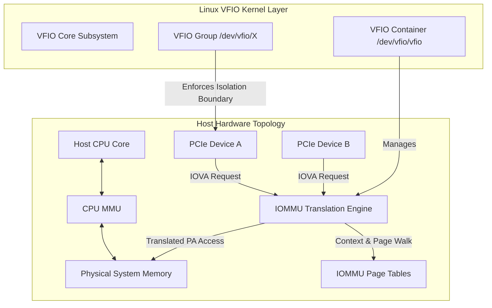
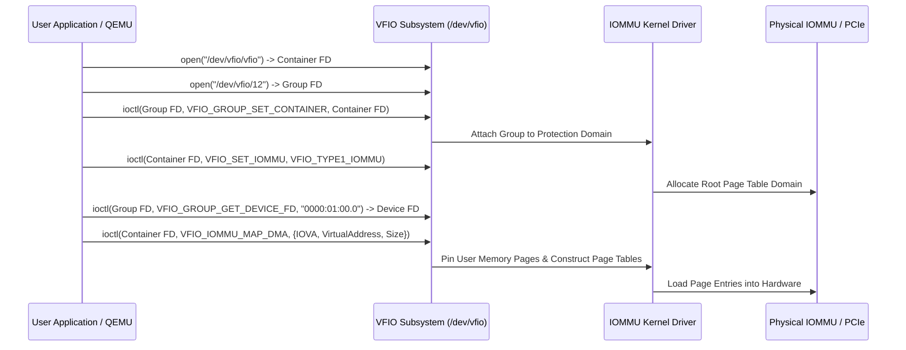

When a PCI Express network interface or GPU executes Direct Memory Access, it issues read and write requests directly across the system bus to physical memory addresses, completely bypassing the CPU. In a classic kernel driver model, the operating system trusts the hardware device and its driver to write only into pre-allocated, ring-buffered memory locations. The moment you push hardware access into user space, whether running high-performance user-space drivers like DPDK or passing physical devices directly into guest virtual machines with KVM, this trust model breaks down entirely. Without kernel intervention on every transaction, a rogue or misconfigured user-space program could instruct the network card to issue DMA transfers directly into kernel text or another process's memory address space.

Linux Virtual Function I/O, universally known as VFIO, solves this security and isolation challenge by transforming hardware devices into safe, isolated user-space file descriptors. At its foundation, VFIO relies on hardware Input-Output Memory Management Units, such as Intel VT-d or AMD-Vi, to enforce hardware-level memory protection and virtual address translation for PCI peripherals.



To understand how VFIO locks down hardware access, you have to look at the memory translation mechanics of the IOMMU itself. Just as a standard CPU Memory Management Unit translates process virtual addresses to physical RAM addresses using page tables, an IOMMU translates I/O Virtual Addresses issued by PCI endpoints into physical host RAM addresses. 

When a PCI device attempts to access host memory, the PCIe packet contains a target IOVA along with a requester ID, which is a bitfield containing the device's bus, device, and function numbers. The IOMMU intercept engine uses this requester ID to look up an entry in its device context tables.

```
+-----------------------------------------------------------------------+
|                       IOMMU Context Walk Pipeline                     |
+-----------------------------------------------------------------------+
| Requester ID (Bus:Dev:Func)                                           |
|    |                                                                  |
|    v                                                                  |
| [ Root Table ] ---> [ Context Table Entry ]                           |
|                            |                                          |
|                            v                                          |
|                     Domain Page Table Pointer                         |
|                            |                                          |
|                            v                                          |
| IOVA Bits [47:39] -> [ PML4 Entry ]                                   |
| IOVA Bits [38:30] ->   [ Page Directory Pointer Entry ]               |
| IOVA Bits [29:21] ->     [ Page Directory Entry ]                    |
| IOVA Bits [20:12] ->       [ Page Table Entry ] ---> Physical Frame   |
+-----------------------------------------------------------------------+
```

The device context table maps the requester ID to a specific protection domain, which holds the root address of the multi-tiered IOMMU page table. The IOMMU walks these page tables to locate the matching physical page frame. If the target IOVA is mapped and the device possesses read or write permissions on that page table entry, the memory access completes across the host bus. If the IOVA isn't mapped, the hardware triggers an IOMMU page fault, dropping the DMA packet and raising an interrupt to signal an unauthorized memory access attempt to the kernel.

Linux models these hardware isolation boundaries using three primary abstractions: VFIO devices, VFIO groups, and VFIO containers.

A VFIO device represents an individual hardware endpoint, such as a single PCI function. You cannot arbitrarily bind a single device to user space in isolation because PCIe hardware topologies introduce physical dependencies. Devices sitting on the same PCIe switch or downstream port might share hardware interconnect paths that allow peer-to-peer DMA transfers without passing through the host IOMMU. 

The kernel evaluates these physical interconnects using PCIe Access Control Services capability checks. If two devices can exchange DMA packets directly without going through the IOMMU, they are grouped into the same IOMMU group. An IOMMU group is the smallest unit of hardware isolation that the kernel can guarantee. You must unbind every single device inside an IOMMU group from its host driver and bind it to the vfio-pci stub driver before user space can access any single device within that group.

The VFIO container represents the software construct for the IOMMU context itself. User space opens `/dev/vfio/vfio` to instantiate a container, which acts as the explicit memory mapping context holding IOMMU page table assignments.

To expose hardware devices to user space safely, VFIO steps through a strict initialization flow. User space begins by opening `/dev/vfio/vfio` to acquire a container file descriptor. Next, user space opens the group file descriptor corresponding to the target device's IOMMU group under `/dev/vfio/<group_id>`. The application then uses an ioctl call on the group descriptor, passing the container file descriptor to attach the group to the container context. Once the group is bound to the container, user space issues a `VFIO_GROUP_GET_DEVICE_FD` ioctl to retrieve an explicit file descriptor representing the physical PCIe device itself.



Once user space holds a device descriptor and container, it must establish memory mappings before issuing any DMA requests. When a standard kernel driver prepares a DMA buffer, it calls memory mapping helpers that temporarily lock pages and write bus addresses into ring buffers. User-space applications cannot call internal kernel helpers on the fly. Instead, the application allocates standard virtual memory, like `posix_memalign` or an anonymous `mmap`, and explicitly registers that memory range with VFIO using the `VFIO_IOMMU_MAP_DMA` ioctl on the container file descriptor.

During a `VFIO_IOMMU_MAP_DMA` execution, the Linux kernel receives the target IOVA, the user-space process virtual address, the mapping size, and access flags. The kernel cannot allow user-space memory mapped for DMA to be paged out to disk, moved by compaction algorithms, or reclaimed by the page cache while hardware devices actively read and write to those physical frames. To prevent corruption, the VFIO driver pins the target user pages in RAM using `pin_user_pages_fast`. Pinning increments the underlying page struct refcounts and flags them, instructing the kernel's memory management subsystem to never reclaim or swap these physical frames.

Because memory pinning locks down real physical RAM and prevents the operating system from overcommitting memory, Linux enforces locked memory resource limits via `RLIMIT_MEMLOCK`. If a user-space application attempts to pin more memory through VFIO DMA mappings than permitted by its resource limits, the `VFIO_IOMMU_MAP_DMA` system call fails with an out-of-memory error.

After pinning the virtual memory range and obtaining the physical page frame numbers, the VFIO Type1 IOMMU driver populates the IOMMU hardware page tables. The driver translates the provided IOVA ranges into host physical addresses and writes the corresponding entries into the active IOMMU domain page tables. Once this step finishes, the PCI hardware can execute direct memory access to those designated IOVA ranges completely unimpeded by kernel execution.

Handling memory access is only half of the physical device equation. Hardware devices must also signal events, complete transfers, and notify the host operating system using interrupts. Modern PCIe devices rely on Message Signaled Interrupts, known as MSI and MSI-X, which send memory write requests to dedicated system architecture addresses rather than toggling physical interrupt lines.

Passing physical interrupt handling to user-space drivers or guest virtual machines introduces significant complexity. If a guest driver inside a virtual machine can write directly to interrupt registers, it could construct malformed MSI packets to trigger arbitrary CPU interrupt vectors on the host system. Hardware vendors mitigate this vulnerability through Interrupt Remapping.

When Interrupt Remapping is enabled, the IOMMU intercepts all PCIe memory write transactions targeting physical interrupt address spaces. Instead of passing the raw vector to the host CPU, the IOMMU matches the write transaction against an Interrupt Remapping Table Entry, indexed by an interrupt index embedded in the PCIe MSI write payload.

```
+-----------------------------------------------------------------------+
|                      Interrupt Remapping Pipeline                     |
+-----------------------------------------------------------------------+
| PCIe Device MSI Write Payload -> Target: 0xFEE00000, Data: Index      |
|    |                                                                  |
|    v                                                                  |
| [ IOMMU Interrupt Remapping Engine ]                                  |
|    |                                                                  |
|    +---> Reads IRTE[Index]                                            |
|    |     |                                                            |
|    |     v                                                            |
|    |     Validates Requester ID & Guest Vector                        |
|    |                                                                  |
|    v                                                                  |
| Converts to Host Interrupt Vector & Target CPU APIC ID               |
|    |                                                                  |
|    v                                                                  |
| Posts Interrupt Vector to Host CPU / KVM Eventfd                      |
+-----------------------------------------------------------------------+
```

VFIO configures these Interrupt Remapping entries when user space uses the `VFIO_DEVICE_SET_IRQS` ioctl. User space allocates an `eventfd` file descriptor and passes it into VFIO alongside the target MSI-X index. The VFIO kernel driver registers an IRQ handler mapped to that specific hardware MSI-X vector. When the device issues an interrupt, the hardware IOMMU validates the transaction against the IRTE, fires the host interrupt, and the host interrupt handler immediately signals the user-space `eventfd`. If the user-space application is QEMU, this `eventfd` connects directly to KVM's irqfd subsystem, injecting the interrupt directly into the guest virtual machine CPU context without requiring a full user-space context switch.

Accessing PCI Base Address Registers and configuration space requires similar precision. When user space needs to configure PCI device settings or access MMIO register regions mapped by the hardware device's BARs, it queries device capability metadata using `VFIO_DEVICE_GET_REGION_INFO`. VFIO exposes region descriptors detailing offset values, sizes, and flag attributes for each hardware BAR.

User space can access BAR regions using read and write system calls on the device file descriptor, which instructs VFIO to trap the access and modify the underlying hardware PCI configuration space or MMIO registers on behalf of the application. For high-performance data path register access, trapping every register access behind system calls creates severe CPU overhead. VFIO handles this by allowing user space to `mmap` MMIO BAR regions directly into its own virtual address space whenever the device region flags support direct mapping. The kernel maps the physical PCI MMIO page frames straight into the process page tables, granting user space direct, unmediated CPU access to control registers on the hardware card.

Through this combination of IOVA page table translation, mandatory PCIe group scoping, page pinning, interrupt remapping table translation, and zero-overhead MMIO register mapping, VFIO bridges the gap between raw hardware speed and host kernel security. Applications run directly on bare metal PCIe capabilities without compromising the physical host memory space.
