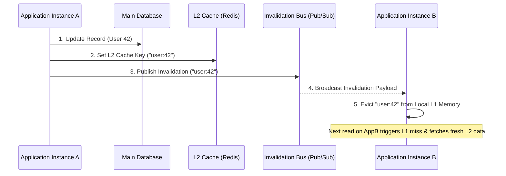
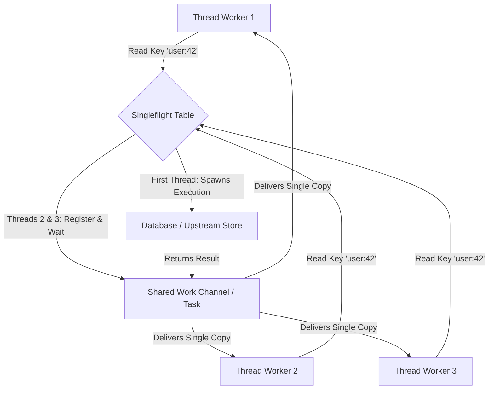

When scaling high-volume web backends, querying a distributed cache like Redis or Memcached over the network introduces a TCP roundtrip tax. Even over low-latency cloud networks, a Redis lookup costs anywhere from 500 microseconds to 2 milliseconds. When a single incoming HTTP request triggers dozens of cache reads, those network roundtrips aggregate fast, destroying p99 latency targets. To hit microsecond response times, systems engineer a local in-process memory cache (L1) directly inside the application runtime, sitting in front of the distributed network cache (L2).

This hybrid L1/L2 approach drastically cuts down network I/O, but it introduces a tricky distributed consistency problem. When Instance A updates a database record and mutates L2, Instance B still holds the old stale value inside its local L1 memory. Without an explicit synchronization mechanism, Instance B serves corrupted or out-of-date state until its local L1 TTL expires.

# L1 Invalidation and the Pub/Sub Backplane

To keep L1 caches synchronized across multiple application instances, high-performance engines rely on a dedicated invalidation backplane. When an instance writes to the underlying store, it updates L2 and immediately emits a cache invalidation event across a low-latency pub/sub message bus.

When Instance B receives the invalidation payload over its persistent TCP subscription, it executes a lock-free lookup in its L1 dictionary and evicts the key. The next read operation on Instance B results in an L1 miss, prompting it to pull fresh data from L2.

Pub/sub channels in systems like Redis or NATS are fire-and-forget. If a network blip or temporary socket reconnect drops an invalidation packet, Instance B's L1 cache remains out of sync indefinitely. Production engines address this by pairing short L1 lifetimes (5 to 30 seconds) with long L2 lifetimes (hours or days). The short L1 TTL acts as a strict upper bound on data staleness during network degradation.

# Cache Stampedes and the Thundering Herd

Multi-tier caching solves read latency and state synchronization, but it leaves backends vulnerable to cache stampedes. A cache stampede occurs when a heavily accessed key expires across L1 and L2 simultaneously under peak query load.

If a key is accessed 10,000 times per second, the moment that key expires, thousands of concurrent threads experience an L1 miss, bypass L2, and simultaneously fire identical SQL queries at the database. This sudden spike in CPU and lock contention saturates database connection pools, causing cascading query timeouts across the infrastructure.

# Request Coalescing with Singleflight

To prevent thousands of duplicate database calls from launching at the exact same millisecond, backend architectures implement request coalescing using the Singleflight pattern. Singleflight guarantees that for any given key, only one in-flight request actively fetches data from the upstream store.

When Thread 1, Thread 2, and Thread 3 encounter an L1 miss for key `user:42`, they register with an in-memory flight table. Thread 1 detects that it is the first request for `user:42`, so it allocates a shared completion source and executes the database query. Thread 2 and Thread 3 find the existing flight entry, attach their context to Thread 1's completion handle, and suspend execution.

Once Thread 1 completes the database fetch, it populates L1 and L2 and resolves the shared handle. All waiting threads unblock simultaneously, receiving the identical result payload with zero additional database calls.

# Probabilistic Early Expiration via XFetch

While Singleflight protects the database from redundant queries on a single node, it does not prevent latency spikes when an L2 entry expires globally. Worker threads must still wait for that single long-running database query to complete before returning a response.

Modern high-scale engines eliminate this latency penalty using probabilistic early expiration, specifically the XFetch algorithm. Instead of waiting for hard TTL expiration, XFetch calculates a dynamic probability of early refresh on every read operation. As the cache key approaches its expiration timestamp, the probability that a read request triggers a background refresh increases exponentially.

The algorithm evaluates the following inequality during each read:

$$\text{read\_time} - \beta \cdot \delta \cdot \ln(\text{rand}()) > \text{ttl}$$

The parameter `delta` represents the compute time in milliseconds required to recalculate the cache value, while `beta` is an aggressiveness multiplier greater than zero. The expression `rand()` yields a uniform random floating-point number between 0 and 1.

If the left side of the inequality exceeds the hard expiration timestamp `ttl`, the reading thread immediately serves the existing cached item to the client without blocking. Simultaneously, it dispatches an asynchronous background task to re-query the database and refresh L2.

Because `rand()` yields a continuous probability distribution, only one worker thread among thousands of concurrent requests triggers the background refresh as expiration approaches. All other concurrent requests serve the cached item instantly from L1 memory. By the time hard TTL expiration arrives, the background worker has already updated the cache, eliminating cold cache misses across the cluster.

# Low-Allocation Runtime Mechanics

Building a high-throughput multi-tier engine in managed environments like C# or Go demands careful attention to memory allocation. Allocating transient string objects for cache keys on every lookup triggers excessive garbage collection pressure under heavy load.

Cache key lookups should operate directly over UTF-8 read-only byte spans or non-cryptographic 64-bit integer hashes like xxHash64. For L1 storage layers, bounded lock-free structures paired with atomic memory fences keep lookups allocation-free while preventing unbounded memory consumption during traffic bursts. Combined with compact invalidation events shipped over persistent socket connections, an application node can hit millions of cache operations per second per core with minimal thread contention.
