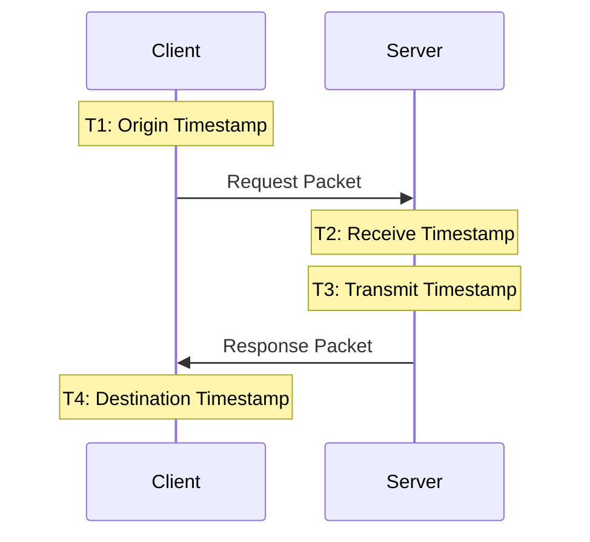
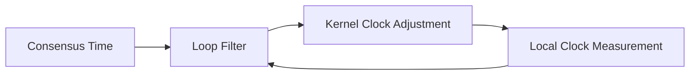

The quartz crystal on your motherboard is garbage. It vibrates at a frequency that is supposed to be steady, but it is sensitive to the heat of your CPU, the age of the silicon, and even the voltage of your power supply. If you left a server alone without a network connection for a day, its clock could easily drift by several seconds. In the world of distributed databases and log correlation, several seconds is enough to break everything. This is why the Network Time Protocol exists. It is one of the oldest protocols on the internet, and it doesn't just set the time. It models the physical flaws of your hardware to keep it honest.

Everything starts with a simple packet exchange. You can't just ask a server for the time because the request itself takes time to travel over the wire. If the server says it's exactly noon when it receives your request, it isn't noon by the time that message hits your network card. To solve this, NTP uses a four-timestamp handshake. The client records when the request leaves. The server records when it arrives and when the response is sent. Finally, the client records when the response arrives. 



These four points allow the client to calculate two critical values. The first is the round-trip delay, which is the total time the packet spent in transit. The second is the clock offset, which is the difference between the local clock and the server clock. The math assumes that the trip to the server takes the same amount of time as the trip back. While network congestion makes this assumption slightly wrong, averaging many samples over time filters out the noise. 

Most NTP setups talk to multiple servers simultaneously to avoid trusting a single source. This introduces the problem of conflicting reports. Server A might tell you it is 10:00:01 while Server B insists it is 10:00:02. Marzullo's algorithm provides the logic to resolve this mess. Instead of treating a server's time as a single point, NTP treats it as an interval. If a server provides a time T and has a maximum estimated error E, the true time is somewhere in the range of T minus E to T plus E.

Marzullo's algorithm sorts all the endpoints of these intervals and scans across them to find the region where the most intervals overlap. If you have five servers and four of them have overlapping intervals, that overlap region is considered the true time. The fifth server, the one that doesn't fit, is labeled a falseticker and is discarded. This keeps the system from being fooled by a single broken or malicious clock source.

```
Server A: [-------*-------]
Server B:     [-------*-------]
Server C:         [-------*-------]
Server D:                [-------*-------] (Outlier)

Consensus:        [---]
```

Once the client knows the correct time, it has to apply it to the local system. You cannot just jump the clock. Snapping the time backward can cause databases to crash or logs to overwrite themselves. Snapping it forward creates gaps that make debugging impossible. NTP handles this by slewing the clock. It treats the system clock like a motor that can be speeded up or slowed down. 

This is done through a clock discipline loop. It is a combination of a phase-locked loop and a frequency-locked loop inside the kernel. If the local clock is running slow, the kernel is instructed to add a few extra microseconds to every hardware timer interrupt. If it's fast, it subtracts some. The NTP daemon continuously adjusts the frequency of these interrupts to match the observed drift of the local crystal. 



This feedback loop effectively learns the physical characteristics of your specific quartz crystal. It figures out exactly how much that crystal drifts at a given temperature and compensates for it at the interrupt level. The result isn't just a clock that gets updated every few minutes, but a clock that actually runs at the correct speed despite its own internal flaws. It is a perfect example of using software to solve the inherent unreliability of hardware.
