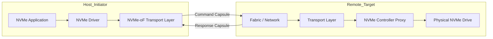
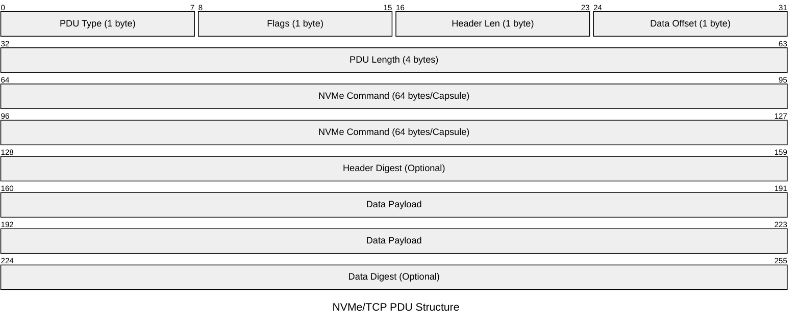

NVMe changed the game for storage by ditching the legacy bottlenecks of the SCSI stack. It replaced the single, locked queue of AHCI with up to 65,535 parallel queues, each 64k entries deep. This was great for local PCIe lanes, but the modern data center demands disaggregated storage. We want our compute nodes to be separate from our storage nodes so we can scale them independently. This is where NVMe-over-Fabrics (NVMe-oF) comes in. It takes the NVMe command set and wraps it in a network transport so a remote disk looks and feels like it's sitting on the local PCIe bus.

The core architectural shift in NVMe-oF is moving from a memory-mapped interface to a message-based one. In a local setup, the host tells the controller it has work to do by writing to a doorbell register. In a fabric setup, the host sends a Command Capsule. These capsules contain the same 64-byte NVMe commands you'd find in a local Submission Queue, but they're augmented with SGLs (Scatter Gather Lists) that describe where the data lives. The target receives these capsules, processes them, and returns a Response Capsule containing the completion status. 

The choice of transport layer defines the performance profile of the fabric. RDMA (Remote Direct Memory Access) is the traditional favorite for low latency. By using InfiniBand or RoCEv2 (RDMA over Converged Ethernet), the transport can bypass the host CPU and the kernel's networking stack entirely. When the target needs to read data from the host, it performs a one-sided RDMA read. The data moves directly from the host's memory to the target's memory over the NIC, meaning the host CPU doesn't even know the transfer happened until the completion interrupt arrives. This minimizes tail latency and reduces CPU overhead to almost zero.

While RDMA is fast, it requires a lossless network. This means you need specialized switches that support Priority Flow Control (PFC) to prevent packet loss, which can be a nightmare to configure at scale. This friction has pushed the industry toward NVMe/TCP. By running NVMe over the standard TCP/IP stack, you can use existing data center networking. The trade-off is higher latency and more CPU cycles because the kernel has to handle the TCP state machine, checksums, and reassembly. However, with the rise of 100GbE and 200GbE networking, the penalty of the TCP stack is becoming less of a deal-breaker for many workloads.

NVMe/TCP introduces a specific PDU (Protocol Data Unit) structure to manage the stream of bytes. Since TCP is a stream-oriented protocol, the receiver needs a way to find the boundaries of NVMe capsules. Each PDU starts with a header that specifies the PDU type, such as Initialize Connection, Command, or Data. There is also a Digestion field that can provide CRC32C data integrity checks for both the header and the payload. This is critical because even though TCP has its own checksum, it isn't strong enough for the data integrity requirements of enterprise storage.

Discovery is another major component of the NVMe-oF ecosystem. You don't just point a host at an IP address and hope for the best. Instead, hosts talk to a Discovery Controller. This is a specialized NVMe service that provides a Log Page containing a list of available subsystems the host is allowed to access. This allows for a dynamic environment where storage targets can be added or removed without manual reconfiguration of every compute node. The host connects to the discovery service, gets its list of targets, and then establishes separate queue pairs for each target subsystem.

Handling congestion in NVMe-oF is far more complex than in a local PCIe environment. In a PCIe bus, the flow control is handled by the hardware at the link layer. On a fabric, especially with NVMe/TCP, you have to deal with Incast problems where multiple initiators flood a single target port, leading to buffer overflows in the switches. While RDMA uses hardware-level flow control, NVMe/TCP relies on the standard TCP congestion control algorithms like Cubic or BBR. This makes the storage performance highly dependent on how well-tuned the network is. If your network starts dropping packets, your storage latency will spike as TCP enters retransmission timeouts, which is why many high-performance deployments are moving toward Data Center Bridging (DCB) to provide dedicated bandwidth for storage traffic even when using TCP.
