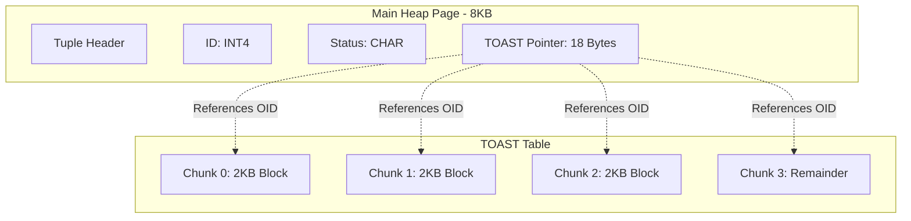
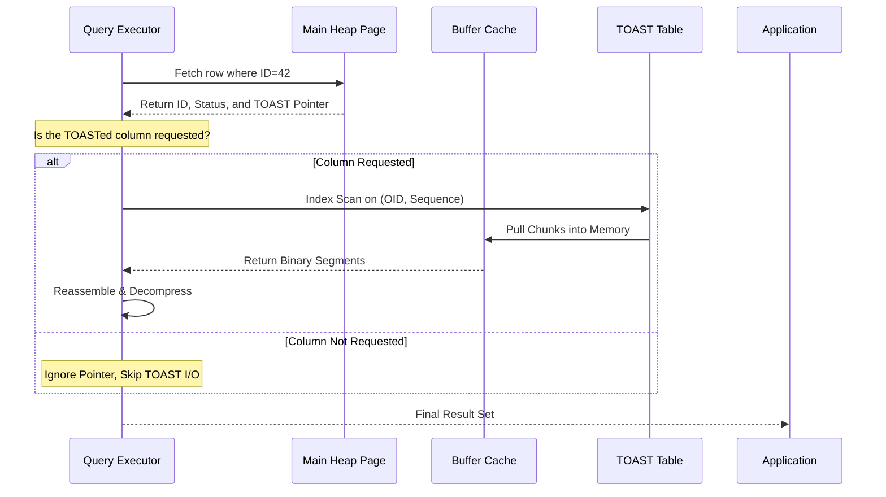

Postgres has a hard rule about page sizes that sounds restrictive at first. Every single row must fit within a single 8KB page. When you subtract the page header and the tuple header, you are left with even less room. If you are trying to store a massive JSON blob, a high-resolution binary image, or a long-winded legal document in a TEXT field, you are going to hit that wall instantly. This is where TOAST comes in. It stands for The Oversized-Attribute Storage Technique. It is the system's way of cheating the 8KB limit by moving large values into secondary storage and leaving a tiny breadcrumb behind in the main table.

The logic kicks in when a row exceeds about 2KB. Postgres does not just dump the data into a file on disk. It follows a specific hierarchy of desperation to make the data fit. First, it tries to compress the value. Until recently, this was always PGLZ, which is a built-in compression algorithm. Since Postgres 14, you can also opt into LZ4, which is significantly faster. If the compressed data is small enough to fit back into the page, the job is done. If not, Postgres starts moving the data out-of-line into a hidden sidecar table dedicated to that specific main table.

The hidden table is essentially a key-value store for fragments. It is named based on the OID of your original table, something like pg_toast_12345. Each entry in this table consists of three columns: the OID of the original toasted value, a sequence number, and the raw binary data chunk. Because the side-table has its own index on the OID and sequence number, the database can rapidly pull the pieces back together and reassemble them in the correct order when you query the row.

There are four distinct storage strategies that control this behavior. Plain strategy is for fixed-length types like integers or timestamps. It never uses TOAST. Extended strategy is the default for text and binary data. It allows both compression and out-of-line storage. External strategy allows out-of-line storage but forbids compression. This is actually a great performance tweak if you are already storing data that is compressed at the application level, like a gzip file or a JPEG, because it prevents the CPU from wasting cycles trying to compress something that is already high-entropy. Main strategy tries to compress the data but tries to keep it in the original page if at all possible, only moving to the TOAST table if there is literally no other way to make the row fit.

The performance implications of this design are brilliant. If you have a table with a massive JSONB column and you run a query that only filters on an integer ID or a status flag, the database never touches the TOAST table. You get the high-density storage of a narrow table even if your logical rows are massive. The pointer in the main page is only about 18 bytes. This means you can fit hundreds of rows into a single 8KB page as long as you aren't selecting the large columns. You only pay the price for the large data when you actually ask for it.

When you do ask for it, the engine performs an index scan on the TOAST table. It fetches the chunks, which are usually sized around 2KB each. This size is intentional. It ensures that every chunk comfortably fits within the buffer cache and can be managed like any other page. The downside is that retrieving a 1MB text field requires several dozen random-ish I/O operations if the chunks aren't perfectly contiguous in the TOAST table, which can lead to latency spikes compared to filesystems that use larger extents.

Updating a row with TOASTed data is also relatively efficient. In the standard Postgres MVCC model, an update creates a new version of the row. If you update a small column like a boolean flag, the new version of the row simply points to the same entry in the TOAST table. The database doesn't duplicate the large blob. It only creates a new TOAST entry if the value in the large column itself is modified. This drastically reduces the write amplification that usually plagues MVCC databases when dealing with large objects. 

If you want to poke around your own database, you can use the pg_column_size function to see the difference between the physical size on disk and the logical size. A heavily compressed text blob might look tiny in the main heap while technically representing several megabytes of data. It is a hidden layer of complexity that makes the rigid 8KB page structure surprisingly flexible in the face of modern, data-heavy applications.
