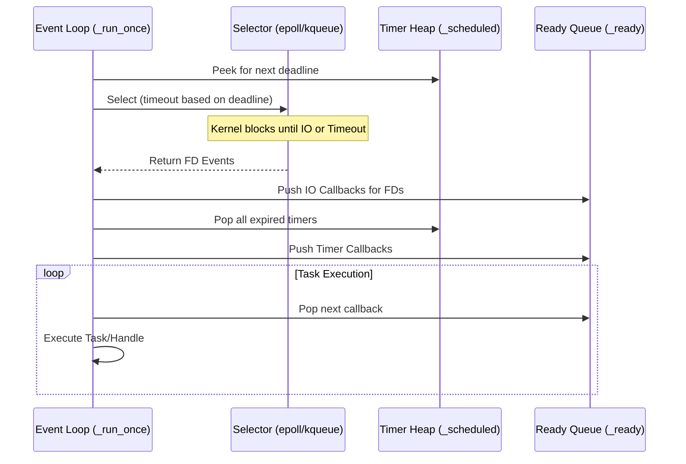

Most developers treat the Python asyncio event loop as a black box that magically handles concurrent tasks. They write await and assume the runtime handles the rest. But the reality is that asyncio is a relatively simple user-space task scheduler written mostly in Python itself. It doesn't rely on kernel-level threading to achieve concurrency. Instead, it manages a single thread and uses a tight loop to swap between different execution contexts. The heart of this entire operation is a single method inside the BaseEventLoop class called _run_once. This is the engine that drives every async Python application, and understanding its mechanics is the only way to write high-performance non-blocking code.

The event loop operates on a cycle that balances two different types of events. On one side, you have the scheduled callbacks. These are things like timers or delayed tasks. If you call asyncio.sleep(1), the loop doesn't actually stop or pause the thread. It wraps your continuation in a handle and pushes it onto a priority queue called _scheduled. This queue is a min-heap, which means the loop can always find the task with the soonest deadline in O(1) time. On the other side of the cycle, the loop has to deal with I/O events. This is handled by a Selector object, which is a high-level wrapper around system-specific calls like epoll on Linux, kqueue on BSD, or select on older systems. The loop effectively sits in a blocking call to the selector, waiting for a socket to become readable or for the next timer in the heap to expire.

When the selector wakes up, it tells the loop which file descriptors are ready. The loop then takes the callbacks associated with those descriptors and pushes them into a simple deque called _ready. It also looks at the timer heap and moves any timers that have passed their deadline into that same _ready queue. Once the I/O and timers are processed, the loop starts draining the ready queue one by one. This is the execution phase. Each callback is executed to completion before the next one starts. If your code is a Task, the loop calls the __step method on the task object, which drives the underlying generator or coroutine until it hits the next yield point. This design makes it clear why CPU-bound work is so destructive in asyncio. Since the loop only checks for new I/O and timers at the start of a cycle, a single long-running callback will prevent the loop from ever returning to the selector to check for new network packets.

The bridge between the raw file descriptors and your high-level application code is the Transport and Protocol system. A Transport is essentially a specialized buffer that knows how to read and write bytes to a specific medium, like a TCP socket or a pipe. It handles the low-level heavy lifting, such as calling recv() and handling flow control. The Protocol is a state machine that defines what to do with those bytes. When the event loop detects data on a socket, it tells the Transport to read it, and the Transport immediately passes those bytes to the Protocol's data_received method. This decoupling is why asyncio is so flexible. You can swap a standard TCP transport for a TLS transport, and your Protocol doesn't have to change its logic at all. It just keeps receiving bytes through the same interface while the transport handles the encryption handshake and buffer management behind the scenes.

One common point of confusion is the difference between a Future and a Task. A Future is a low-level object that represents a result that hasn't happened yet. It is little more than a state flag and a list of callbacks. A Task is a subclass of Future that specifically knows how to wrap a coroutine and schedule itself on the event loop. When you await a Future, you are essentially telling the loop to stop executing the current task and only resume it once that Future's result has been set. This orchestration relies on the fact that every yield point in a coroutine allows the control flow to bubble all the way back up to the _run_once loop, which can then decide what to do next based on its ready and scheduled queues. It is a cooperative system that works perfectly until someone decides to do a heavy math calculation or a blocking disk read in the middle of a request handler.
