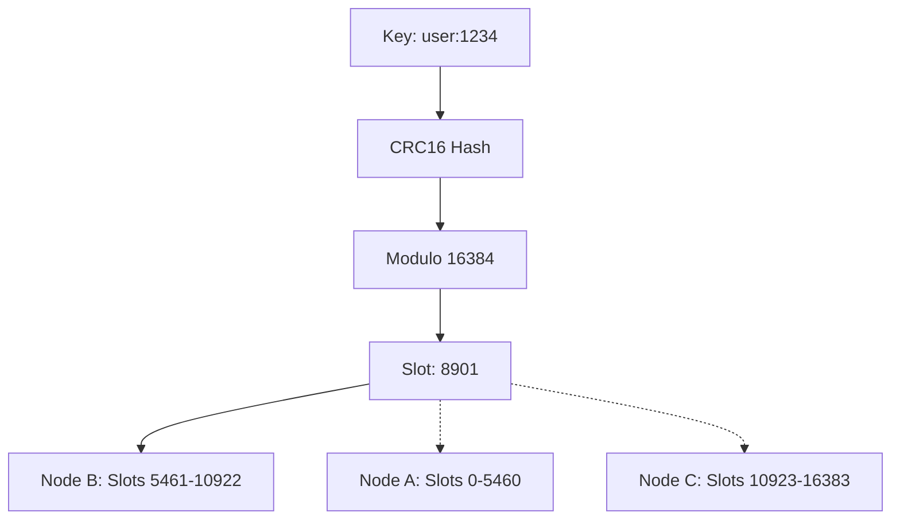
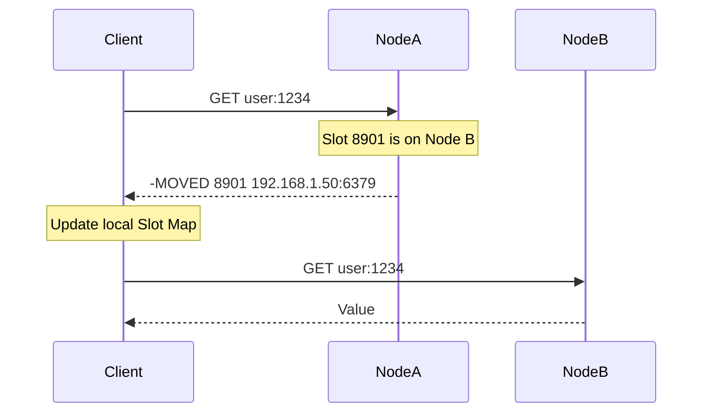

Scaling a single-threaded data store like Redis eventually hits a physical wall where a single machine just isn't enough. While you can throw more RAM at the problem, you're still bottlenecked by the CPU or the network interface. Redis Cluster is the official answer to this scaling wall. Unlike early sharding solutions that relied on client-side logic or proxy layers like Twemproxy, the cluster handles distribution natively. It's a share-nothing architecture where every node is aware of the entire cluster state, and they communicate using a binary protocol to stay in sync.

The core of this distribution is the hash slot. Redis doesn't shard by the actual key name directly. It uses a fixed space of 16,384 hash slots. When you store a key, the cluster runs it through a CRC16 hash and takes the result modulo 16,384. This mapping is what determines which node owns the data. Because the number of slots is fixed and relatively small, it's easy for every node to keep a bitmap of which slot belongs to whom. Moving data between nodes during a rebalance isn't a chaotic mess of rehashing every single key. You're just moving ownership of specific slots from one node to another.

Communication in the cluster doesn't rely on a central coordinator like Zookeeper or etcd. Instead, it uses a gossip protocol. Every node is constantly shouting at its peers using PING and PONG packets. These packets carry a header with the node's current configuration epoch and a snapshot of its slot ownership. But the payload also contains information about a few other random nodes in the cluster. This is how state propagates. If Node A sees that Node B thinks Node C is down, it updates its internal failure state for C. This decentralized approach makes the cluster incredibly resilient to network partitions since there's no single point of failure to take down the management plane.

Client interaction with a cluster is where things get tricky for people used to a single instance. If you send a command to Node A for a key that actually lives in a slot owned by Node B, Node A won't proxy that request for you. It'll send back a MOVED error with the IP and port of the correct node. Smart clients learn from these errors. They cache the slot-to-node map locally so they only get redirected once. This keeps the latency low because you don't have an extra hop for every request like you would with a proxy. However, during a migration where slots are moving between nodes, you might see an ASK redirection. This is a temporary signal telling the client that the key is currently being moved and it should try the target node just for this one command.

High availability is handled through an internal master-slave election process. Each master has one or more replicas. If a master becomes unreachable, the other masters in the cluster detect it through the gossip protocol. They mark the node as PFAIL, which is a local suspicion of failure. Once a majority of masters agree that the node is down, the state flips to FAIL. At this point, the slaves of the failed master start an election. They increment their current epoch and ask the other masters for votes. The slave with the most up-to-date data and the earliest request usually wins, promotes itself to master, and broadcasts the new slot ownership to the rest of the cluster.

It's important to realize that Redis Cluster is fundamentally an AP system in CAP theorem terms. It prioritizes availability over consistency. Because replication is asynchronous, there's always a tiny window where a master could acknowledge a write and then fail before that write reaches its slaves. If a failover happens during that window, that data is lost. There's also the risk of a split-brain scenario during a major network partition. If a master is on the minority side of a partition, it'll eventually realize it can't see the majority and stop accepting writes, but there's a timeout period where it might still process requests that will eventually be discarded when the partition heals and it demotes itself back to a slave.
