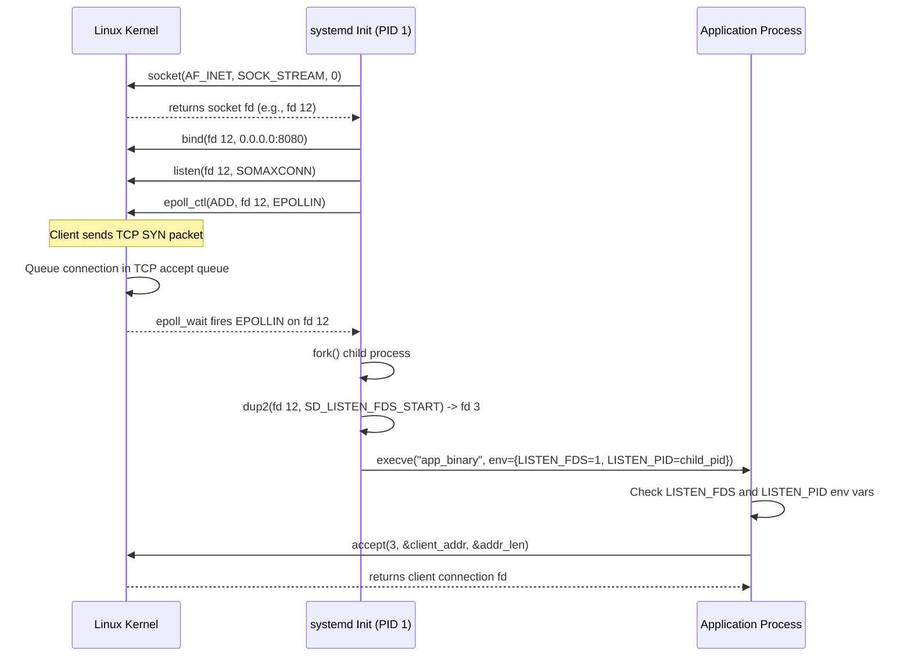

Traditional process management requires daemons to handle their own socket creation lifecycle. A web server or database boots up, parses its configuration files, opens a socket via the `socket()` system call, binds it to an IP and port using `bind()`, and starts listening with `listen()`. When services depend on each other, this creates sequencing headaches. Process B cannot start sending packets until Process A completes its initialization and starts accepting connections. If Process A crashes or restarts, incoming socket connections fail immediately with connection refused errors until Process A finishes re-reading configuration files and binding to the network interface.

Systemd solved this chicken-and-egg startup problem by decoupling network socket ownership from daemon runtime life cycles. By moving socket creation directly into the init system, systemd binds to listening sockets before child processes ever execute. The kernel manages the backlog queue while the daemon boots in the background. Incoming TCP SYN packets or Unix domain socket connections sit safely in the kernel socket queue without throwing connection errors. When the child process starts, systemd passes the pre-allocated file descriptors into the new process environment, allowing the child to immediately invoke `accept()` or `recvmsg()` without ever calling `socket()` or `bind()`.

Systemd initializes socket units during early boot or unit loading by parsing the `.socket` configuration file. It extracts directives like `ListenStream=8080` or `ListenDatagram=/run/app.sock`. The manager process calls `socket()` to allocate a file descriptor in its own file descriptor table. It sets socket options such as `SO_REUSEADDR` and `SO_REUSEPORT`, binds the socket to the configured address, and executes `listen()` with the requested backlog depth. At this stage, the socket exists entirely inside systemd's file descriptor table, and the kernel begins tracking connection state transitions on that socket.



File descriptor passing during process execution relies on POSIX `fork()` and `execve()` mechanics. When systemd spawns a service configured for socket activation, the child process created by `fork()` inherits every open file descriptor from systemd unless the `FD_CLOEXEC` close-on-exec flag is explicitly set. Systemd explicitly duplicates the socket file descriptor to fixed numeric indices starting at index 3, defined as `SD_LISTEN_FDS_START`. File descriptors 0, 1, and 2 are reserved for standard input, standard output, and standard error. Systemd calls `dup2()` to clone the socket descriptor into file descriptor slot 3. If multiple sockets are passed to the service, systemd populates slots 3, 4, 5, and so on, matching the ordering of socket units.

To inform the newly executed process about these inherited file descriptors, systemd sets two key environment variables prior to calling `execve()`. `LISTEN_FDS` contains an integer specifying the total number of passed socket file descriptors. `LISTEN_PID` contains the process ID of the target child process. The child process reads these environment variables upon startup. The inclusion of `LISTEN_PID` prevents sub-processes spawned by the application from mistakenly attempting to read from systemd file descriptors if environment variables are accidentally inherited across child process boundaries. If `LISTEN_PID` does not match the current process ID returned by `getpid()`, the application knows the inherited environment variables belong to an ancestor and ignores them.

Applications integrate with socket activation through helper libraries like `libsystemd` or custom parser logic. The `sd_listen_fds(int unset_environment)` function encapsulates this parsing sequence. When invoked, `sd_listen_fds` reads `LISTEN_PID`. If the process ID matches, it reads `LISTEN_FDS`, clears `FD_CLOEXEC` on the target socket descriptors using `fcntl()`, and optionally unsets `LISTEN_FDS` and `LISTEN_PID` from the environment if requested. This ensures that child processes spawned later by the application will not attempt to re-parse the same file descriptors.

Systemd uses `epoll` instances to drive on-demand socket activation. For services configured with `Accept=no`, systemd creates the listening socket and registers it with its internal main event loop using `epoll_ctl()`. Systemd does not spawn the application binary until an actual connection attempt arrives. When a remote client sends a TCP SYN packet, the Linux network stack completes the TCP three-way handshake and places the connection in the socket's accept queue. This state change triggers an `EPOLLIN` event on systemd's `epoll` file descriptor. Systemd catches the event, removes the socket from its `epoll` monitoring set, transitions the target service state machine from `dead` to `activating`, and executes the service binary.

For per-connection activation, configured via `Accept=yes`, systemd behaves similarly to classic `inetd` or `xinetd`. When `epoll_wait()` notifies systemd of an incoming connection on the listening socket, systemd calls `accept()` directly. Systemd takes the newly created connection socket file descriptor returned by `accept()` and assigns it to standard input and standard output of a newly spawned, transient process instance. This model creates a separate process for every incoming connection, which works well for low-concurrency legacy utilities but imposes high fork overhead for high-performance network services. Modern server applications almost universally prefer `Accept=no`, where a single long-running application process inherits the master listening socket and handles concurrent client connections internally using event loops or thread pools.

The true power of systemd socket activation manifests during zero-downtime service upgrades and process restarts. In a traditional architecture, stopping a web server closes its listening socket. Any incoming connection during the window between process termination and new process binding results in a TCP `RST` packet or a connection refused error. With socket activation, systemd maintains ownership of the underlying socket file descriptor inside PID 1 throughout the service restart lifecycle.

When you execute `systemctl restart my-service`, systemd sends `SIGTERM` to the running service process. While the old process terminates and the new process initializes, the listening socket file descriptor remains open inside systemd. Incoming client TCP handshake requests continue to complete at the Linux kernel transport layer. The kernel places these established connections into the socket's backlog queue, bounded by the `SOMAXCONN` limit. Once the new process binary boots, systemd passes the identical file descriptor slot to the new process. The new process immediately calls `accept()` and drains the buffered connections from the kernel queue. Clients experience a slight latency bump during the restart window, but zero connections are dropped or refused.

```
  [ Client Connection Requests ]
              │
              ▼
   ┌─────────────────────────────────────────┐
   │        Linux Kernel TCP Stack           │
   │  ┌───────────────────────────────────┐  │
   │  │   Socket Accept Queue (Backlog)   │  │
   │  └───────────────────────────────────┘  │
   └────────────────────┬────────────────────┘
                        │
                        │ File Descriptor Ownership
                        ▼
   ┌─────────────────────────────────────────┐
   │             systemd (PID 1)             │
   │ Maintains open socket fd during restart │
   └────────────────────┬────────────────────┘
                        │
                        │ Passes fd 3 via execve()
                        ▼
   ┌─────────────────────────────────────────┐
   │         Application Service             │
   │ Executes accept(3) to process backlog   │
   └─────────────────────────────────────────┘
```

Here is how to write native socket activation code in Rust without depending on C library bindings. The application reads environment variables, validates process ownership, checks file descriptor limits, and creates a network listener directly from raw file descriptors.

```rust
use std::env;
use std::net::TcpListener;
use std::os::unix::io::FromRawFd;
use std::process;

fn get_systemd_socket() -> Option<TcpListener> {
    let listen_pid = env::var("LISTEN_PID").ok()?.parse::<u32>().ok()?;
    if listen_pid != process::id() {
        return None;
    }

    let listen_fds = env::var("LISTEN_FDS").ok()?.parse::<usize>().ok()?;
    if listen_fds == 0 {
        return None;
    }

    // Systemd socket descriptors start at index 3 (SD_LISTEN_FDS_START)
    const SD_LISTEN_FDS_START: i32 = 3;

    // Safety: We verified that systemd passed at least one file descriptor
    // to this specific process ID.
    let listener = unsafe { TcpListener::from_raw_fd(SD_LISTEN_FDS_START) };
    
    // Clean up environment variables to prevent child process inheritance
    env::remove_var("LISTEN_FDS");
    env::remove_var("LISTEN_PID");

    Some(listener)
}

fn main() {
    let listener = match get_systemd_socket() {
        Some(l) => {
            println!("Booted using systemd socket activation file descriptor 3");
            l
        }
        None => {
            println!("Falling back to standard socket bind on 127.0.0.1:8080");
            TcpListener::bind("127.0.0.1:8080").expect("Failed to bind socket")
        }
    };

    for stream in listener.incoming() {
        match stream {
            Ok(mut socket) => {
                use std::io::Write;
                let _ = socket.write_all(b"HTTP/1.1 200 OK\r\nContent-Length: 3\r\n\r\nOK\n");
            }
            Err(e) => eprintln!("Connection error: {}", e),
        }
    }
}
```

Systemd socket units provide fine-grained tuning parameters that interact directly with Linux kernel socket options. Directives like `Backlog=4096` map directly to the second argument of the `listen()` system call, extending the kernel queue size for high-throughput service spikes. Directives such as `ReceiveBuffer=` and `SendBuffer=` execute `setsockopt()` calls with `SO_RCVBUF` and `SO_SNDBUF` prior to service startup. Systemd can also perform socket security boundaries using `SocketUser=` and `SocketGroup=`, allowing PID 1 to bind to privileged low ports such as 80 or 443 under root authority before dropping privileges and executing the service binary under an unprivileged system user account.

For Unix domain sockets, systemd handles filesystem permission management and cleanup mechanics automatically. When systemd parses `ListenStream=/run/app.sock`, it unlinks any stale socket node remaining on the filesystem from previous unclean process crashes, calls `bind()`, and enforces permissions specified via `SocketMode=0660`. Systemd manages file creation masks and path ownership natively, isolating network interface initialization from application domain execution.

Understanding systemd socket activation reveals how modern Linux init systems eliminate boot race conditions and simplify zero-downtime application deployments. By pushing socket lifecycle management into kernel space through PID 1 file descriptor handoffs, services gain robust connection queuing, instant fault recovery, and clean privilege separation without adding complex application orchestration layers.
