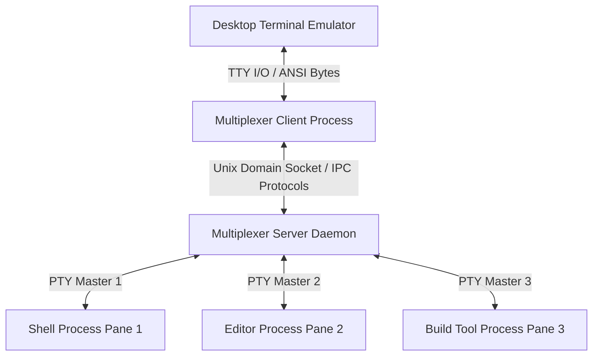
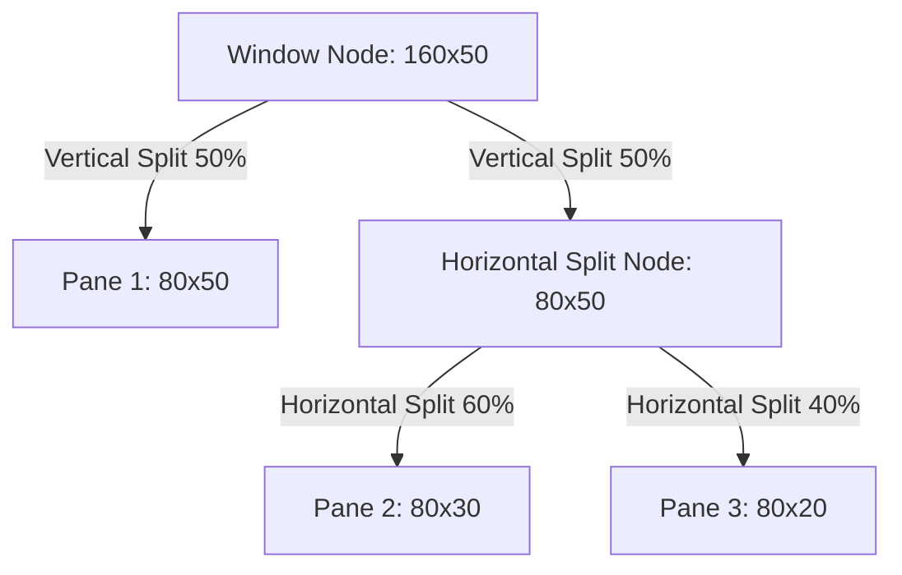

# Architecture of a Terminal Multiplexer

When you run tmux or zellij, you are not running a single terminal wrapper. You are running a distributed client-server architecture inside a single machine. The terminal emulator running on your desktop, such as Alacritty, iTerm2, or Kitty, communicates with the multiplexer client process over standard input and standard output. The multiplexer client connects to a long-running background daemon through a Unix domain socket.

This server daemon acts as the single source of truth. It manages running terminal sessions, maintains memory buffers for every pane, parses streaming byte streams from child shell processes, and renders composite frames back to the client.



The server opens a pseudo-terminal pair for every pane you create. It holds the master file descriptor while spawning the child process connected to the slave file descriptor. The child process believes it is talking directly to a real physical terminal. When the child process writes output, those bytes flow into the kernel PTY buffer, and the multiplexer server wakes up via an epoll event loop reading from the master file descriptor.

The server does not simply forward those bytes to your desktop terminal. If it did that, output from multiple panes would interleave into an unreadable mess. Instead, the server intercepts every single byte, passes it through an internal state machine that mimics a physical hardware terminal like a VT100 or VT220, updates an in-memory grid representation of the pane, and then calculates the diff between what your physical terminal currently shows and what the composite layout ought to look like.

# State Engines and Escape Sequence Parsing

At the heart of every terminal multiplexer lives a streaming parser capable of interpreting ISO/IEC 6429 and ECMA-48 escape codes. When a shell command outputs colored text or moves the cursor, it sends raw bytes mixed with control sequences. A plain byte like ASCII 65 renders the character A, while an escape sequence like ESC followed by bracket 31 m changes the foreground color to red.

Multiplexers implement state machines closely modeled on the Paul Williams VT500 state parser design. The parser reads input byte by byte, shifting states based on control code classifications.

```mermaid
stateDiagram-v2
    [*] --> Ground
    Ground --> Escape: ESC (0x1B)
    Escape --> Ground: Execute / Print
    Escape --> CSI_Entry: '[' (0x5B)
    CSI_Entry --> CSI_Param: '0'..'9' / ';'
    CSI_Param --> CSI_Param: '0'..'9' / ';'
    CSI_Param --> Ground: Dispatch Action (e.g., 'm', 'H')
    Escape --> OSC_String: ']' (0x5D)
    OSC_String --> Ground: BEL (0x07) / ST (0x1B 0x5C)
```



The ground state processes ordinary printable characters and basic control codes like linefeed or carriage return. When the parser encounters the escape character 0x1B, it shifts into the escape state, suspending printable character handling.

If the byte following the escape character is an open bracket 0x5B, the parser enters the Control Sequence Introducer, or CSI state. Here, it collects numeric parameters into an array. Semi-colons act as parameter separators. For example, in ESC bracket 3 8 semicolon 2 semicolon 2 5 5 semicolon 0 semicolon 0 m, the parser collects parameters 38, 2, 255, 0, and 0. Once a final character like m, H, or J appears, the parser dispatches the collected parameters to the target action handler and returns to the ground state.

Handling state errors gracefully is vital. If an unknown sequence arrives, the parser must drop the invalid parameters, emit any buffered text safely, and transition back to the ground state without corrupting the surrounding screen layout.

# Screen Buffers and Memory Layout

Every pane inside a multiplexer maintains its own isolated virtual screen state. This state consists of two distinct grid buffers: the primary screen buffer and the alternate screen buffer.

The primary buffer is designed for typical interactive shell sessions where text scrolls off the top of the screen into history. It consists of an active visible viewport of fixed row and column dimensions, attached to an append-only scrollback ring buffer. The scrollback buffer stores historical lines that have scrolled off the top viewport, allowing you to search and copy past command output.

The alternate screen buffer is triggered when you launch full-screen terminal programs like Vim, htop, or Less. When these programs emit the terminal control sequence ESC bracket question 1 0 4 9 h, the multiplexer swaps the pane grid pointer from the primary buffer to the alternate buffer. The alternate buffer has no scrollback history. It is a strict 2D array matching the exact dimensions of the pane. When the editor exits, it emits ESC bracket question 1 0 4 9 l, and the multiplexer restores the primary buffer pointer, preserving your original shell scrollback state completely untouched.

```
Pane Memory Layout Architecture
===================================================================
+-----------------------------------------------------------------+
| Scrollback History Ring Buffer (Lines 0 to N)                   |
| [Line 0001] "usr@host:~$ cargo build"                          |
| [Line 0002] "   Compiling async-engine v0.1.0"                  |
| ...                                                             |
+-----------------------------------------------------------------+
| Active Primary Viewport Grid (Rows x Columns)                   |
| [Row 0] "   Finished dev [unoptimized + debuginfo] target(s)"   |
| [Row 1] "usr@host:~$ _"                                        |
+-----------------------------------------------------------------+
                               ^
                               | Pointer Swap (ESC [ ? 1049 h / l)
                               v
+-----------------------------------------------------------------+
| Alternate Screen Buffer (No Scrollback, Fixed Grid)             |
| [Row 0] "VIM - Vi IMproved                               "      |
| [Row 1] "~                                               "      |
+-----------------------------------------------------------------+
```

Inside the grid array, screen cells are packed into memory contiguously to optimize CPU cache locality. Each cell structure holds state for a single character slot:

```
Cell Bitfield / Struct Memory Representation
+-----------------------+-----------------------+-----------------------+
|  Rune Data (4 Bytes)  |  Attributes (4 Bytes) |  FG Color (4 Bytes)   |
|  UTF-8 Codepoint      |  Bold, Underline, etc |  24-bit RGB / Index   |
+-----------------------+-----------------------+-----------------------+
|  BG Color (4 Bytes)   |  Hyperlink ID (2 B)   |  Cell Flags (2 Bytes) |
|  24-bit RGB / Index   |  Optional Link Ref    |  Wide Char, Dirty Bit |
+-----------------------+-----------------------+-----------------------+
```

A modern terminal cell stores a 32-bit Unicode codepoint or an offset into a grapheme cluster pool for complex multi-byte characters like emojis. It holds style attribute bitmasks for bold, dim, italic, underline, curly underline, blink, and reverse video. It stores foreground and background colors supporting full 24-bit TrueColor, alongside flags tracking whether the cell is wide, such as East Asian CJK characters taking up two grid columns, or part of a multi-cell combination.

# Spatial Partitioning and Window Layout Trees

Multiplexers allow splitting a single window into multiple nested horizontal and vertical panes. Managing these arrangements requires a Binary Spatial Partitioning layout tree.

The root of the tree represents the total pixel or cell area of the physical client window. Internal nodes represent split directions, either vertical or horizontal, along with percentage or cell-count split ratios. Leaf nodes in the tree point directly to individual pane objects containing the screen buffers described earlier.



When a layout tree undergoes modification, such as a user splitting a pane or resizing the outer terminal window, the server executes a recursive geometry recalculation pass over the tree.

During layout calculation, the server assigns absolute Cartesian coordinates (X offset, Y offset, width, height) to each leaf node pane. If a pane width or height shrinks below its previous size, the multiplexer triggers a resize event on the child process by calling the ioctl system call with the TIOCSWINSZ flag on the master PTY file descriptor. This sends a SIGWINCH signal to the child process, notifying applications like Neovim to redraw their user interfaces to match the new bounding box.

Coordinates must also map bidirectionally for user interactions. When a user clicks a mouse button inside the outer physical terminal, the client sends the mouse click coordinates to the server. The server traverses the window layout tree, testing bounding boxes to determine which pane received the mouse event, translates the absolute window coordinates into pane-relative coordinates, and forwards the encoded mouse VT sequence into that specific pane's PTY master descriptor.

# Damage Tracking and Cell Grid Diffing Engines

The main performance bottleneck for a terminal multiplexer is rendering. If three separate panes are constantly streaming compiler logs, running test suites, or printing system metrics, outputting raw stream bytes directly to the outer physical terminal would saturate stdout buffers and destroy performance.

Multiplexers solve this through damage region tracking and frame diffing engines. The goal is to compute the absolute minimal set of ANSI control sequences needed to update the physical terminal screen from state T to state T+1 during each frame tick, ideally targetting 60 updates per second.

```
Frame Rendering Engine Pipeline
+-------------------+      +--------------------+      +--------------------+
| PTY Read & Escape | ---> | Update Local Pane  | ---> | Mark Row / Cell    |
| Sequence Parsing  |      | Virtual Grid Array |      | Damage Bitflags    |
+-------------------+      +--------------------+      +--------------------+
                                                                |
+-------------------+      +--------------------+               |
| Flush ANSI Output | <--- | Frame Composer &   | <-----------+
| String to Client  |      | Cell Diffing Engine|
+-------------------+      +--------------------+
```

The diffing engine maintains a double-buffer of the composite physical screen. One buffer represents what is currently displayed on the user screen (the front buffer), while the second buffer represents the newly calculated composite state of all active window panes merged according to their layout coordinates (the back buffer).

Every row in a pane grid contains a dirty flag. When the VT parser mutates cells in a row, it sets the row's dirty flag to true. During the frame render loop, the compositor skips rows where no leaf pane has been marked dirty.

For rows marked dirty, the renderer performs a cell-by-cell comparison between the back buffer cell and the front buffer cell.

```
Front Buffer (Current Screen): [A][B][C][D][E]
Back Buffer  (Target State):  [A][B][X][D][F]
Diff Mask:                     [0][0][1][0][1]
```

Instead of moving the cursor to column 3, writing X, moving the cursor to column 5, and writing F, the renderer evaluates jump cost economics. Moving the cursor requires emitting an escape sequence like ESC bracket Y semicolon X H, which takes between 6 to 10 bytes of bandwidth. If the gap between modified cells is small, it is cheaper to write out the unmodified intermediate characters than to emit cursor positioning commands.

Color state change batching works similarly. Setting a 24-bit foreground color via ESC bracket 3 8 semicolon 2 semicolon R semicolon G semicolon B m requires up to 19 bytes. The renderer tracks the currently active graphic rendition attributes across the frame flush. If consecutive dirty cells share identical styling attributes, the renderer omits attribute escape sequences entirely, streaming character bytes continuously.

Once the diff pass completes, the renderer writes the compiled byte array to the client socket, copies the back buffer memory into the front buffer, resets all dirty bitflags, and waits for the next epoll readiness event. This approach decouples child process I/O rates from output rendering performance, ensuring your terminal remains fluid even under high output loads.
