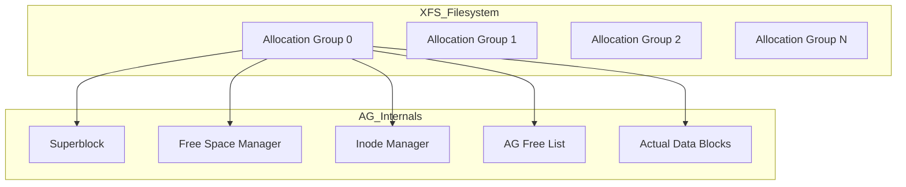
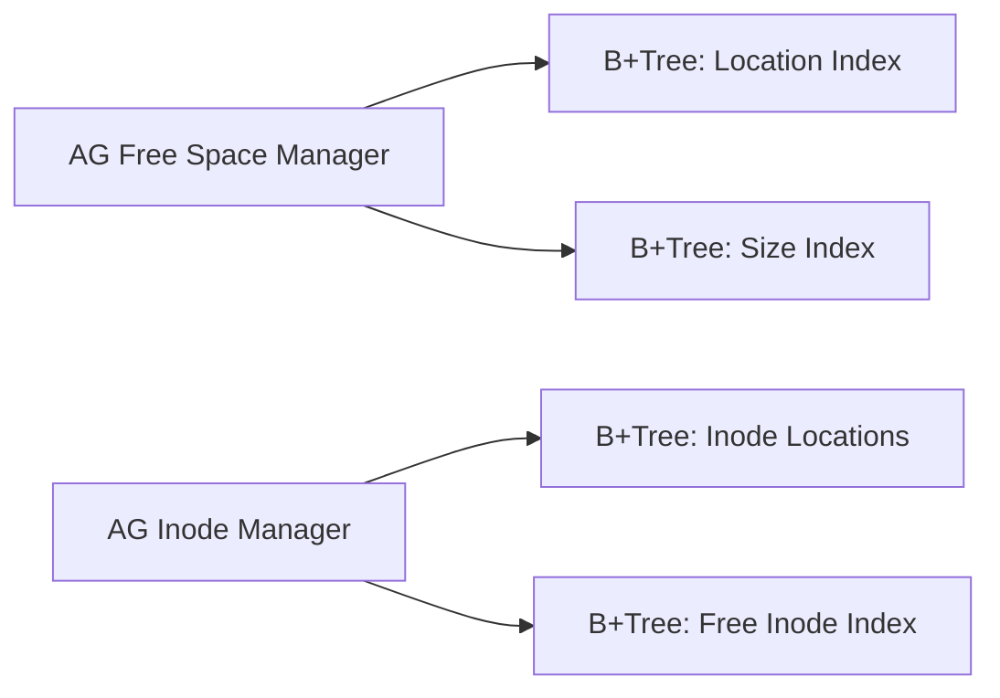

XFS isn't just another filesystem. It's a relic from the high-performance computing era of SGI that somehow became the modern standard for enterprise Linux. Most filesystems like ext4 feel like they were built for a single disk and a single CPU. XFS feels like it was built for a supercomputer because it literally was. It doesn't view a disk as a single monolithic block of storage. It views it as a collection of independent, parallel engines. This is the only way to explain why it handles massive file operations without the metadata bottlenecks that kill other systems.

The core of this parallelism is the Allocation Group or AG. When you format a partition with XFS, it divides the total space into multiple AGs. You can think of an AG as a self-contained mini-filesystem. Each one has its own superblock, its own free space management, and its own inode allocation. This design is why XFS is so good at concurrent I/O. If multiple threads are trying to allocate blocks at the same time, they don't have to fight over a single global lock. They just grab different AGs and work in parallel. It's a shared-nothing architecture applied to disk blocks.

Inside each AG, the management of free space is where things get really clever. XFS doesn't use bitmaps like ext4. Bitmaps are slow when a disk gets full because the kernel has to scan thousands of bits to find a single free block. Instead, XFS uses two separate B+Trees for free space in every single AG. The first tree, the bnobt, indexes free extents by their starting block number. The second tree, the cntbt, indexes them by their size. This dual-index approach allows the allocator to satisfy different needs instantly. If you need locality, the kernel looks in the bnobt to find a hole near your existing data. If you need a huge contiguous chunk for a video file, it looks in the cntbt to find the best fit. It's a classic space-for-time tradeoff that pays off as the filesystem scales.

Inodes in XFS are also a departure from the norm. In traditional filesystems, you decide how many inodes you want when you format the drive. If you run out, you're stuck, even if you have gigabytes of free space. XFS allocates inodes dynamically. It grabs chunks of blocks and turns them into inodes on demand. To keep track of where these inodes are, it uses yet another B+Tree. This tree stores the location of every inode chunk in the AG. When the kernel needs to look up an inode number, it does a tree search to find the physical block address. It's more complex than a simple array lookup, but it means you'll never hit an out-of-inodes error as long as you have disk space.

Another performance trick is delayed allocation. When an application writes data, XFS doesn't immediately decide where that data will live on the disk. It just keeps the data in the page cache and marks the blocks as reserved in memory. This is called a delalloc. By waiting until the very last second to commit the data to disk (usually when the kernel flushes the cache), the filesystem has much more information about the file's final size. This allows it to allocate one large contiguous extent instead of dozens of small fragments. It also prevents short-lived temporary files from ever hitting the disk, which saves a massive amount of I/O overhead.

Mapping a file's logical offset to its physical location on disk uses the BMAP B+Tree. Every inode contains a root for this tree. If a file is small and contiguous, it just stores a few extent records directly in the inode. But as the file grows or becomes fragmented, the mapping overflows into a full B+Tree. This structure supports files up to eight exabytes in size. The tree allows for fast lookups even in the face of extreme fragmentation, though delayed allocation tries its best to prevent that fragmentation from happening in the first place.

Logging and recovery are handled by the XFS Log. Unlike some filesystems that journal everything, XFS only journals metadata. It uses a logical journal, meaning it records the change that was made rather than the entire block. The log is a circular buffer, and XFS uses an Asynchronous Item List or AIL to track which metadata updates have been successfully written to their final locations. If the power cuts out, the recovery process just replays the log. Because the log records are pinned to specific versions of the metadata blocks via Sequence Numbers, it can safely reconstruct the state without corruption. It's a robust system that has been hardened over decades in the most demanding environments on earth.
